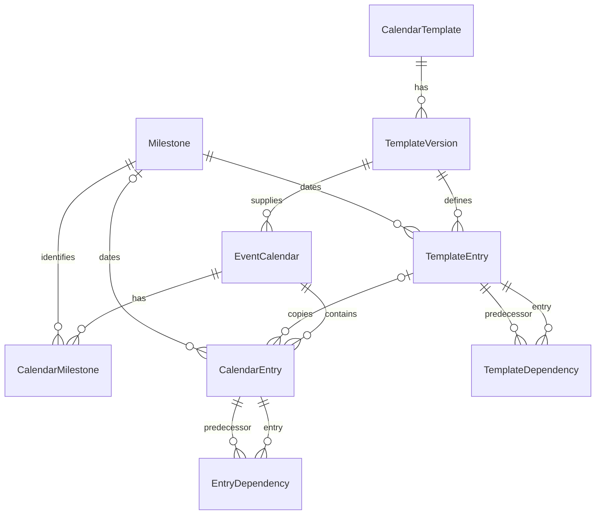

# Diary callable API

For browser instructions, see the [Diary web user guide](USER_GUIDE.md).
This document covers integration, configuration, and the callable API.

API module: `Diary.api`.
API version: `1`.

`DiaryInstance.close()` closes an existing diary instance even when tasks remain open.

This implementation provides models, migrations, and a Python callable API.
It also provides a standalone task list template and its reusable content fragment.
It provides authenticated template creation and editing pages.
Personal and manager task lists and the task creation page are implemented.
Task details, due-date edits, and task completion are implemented.
Reminders and automatic event callbacks remain outside the current implementation.
The host dashboard also needs a subsequent implementation step.
Diary is for configured DiaryUsers and DiaryManagers who have actions to complete for a successful event.
Diary has no public view.
Task role ownership alone does not grant Diary access.
Diary provides a generic capability to hold an event diary.
The selection of template tasks and their dates is outside the feature definition.
Template content is application data and does not prevent implementation of the feature.
Task progress through completion is required in the first feature release.
The V1 completion rules below define permissions and predecessor checks.
Any additional progress states and transitions still need definition.
The first release uses a simple date-ordered list.
A month display is not required for the first release.
Milestone date changes and their impact review belong in V2.
The first release uses the milestone dates supplied during calendar creation.
Reminders are outside V1 scope.
No later release number is confirmed for reminders.
Only DiaryManagers can change calendar templates.
DiaryManagers approve new templates and template versions through the save action in V1.
A separate approval step is outside V1 scope.
Only DiaryManagers can modify tasks copied from a template into a calendar instance.
Task assignment does not grant permission to modify those tasks.
Permitted users can complete accessible tasks under the V1 predecessor rules.
Multiple sign-offs are outside V1 scope.
V1 keeps one completion record per task, including a role-owned task.
Personally added tasks are visible only to their owner and DiaryManagers within the host's permitted calendar scope.
Only DiaryManagers can add tasks owned by another person.
In V1, DiaryManagers can edit dependencies only in templates.
Template dependency changes do not propagate into live diaries.
DiaryManagers cannot remove or replace live diary predecessors through dependency editing.
Template changes leave existing diaries unchanged.
Copying existing template tasks into existing diaries is not a required feature.
A manager can create a new diary task and optionally add it to a template for future diaries.

## V1 implementation tracking

Use the [Diary V1 checklist](TODO_V1.md) to track implementation.
It gives each item a stable identifier, completion conditions, and links to the requirements.
It separates implemented components, outstanding work, unresolved details, host integration, and deferred features.
The checklist replaces the earlier duplicated remaining-work list.
Previews do not complete production page requirements.
Each partial checklist item states its remaining work.
The [partial implementation design](../docs/design/diary-v1-remaining-work.md) describes substantial gaps and separates requirements from proposals.

## App boundary

Diary's only host dependencies are Django settings and the configured Django user model.
Use `django.contrib.auth.get_user_model()` when Diary needs the user model class.
Do not import a host user model class directly.
Diary has no dependency on host event models or custom request attributes.
The standard Django authentication, group, and permission system is a framework requirement.
Its current models have no foreign keys to other project apps.
The host supplies event references, dates, person references, and role names.
All foreign keys in Diary point to Diary models.
All database operations use PostgreSQL.

A reference is an opaque string, such as `GarageSale:event:17` or `user:42`.
The host must use a stable namespace for these references.
The Diary key is a UUID that identifies an event calendar.
The host stores it in `EventData.diary_key` without a foreign key.

## Access configuration

### Confirmed role and calendar scope

DiaryManager and DiaryUser are technical names for configurable Diary roles.
They are not fixed Django group names.
The host maps its groups through `settings.py`.
V1 uses `DIARY_MANAGER` and `DIARY_USER`, each containing one Django group name.
Garage Sale uses Officer for DiaryManager and ExecMember for DiaryUser.
Other projects can select different group names.

A DiaryManager can view any calendar instance that the host permits.
Diary adds no current-event restriction or separate calendar selection policy for managers.
A DiaryUser can view associated tasks in the instances permitted by the host.
Associated tasks include personal tasks and tasks owned by the user's current roles.

The callable API and HTTP API must support all permitted instances or one selected permitted instance.
The host supplies the trusted identity, role memberships, and permitted instance scope.
Diary enforces that scope on each request.
An all-instances selection cannot expand the host's permission grant.
These read rules do not grant task-change or completion permissions.
Only DiaryManagers can change templates, including their entries, date rules, owners, and dependencies.
DiaryUsers cannot change templates through any interface.
DiaryManagers approve new templates and versions through their save action in V1.
This includes an event entry addition to the template for future events.
V1 has no separate approval step.

### Confirmed HTML view inputs and defaults

Each HTML view accepts its applicable selector through a URL parameter or trusted server-supplied context.
Use `diary_key` for diary views and `template_name` for template views.
The view supplies `diary_key` as `key` to `DiaryAPI.diary()` or `DiaryInstance.from_key()`.
Both input methods use the same permission and personal-entry visibility checks.

With a diary key, the personal task view shows the user's open tasks and their current role-owned tasks in that diary.
Without a key, it shows those tasks across all permitted open diaries, grouped by diary name.
Each group retains the diary key and uses the diary name as its heading.
Diary pages display the diary name and do not require a host event name or event date.
Calendar creation requires a nonempty name, which the current model and API already enforce.
Completed tasks and closed diaries do not contribute tasks to this view.

With a template name, the template view shows the version with the highest version number, including a draft.
Without a name, the view lists available templates so the user can select one for editing.
Only DiaryManagers can edit templates.
An absent name must open the chooser rather than select `DIARY_TEMPLATE_NAME` automatically.
This view behavior differs from the current callable API's default selection of an approved template version.

`DiaryInstance.personal_tasks()` reads one diary instance.
`DiaryAPI.personal_tasks()` reads one or all permitted open diaries.
The HTML personal view implements the selection behavior above.
The read-only HTTP data API applies the same task privacy and trusted diary scope.

### HTTP data API

The technical view class is `Diary.views.DiaryDataView`.
JSON is a text format for structured data.
DV1-031 applies personal-entry privacy to every data resource.
These routes use Django session authentication and the current user groups.
Anonymous requests follow the configured login redirect.
An inactive user receives no data.
Only GET, HEAD, and OPTIONS are permitted.
POST, PUT, PATCH, and DELETE return HTTP 405 for authenticated callers.

Hosts must supply `permitted_diary_keys` or override `get_diary_keys()` through trusted server context.
The default routes grant no diary scope.
A query parameter cannot grant permissions or replace the authenticated person.
The technical view attribute `resource` selects one resource in trusted route configuration.
Do not set it from request input.

| Route name | Default path | Resource |
| --- | --- | --- |
| `Diary:data-diary` | `/diary/data/diary/` | Visible diary metadata and tasks. |
| `Diary:data-active` | `/diary/data/active/` | Visible open tasks with readiness and lateness. |
| `Diary:data-personal` | `/diary/data/personal/` | Current personal and role assignments from permitted open diaries. |
| `Diary:data-search` | `/diary/data/search/` | Visible task names and descriptions, including history. |
| `Diary:data-task` | `/diary/data/tasks/<entry_key>/` | Visible task details and private-safe blockers. |
| `Diary:data-predecessors` | `/diary/data/tasks/<entry_key>/predecessors/` | Visible predecessor choices for an accessible task. |

Supply `diary_key` as a query parameter or trusted view selector.
Diary, active, task, and predecessor resources require one diary selector.
Personal and search resources accept an omitted selector for all permitted diaries.
Search includes closed diaries and completed tasks. Personal results include open assignments only.
Predecessor reads do not permit dependency editing in existing diaries.

Supply `q` to search names and descriptions without case sensitivity.
Search ignores surrounding spaces and accepts at most 256 characters.
Empty search text selects all visible tasks.
`DiaryAPI.search_tasks(query='', diary_key=None)` provides the corresponding callable search.
`DiaryInstance.search_tasks(query='')` searches one diary.
Search results include `diary_key` and `diary_name` with each task.

Successful JSON responses use the envelope `{"data": ...}`.
UUIDs, dates, and timestamps use the standard Django JSON string representation.
Arrays preserve task order. Results contain no pagination fields.
Malformed or conflicting selectors and invalid search text return HTTP 400.
Out-of-scope selectors and missing access-group membership return HTTP 403.
Private and unknown task keys return the same generic HTTP 404 response.
An unknown permitted diary also returns HTTP 404.
Handled JSON errors use the envelope `{"error": "..."}`.
Authentication redirects and framework permission errors use the normal Django response format.
Successful responses and handled errors use `Cache-Control: private, no-store` and `Vary: Cookie`.

Person-owned diary additions are visible only to their owner and permitted DiaryManagers.
Template tasks remain visible through permitted diary reads, regardless of owner.
Related references and completion comments cannot disclose inaccessible task content.
Readiness still includes inaccessible predecessors.
Task details represent inaccessible open blockers with one generic marker.

This example supplies trusted scope for a search route:

```python
from django.urls import path
from Diary.views import DiaryDataView

urlpatterns = [
    path('host/diary-search/', DiaryDataView.as_view(
        resource='search', permitted_diary_keys=host_authorized_keys,
    )),
]
```

The technical name `host_authorized_keys` represents diary UUIDs from the host's access policy.
Override `get_diary_keys()` when that policy depends on the current request.
Do not obtain these keys from query or form data.

### Personal diary page integration

The technical view class is `Diary.views.PersonalDiaryView`.
The default Diary route `Diary:personal-diary` uses `/diary/` in the standard project URL configuration.
It requires an authenticated, active DiaryUser or DiaryManager.
Managers see their own assignments in this personal view.
The separate manager view retains its broader task selection.

Host code must supply `permitted_diary_keys` through trusted context or override `get_diary_keys()`.
The default route grants no diary scope.
The personal and manager views share `DiaryScopeMixin` for authentication, scope, and selector validation.
A query parameter cannot grant access to a diary.

This example configures the personal view for host-authorized diaries:

```python
from Diary.views import PersonalDiaryView

personal_view = PersonalDiaryView.as_view(extra_context={
    'permitted_diary_keys': permitted_diary_keys,
})
```

The host registers the configured callable in its own URL configuration.
Add `diary_key` to trusted context to select one permitted diary.
Alternatively, use the GET selector `?diary_key=<diary UUID>`.
Both names also work as `as_view()` keyword arguments.
A host subclass can provide dynamic context through `get_context_data()` or dynamic scope through `get_diary_keys()`.

Without a selector, My Diary groups owned tasks across permitted open diaries.
Each group retains its diary key, including when diary names are identical.
A selected diary retains its name when the filters produce no tasks.
Completed tasks and closed diaries contribute no personal tasks.
A selected closed diary displays an explanatory message.
Malformed, blank, and conflicting selectors return HTTP 400.
Out-of-scope selectors return HTTP 403.
An unknown permitted key returns HTTP 404.

| Control | Technical GET name | Default and effect |
| --- | --- | --- |
| show blocked also | `show_blocked` | Clear. Adds blocked owned tasks to the general open-task selection. |
| include whole-team tasks | `include_whole_team` | Clear. Adds whole-team work without adding unrelated person or group assignments. |
| Task status | `task_status` | `all`. Uses the blocked-task checkbox for the general open-task selection. |

The status values are `all`, `late`, `ready`, and `blocked`.
Specific status selections take precedence over the blocked-task checkbox.
`late` includes ready and blocked incomplete tasks due today or earlier.
`ready` includes ready tasks that are not late.
`blocked` includes blocked tasks that are not late.
Thus, each owned task contributes to exactly one status count.
The Late, Ready, and Blocked count links use the same rules.
Counts include whole-team work only when its checkbox is selected.
Undated tasks are not late.
Invalid status values return HTTP 400.

Select **Apply filters** to submit the current choices.
Select **Reset filters** to restore ready-only defaults while keeping the selected diary.
Status links also retain a selected diary and optional whole-team selection.
The view reads current group membership on each request.
It creates no diary records and changes no task data.
Future due-date window controls remain deferred under DFUT-003.

The technical page template is `Diary/personal_diary.html`.
The reusable fragment `Diary/partials/personal_diary.html` supplies the `.diary` namespace.
It uses the shared `Diary/partials/task_list.html` fragment for each diary group.
A host document can include the personal fragment with the view's context and the Diary stylesheet.

### Confirmed V1 manager diary filters

Requirement identifier: **DV1-052**. The manager diary page implements these filters.

When a DiaryManager views one permitted diary, provide these checkbox filters:

| Interface label | Default | Effect when selected |
| --- | --- | --- |
| include completed tasks | Clear. | Include completed tasks so the manager can inspect completion history. |
| exclude blocked tasks | Clear. | Exclude tasks blocked by incomplete predecessors. |
| exclude non-late tasks | Clear. | Exclude tasks that are not late, for a view of late tasks only. |

The default manager view shows all incomplete tasks, including blocked tasks and tasks that are not late.
The filters must preserve the selected diary, task privacy, and permitted diary scope.
This requirement applies to the manager's specific diary view.
The personal DiaryUser view retains its separate ready-task default under DV1-049.
See [manager diary filters](../docs/design/diary-v1-remaining-work.md#dv1-052-manager-filters-for-one-diary) for implementation boundaries and open decisions.

### Manager diary page integration

The technical view class is `Diary.views.ManagerDiaryView`.
The named route `Diary:manager-diary` uses `/diary/manager/` under the standard project URL configuration.
The page accepts GET requests only, with standard HEAD and OPTIONS support.
The page requires an authenticated, active member of the configured `DIARY_MANAGER` group.

Supply the technical query parameter `diary_key` to select a diary:

```text
/diary/manager/?diary_key=<diary UUID>
```

A selector does not grant access.
The default route grants no diary scope.
The host must configure the view with permitted keys or supply its own subclass.
The technical context name `permitted_diary_keys` contains the UUIDs that the host permits the caller to view.
Only trusted server code can supply this context.
The view ignores query parameters that attempt to supply permitted keys.

This example configures GET selection for one permitted diary:

```python
from Diary.views import ManagerDiaryView

manager_view = ManagerDiaryView.as_view(
    extra_context={'permitted_diary_keys': (stored_diary_key,)},
)
```

The host registers the configured callable in its own URL configuration.
To select the diary through trusted context, include `diary_key`:

```python
manager_view = ManagerDiaryView.as_view(extra_context={
    'diary_key': stored_diary_key,
    'permitted_diary_keys': (stored_diary_key,),
})
```

The view also accepts `diary_key` and `permitted_diary_keys` as `as_view()` keyword arguments.
For request-specific context, override Django's `get_context_data()` method in a host subclass.
Call its parent method before adding trusted keys.
Alternatively, override `ManagerDiaryView.get_diary_keys()` to obtain the host's current permitted scope.
The host must calculate that scope from authenticated identity and its access policy.

GET and trusted context use the same UUID validation and permission checks.
Repeated copies of the same UUID are permitted.
Conflicting selectors return HTTP 400.
Malformed or blank selectors also return HTTP 400.
A permitted key without a matching diary returns HTTP 404.
An out-of-scope key returns HTTP 403.
An omitted selector shows an explicit selection message.
No read creates a diary or changes a task.

The technical GET checkbox names are `include_completed`, `exclude_blocked`, and `exclude_non_late`.
Selected checkboxes submit `on`. An absent checkbox is clear.
Select **Apply filters** to apply all selected filters together.
Select **Reset filters** to clear the checkboxes while keeping the selected diary.
Checkbox selections remain in the URL after submission.

Completed tasks are never late or blocked in this view.
Thus, the late-only filter excludes completed tasks even when completion history is selected.
The blocked-task exclusion retains completed history entries.
The page orders entries by due date, with unset dates last.
It shows the completing actor, time, and preserved due date for completed entries.
Closed diaries remain readable and display a closed-state message.
Their displayed records do not contribute active tasks to other Diary views.
Forced-completion comments and task actions remain separate implementation work.

The technical page template is `Diary/manager_diary.html`.
The reusable fragment `Diary/partials/manager_diary.html` includes `Diary/partials/manager_tasks.html`.
Include the manager fragment with the view's `diary_data`, `tasks`, and `filters` context in a host document.
Load the documented Diary stylesheet when embedding the fragment.
The manager fragment supplies the `.diary` namespace and does not add another HTML document.

### Deferred future date-window filter

Requirement identifier: **DFUT-003**. No release is assigned.

All diary views must eventually support a future due-date window for incomplete tasks.
The user can select a window to inspect upcoming work.
This requirement remains deferred and adds no V1 completion condition.
Window boundaries and interactions with other filters remain open decisions.
See [future date-window filtering](../docs/design/diary-v1-remaining-work.md#dfut-003-future-date-window-filtering).

### Current API configuration

The host supplies this configuration in settings:

```python
DIARY_MANAGER = 'Officer'
DIARY_USER = 'ExecMember'

# Optional override. Omit it to use the project's TIME_ZONE setting.
DIARY_TIME_ZONE = 'Europe/London'
# Optional default when a call does not select a template explicitly.
DIARY_TEMPLATE_NAME = 'Garage Sale calendar'
DIARY_TASK_OWNER_ROLES = ('ExecMember', 'Officer', 'SponsorshipManager')
```

`DIARY_MANAGER` identifies the DiaryManager group.
`DIARY_USER` identifies the DiaryUser group.
Both settings must contain a nonempty group name without surrounding spaces.
Missing or invalid values raise `ImproperlyConfigured`, including during application startup.

`DIARY_TIME_ZONE` is optional and overrides Django's project-default `TIME_ZONE` setting.
Omit `DIARY_TIME_ZONE` to use the project default.

<!-- DV1-050: Explain daylight saving time when selecting the project fallback. -->

**Warning: daylight saving time.** New Django project templates normally set `TIME_ZONE = 'UTC'`.
See the [Django setting reference](https://docs.djangoproject.com/en/5.0/ref/settings/#time-zone).
UTC does not follow daylight saving time.
A regional zone such as `Europe/London` includes the applicable daylight saving rules.
See the [Python time-zone reference](https://docs.python.org/3/library/zoneinfo.html).

If the project uses UTC, omitting `DIARY_TIME_ZONE` can change task lateness around local midnight during daylight saving time.
During British Summer Time, 00:30 in London is 23:30 UTC on the previous date.
A task due that day would become late one hour later under UTC.
This difference applies throughout British Summer Time, not only on transition days.

Set `DIARY_TIME_ZONE = 'Europe/London'` when the Diary must follow UK local dates.
Alternatively, omit the override when the project's `TIME_ZONE` already specifies the correct regional zone.
[Garage Sale settings](../GarageSale/settings.py) currently use `TIME_ZONE = 'UTC'` and `DIARY_TIME_ZONE = 'Europe/London'`.

Managers inherit DiaryUser capabilities without membership in the `DIARY_USER` group.
They also have all template permissions, including viewing, creation, editing, and approval.
DiaryUsers have no template permissions through their user role.
Instance access remains limited by the host's permitted diary keys.
The V1 task and dependency rules continue to limit permitted operations.

Replace the former `DIARY_PERMISSION_GROUPS` setting with these two settings.
V1 does not read the old action mapping.
`DiaryAPI.permission_groups()` returns `{'manager': DIARY_MANAGER, 'user': DIARY_USER}`.
The returned values are group-name strings.

Finer-grained permissions may become an optional feature in a later version.
That option is outside V1 scope and has no confirmed release number.

`DIARY_TEMPLATE_NAME` is an optional default template name.
The calling project can supply a fixed `template_name` or `template_version_key` instead.
No default setting is necessary when calls select their template explicitly.
Diary creation uses the highest approved version of the selected name.
A draft with a higher number does not replace an approved version.
The configured name can change when another application reuses Diary.
Existing calendars keep their original template version.
An absent template or approved version produces a validation error.
The API does not silently create or approve a template.

These settings select groups and do not create automatic Django database permission grants.
The current host values implement the confirmed Officer and ExecMember split.
These exact group names in the examples are Garage Sale configuration, not required Diary role names.

The host constructs an `Actor` from an authenticated, active identity.
It supplies the user's reference, current group names, and permitted calendar keys.
For a current-event request, the host supplies the permitted current calendar key.
For other requests, the host can supply multiple permitted calendar keys.
The current `DiaryInstance.personal_tasks()` method still reads only its selected instance.
The host must not take this information from an untrusted request body.

```python
from Diary.api import Actor

actor = Actor(
    reference='user:42',
    groups=frozenset({'ExecMember', 'Officer'}),
    calendar_keys=frozenset({stored_diary_key}),
)
```

The API is a trusted backend interface.
It is not an authentication service.
HTTP adapters must authenticate users and construct the Actor before an API call.

### Configurable task-owner roles

`DIARY_TASK_OWNER_ROLES` is the collection of role names permitted as task owners.
An absent or empty collection permits no role assignments.
Person ownership and whole-team ownership do not require a role from this collection.
Use exact role names without surrounding spaces.
`DiaryAPI.task_owner_roles()` returns the configured names as a `frozenset`.
Template and calendar entry additions reject unlisted role owners.
Diary checks role existence directly through `django.contrib.auth.models.Group`.
Role assignments do not need a caller-supplied lookup or `OwnerDirectory`.
The former `DIARY_ROLE_LOOKUP` setting is no longer used.

**V1 assumption:** Every member of each group in `DIARY_TASK_OWNER_ROLES` also belongs to the group named by `DIARY_USER`.
The Diary app does not check this assumption.
The host application must maintain this membership relationship.
Ownership-group membership alone does not grant DiaryUser access.

Startup checks that every configured ownership group exists and contains at least one user.
`Diary.roles.validate_task_owner_roles()` uses the configured Django user model for membership checks.
Missing groups and empty groups raise `ImproperlyConfigured` with separate explanations and the `DIARY_TASK_OWNER_ROLES` setting name.
One error identifies all missing and empty configured ownership groups.
Invalid settings and database access failures also produce configuration errors.
The check does not create roles or change existing task ownership.

Database setup and repair commands defer the database checks described below.
They still validate access-setting values and the form of `DIARY_TASK_OWNER_ROLES`.
After setup, restart the application to perform normal startup validation.
Normal startup checks ownership-group existence and membership when the configured collection is not empty.

### Startup and ownership validation requirements

**Deferred requirement DFUT-002:** `DIARY_USER` will support multiple groups, with access through membership in any configured group.
This will support ownership groups with no common members or shared access group.
The current implementation still requires one group name and rejects collections.
See [Multiple Diary user groups](../docs/design/diary-user-groups.md) for validation impacts, proposals, and open decisions.

At startup, `DIARY_MANAGER` and `DIARY_USER` must be specified in Django settings.
Every referenced group must exist and contain at least one user.
Every role in `DIARY_TASK_OWNER_ROLES` must also exist and have at least one member.
Invalid startup configuration must raise `ImproperlyConfigured` with the relevant settings and group names.
The error must distinguish missing groups from empty groups.

Diary creation must repeat the ownership-role checks against current database values.
An absent or empty configured role must prevent creation without leaving partial data.
Template editing must show an on-screen warning for a selected ownership group with no members.
The warning must identify the group and affected task.

<!-- DV1-012: Document the limit on automatic runtime warnings. -->

**Warning:** Diary does not continuously monitor task-owning groups after startup.
If a group becomes empty or is deleted, Diary gives no automatic runtime warning.
The next server restart, diary creation, or template edit is the next validation or warning point.

The current implementation validates both access-setting values and checks that each configured access group exists and has a member.
`Diary.roles.validate_access_groups()` uses `get_user_model()` for the membership query.
`DiaryConfig.ready()` calls it during normal management-command, WSGI, and ASGI startup.
Errors distinguish a missing group, an empty group, and an unavailable database.
They identify the relevant settings and group names.
Validation does not create groups or assign users.
The startup path also checks configured ownership-group existence and membership.
Ownership validation also runs during diary creation under DV1-016.
The template editor now warns about selected ownership groups without members.
See [startup validation](../docs/design/event-calendar.md#9-startup-validation) for the confirmed requirements.

### Startup setup and repair commands

DV1-014 requires populated access groups for ordinary application startup.
Administrators must still be able to prepare or repair those groups.
The following management commands validate setting values but defer access and ownership database checks:

| Command | Reason |
| --- | --- |
| `migrate` | Create or update the database tables. |
| `sync_access_policy` | Preserve the existing host command for group setup. |
| `shell` | Create groups or repair membership through Django. |
| `createsuperuser` | Create an administrative account before group setup. |
| `loaddata` | Load approved user and group setup data. |
| `test` | Create the separate test database before tests inspect its groups. |

Creating a superuser does not assign Diary group membership automatically.
Assign at least one user to each configured access group before ordinary startup.
The exception applies to the named command, not later server startup.
Commands such as `runserver`, `check`, and `collectstatic` perform normal database validation.
The test suite explicitly calls the normal startup path against its separate PostgreSQL database.
It verifies the command exceptions without querying application data.
Projects can use Django's standard setup commands without providing `sync_access_policy`.

### Future independent diary creation UI

DFUT-001 records a future UI for an authorized user to create a diary from an approved template.
It will prompt for the relevant milestone dates without requiring a host business record.
No release is assigned, and the UI is not implemented.
The [future design](../docs/design/diary-instance-creation-ui.md) separates the confirmed requirement from proposed behavior and open decisions.
The existing callable creation API is implemented.

### Ownership checks during diary creation

`DiaryAPI.create_diary()` and `DiaryInstance.create()` both validate current ownership configuration.
The instance factory calls `Diary.roles.validate_task_owner_roles()` after checking caller permission, inside the creation transaction.
Each group in `DIARY_TASK_OWNER_ROLES` must exist and contain at least one user.
The checks include configured groups that no selected template task currently uses.
An empty ownership-role collection needs no ownership-group query.

Missing groups, empty groups, and unavailable database checks raise `ImproperlyConfigured`.
Invalid ownership configuration creates no diary, milestone records, task copies, or dependency links.
Failure during a later copy step rolls back all new diary records.
The checks do not change groups, user memberships, templates, or existing diaries.

Repeated creation calls perform the same checks before returning an existing diary reference.
A failed retry preserves that diary and its tasks.
Repair the configured groups before retrying the call.
An already running process checks repaired membership on its next creation call.
Later membership changes remain subject to the documented runtime monitoring limit.

## Template creation and editing

The template pages require current membership in the group selected by `DIARY_MANAGER`.
DiaryUsers cannot read or change templates through these pages.
The pages use Django authentication, CSRF protection, and the configured user model.

Garage Sale mounts the pages at `/diary/templates/`.
Other projects can include the same URL configuration:

```python
from django.urls import include, path

urlpatterns = [path('diary/', include('Diary.urls'))]
```

| URL name | Default path | Behavior |
| --- | --- | --- |
| `Diary:template-list` | `/diary/templates/` | Choose a template. An absent selector never uses `DIARY_TEMPLATE_NAME`. |
| `Diary:template-create` | `/diary/templates/new/` | Create a named template and its first approved version. |
| `Diary:template-edit` | `/diary/templates/edit/<template_name>/` | Edit the highest numbered version, including a draft. |

The chooser route also accepts the URL query parameter `template_name`.
Trusted calling views can supply `TemplateEditorView.as_view(template_name='Preparation')`.
They can instead supply `extra_context={'template_name': 'Preparation'}` to `as_view()`.
Conflicting selectors return HTTP 400.
An unknown selected name returns HTTP 404.
GET requests do not create templates, drafts, or tasks.

1. Select **Create template** or choose an existing template.
2. Enter the template name and description.
3. Select **Add task** for each reusable task.
4. Enter each task name and date rule.
5. Select its owner type and any required person or group.
6. Select its predecessors.
7. Select **Save template**.

Existing template names stay fixed in this editor.
The description can change.
Date rules support a milestone date, signed days from a milestone, or an annual date with a year offset.
One-time dates are unavailable because template tasks must be reusable.
A new milestone name defines a stable milestone when Save succeeds.
Its optional label defaults to its name.
Existing milestone labels stay unchanged.
The template's required milestone set consists of the milestones referenced by its tasks.

Ownership can identify a person, a configured ownership group, or the whole team.
Person choices use `get_user_model()` and current DiaryUser or DiaryManager group membership.
The HTTP workflow uses the technical reference format `user:<primary-key>`.
Callable clients must use that format for person references that they want to edit through these pages.
Other opaque reference formats remain available through the callable API and a suitable `OwnerDirectory`.

An empty ownership group produces “No role members” with the task and group names.
The browser also shows a warning immediately when that group is selected.
An empty group does not prevent template saving or change the assignment.
An absent or unconfigured group prevents saving.
The server checks current group existence and person eligibility during Save.
Warnings use current membership when the editor loads or submits.
They do not continuously monitor membership changes.

Predecessor choices exclude the task itself and all its direct and indirect successors.
The browser recalculates choices from unsaved edits across the complete task list.
Use **Find predecessors** to search task names while keeping selected predecessors visible.
The server validates the complete proposed graph and rejects circular or foreign links.
Removing a task in the browser also removes references to it from the proposed graph.
**Restore task** reverses removal before Save, but removed predecessor selections must be selected again.
Without JavaScript, **Add task** submits the form to add a row without saving records.
Use the **Delete** checkbox to remove a task without JavaScript.
Clear references to deleted tasks before saving through that fallback.

Save creates the next numbered version and approves it in one database transaction.
It retains the stable entry keys of the submitted tasks.
It preserves earlier versions and all existing diary snapshots.
There is no separate approval action in this workflow.
The version shown when editing begins is the expected base version.
A newer saved version causes Save to fail with an explanation and preserves the submitted form values.
Reopen the template before applying changes to the newer version.

The editor bounds task rows using Django's `DATA_UPLOAD_MAX_NUMBER_FIELDS` setting.
It reserves twenty request fields and permits at most two hundred task rows.
Increase that Django setting when a larger template exceeds the current request limit.
A value of `4000` supports two hundred rows with ordinary predecessor selections.
Each selected predecessor also counts toward Django's request field limit.
Templates with many dependencies can require a higher setting.
The callable save operation does not use that HTML row limit.

### Complete revision API

These operations supplement the existing draft-building methods.
They require DiaryManager access and do not grant calendar access.

| Operation | Arguments | Result |
| --- | --- | --- |
| `DiaryAPI.templates()` | None. | Tuple of dictionaries with `id`, `name`, and `description`. |
| `DiaryTemplate.editor_data()` | None. | Template metadata and its highest numbered version, including a draft. |
| `DiaryTemplate.save_version()` | `entries`, `predecessors`, `expected_version_key`, optional `description`, `milestone_definitions`, and `directory`. | New approved `DiaryTemplateVersion`. |

`editor_data()` returns `key`, `name`, `description`, `version_key`, `number`, `status`, and `entries`.
An unversioned template returns `version_key=None`, `number=0`, an empty status, and no entries.
Each entry has the fields returned by `DiaryTemplateVersion.read()`.

`entries` is the complete sequence of `EntrySpec` objects for the new version.
Omitted tasks do not appear in that version.
`predecessors` maps entry keys to their predecessor key sequences.
Omitted graph entries have no predecessors.
All dependency endpoints must occur in `entries`.
`expected_version_key` must match the latest version, including a draft.
Use `None` only when the template has no version.

`milestone_definitions` maps new milestone names to labels.
Existing names retain their labels.
The optional `directory` checks person ownership through the existing `OwnerDirectory` contract.
An omitted `description` preserves the template description.
The operation rejects duplicate task names, duplicate entry keys, invalid rules, invalid owners, and invalid dependency graphs.
Failed saves roll back new versions, entries, links, milestone definitions, and description changes.

```python
from Diary.api import DiaryAPI, EntrySpec
from Diary.choices import DateKind

client = DiaryAPI(actor=actor)
template = client.create_template(name='Preparation')
prepare = EntrySpec('Prepare materials', DateKind.RELATIVE,
                    milestone_name='target', day_offset=-7)
review = EntrySpec('Review materials', DateKind.SOURCE, milestone_name='target')
version = template.save_version(
    entries=[prepare, review],
    predecessors={review.entry_key: [prepare.entry_key]},
    expected_version_key=None,
    milestone_definitions={'target': 'Target date'},
)
assert version.read()['status'] == 'approved'
```

Use `dataclasses.replace()` to change an existing `EntrySpec` while retaining its `entry_key`.
Submit the complete task and predecessor sets with the version key returned by `editor_data()`.

### Template workflow verification

`Diary/tests/test_template_editor.py` covers permission checks, field validation, immutable versions, failed saves, and concurrent saves.
`Diary/tests/browser_template_editor.py` provides an optional Chrome workflow check.
It covers task controls, ownership warnings, predecessor search, selected tasks, saves, and narrow screens.
The browser check requires Chrome and Selenium.
Set the optional technical environment variable `DIARY_CHROMEDRIVER` to an existing ChromeDriver executable.
Otherwise, Selenium locates the driver.
Run the optional check explicitly with the project's PostgreSQL test settings:

```sh
python manage.py test Diary.tests.browser_template_editor --settings=your_project.test_settings --noinput
```

`your_project.test_settings` is an example technical module name.
Select test settings that use a separate PostgreSQL test database.
The browser check creates its own users and templates in that database.

### Template page styling

The complete pages are `Diary/template_list.html` and `Diary/template_editor.html`.
Their reusable content lives in `Diary/partials/template_list.html` and `Diary/partials/template_editor.html`.
An embedded editor requires `Diary/scripts/template_editor.js` once after its content.
The fragment requires the context supplied by `TemplateEditorView`.
The current fragment uses one formset prefix and fixed accessibility identifiers.
Include only one editor fragment in each document.

All classes below use the `.diary` namespace.
Existing class names and CSS variables remain unchanged.
The editor adds no CSS variables.

| Class | Purpose |
| --- | --- |
| `diary-template-chooser` | Template chooser root. |
| `diary-template-list` | Available template list. |
| `diary-template-summary` | One template summary card. |
| `diary-template-name` | Summary name heading. |
| `diary-template-link` | Link to edit the named template. |
| `diary-template-description` | Summary description. |
| `diary-template-empty` | Empty chooser message. |
| `diary-template-create` | Create template link. |
| `diary-template-editor` | Editor root. |
| `diary-template-navigation` | Template navigation container. |
| `diary-template-back` | Return link to the chooser. |
| `diary-template-version` | Current version and save behavior. |
| `diary-template-guidance` | Workflow guidance. |
| `diary-template-warnings` | Server ownership warning container. |
| `diary-warning-list` | Warning list. |
| `diary-warning` | One task-specific warning. |
| `diary-template-form` | Complete revision form. |
| `diary-template-metadata` | Template metadata card. |
| `diary-template-section-title` | Task section heading. |
| `diary-template-task-list` | Task form container. |
| `diary-template-task` | One task form card. |
| `diary-template-task-header` | Task heading and removal control. |
| `diary-template-task-title` | Current task name. |
| `diary-template-task-fields` | Task fields that hide after removal. |
| `diary-template-remove` | Remove or restore task button. |
| `diary-template-delete-field` | Server deletion checkbox container. |
| `diary-template-task-deleted` | Task marked for removal from the next version. |
| `diary-template-field` | One labeled field. |
| `diary-template-field-invalid` | Field with validation errors. |
| `diary-field-label` | Form field label. |
| `diary-required` | Required field indication. |
| `diary-input` | Shared form control class. |
| `diary-field-help` | Field instructions. |
| `diary-field-errors` | Field error list. |
| `diary-field-error` | One field error. |
| `diary-form-errors` | Whole-form error list. |
| `diary-form-error` | One whole-form error. |
| `diary-template-milestone-fields` | Milestone name and label fields. |
| `diary-template-relative-fields` | Day offset fields. |
| `diary-template-annual-fields` | Annual date fields. |
| `diary-template-grid` | Responsive field grid. |
| `diary-template-person-fields` | Person selection fields. |
| `diary-template-role-fields` | Ownership group selection fields. |
| `diary-template-owner-warning` | Immediate group membership warning. |
| `diary-template-predecessor-filter` | Browser predecessor search container. |
| `diary-template-predecessor-search` | Search control that retains selected predecessors. |
| `diary-template-live-message` | Screen reader announcement of task changes. |
| `diary-template-add` | Add task button. |
| `diary-template-save` | Save and approve button. |
| `diary-template-milestone-options` | Existing milestone name suggestions. |
| `diary-template-milestone-option` | One milestone suggestion. |
| `diary-template-empty-task` | Inert task form used for browser additions. |
| `diary-template-hidden` | Hidden rule panel or fallback control. |

Each form control also has the corresponding technical field class:

| Class | Field |
| --- | --- |
| `diary-template-field-name` | Template or task name. |
| `diary-template-field-description` | Template or task description. |
| `diary-template-field-expected-version-key` | Hidden base version key. |
| `diary-template-field-entry-key` | Hidden stable task key. |
| `diary-template-field-date-kind` | Reusable date rule. |
| `diary-template-field-milestone-name` | Stable milestone name. |
| `diary-template-field-milestone-label` | Label for a new milestone. |
| `diary-template-field-day-offset` | Signed offset from a milestone. |
| `diary-template-field-month` | Annual month. |
| `diary-template-field-day` | Annual day. |
| `diary-template-field-year-offset` | Annual year offset. |
| `diary-template-field-owner-kind` | Whole-team, person, or role ownership. |
| `diary-template-field-person-ref` | Django person selection. |
| `diary-template-field-role-ref` | Configured ownership group selection. |
| `diary-template-field-predecessors` | Multiple predecessor selection. |
| `diary-template-field-delete` | Remove task checkbox. |

## API objects and factories

The public interface uses `DiaryAPI`, `DiaryInstance`, `DiaryTemplate`, and `DiaryTemplateVersion`.
These technical names identify API classes, not Django models.
`Actor`, `EntrySpec`, and `OwnerDirectory` remain the identity, entry input, and assignment-check contracts.

A `DiaryAPI` object holds the trusted caller context.
Template and diary objects hold that context and a stable UUID in their `key` property.
They do not cache Django model instances, permission decisions, or task status.
Each operation reads the database and checks its applicable permissions again.
Write operations retain their database transactions and locks.

Create a fresh `Actor` from the authenticated identity for each request.
Create the `DiaryAPI` with that actor.
Reuse references only while their actor's membership and calendar scope remain current.
Changed membership requires a new actor and new API references.

Factories return API objects rather than UUIDs.
Use the returned object's `key` property when the host stores a reference.
`close()` and `approve()` return the same API object.
Entry additions still return a stable entry UUID.
Read methods still return dictionaries or tuples.

Creation does not expand the actor's permitted calendar keys.
The host must authorize the returned key before reading or changing that diary.
An object reference alone does not grant access.

### Factory methods

All factory arguments are keyword arguments.
Class factories receive `actor` explicitly.
A `DiaryAPI` factory supplies its stored actor.

| Factory | Other arguments | Result |
| --- | --- | --- |
| `DiaryAPI(actor=actor)` | None. | Caller context. |
| `DiaryAPI.create_template` | Optional `name`, optional `description` | `DiaryTemplate`. |
| `DiaryAPI.template` | Optional `key` or `name` | `DiaryTemplate`. |
| `DiaryAPI.template_version` | Optional `key` or `name` | `DiaryTemplateVersion`. Names select the latest approved version. Without a selector, uses the optional default name. |
| `DiaryAPI.create_diary` | `name`, `milestone_dates`, optional `event_ref`, optional `template_version_key` or `template_name` | `DiaryInstance`. |
| `DiaryAPI.diary` | `key` | `DiaryInstance`. |
| `DiaryTemplate.create` | Optional `name`, optional `description` | New `DiaryTemplate`. |
| `DiaryTemplate.from_key` | `key` | Existing `DiaryTemplate`. |
| `DiaryTemplate.from_name` | Optional `name` | Existing `DiaryTemplate`. An absent name uses `DIARY_TEMPLATE_NAME`. |
| `DiaryTemplate.create_version` | `number` | New draft `DiaryTemplateVersion` for this template. |
| `DiaryTemplate.version` | `number` | Existing `DiaryTemplateVersion` for this template. |
| `DiaryTemplate.latest_version` | Optional `approved_only=False` | Highest numbered version, including a draft unless `approved_only=True`. |
| `DiaryTemplateVersion.create` | `template_key`, `number` | New draft `DiaryTemplateVersion`. |
| `DiaryTemplateVersion.from_key` | `key` | Existing `DiaryTemplateVersion`. |
| `DiaryTemplateVersion.from_name` | `name` | The named template's latest approved version. |
| `DiaryTemplateVersion.from_default` | None. | The configured template's latest approved version. |
| `DiaryInstance.create` | `name`, `milestone_dates`, optional `event_ref`, optional `template_version_key` or `template_name` | New or existing `DiaryInstance`. Identical repeated inputs with the same `event_ref` reuse its key. |
| `DiaryInstance.from_key` | `key` | Existing permitted `DiaryInstance`. |

`DiaryAPI.template` rejects simultaneous `key` and `name` arguments.
An HTTP view without a template name must still show the template chooser.
The default-name factory is an explicit callable API convenience.
Diary creation accepts either a template version key or a template name, but not both.
Without either selector, it uses `DIARY_TEMPLATE_NAME` only if that optional default is set.
A call without a selector or default raises a clear `ValidationError`.
Approved-version selection does not require the caller to read the template first.
The template editor can use `DiaryTemplate.latest_version()` to include draft versions.

### Operation methods

Operation arguments are keyword arguments.
The object supplies its actor and applicable object key.
The static configuration methods do not need an actor.

| Method | Arguments | Result |
| --- | --- | --- |
| `DiaryAPI.permission_groups` | None. | `manager` and `user` group-name strings in a new dictionary. |
| `DiaryAPI.task_owner_roles` | None. | A `frozenset` of permitted task-owner role names. |
| `DiaryAPI.define_milestones` | `definitions` | Milestone UUIDs by name. |
| `DiaryAPI.personal_tasks` | Optional `diary_key`, `today`, `include_whole_team=False` | Owned open tasks from one or all permitted open diaries. |
| `DiaryTemplateVersion.required_milestones` | None. | Distinct milestone definitions used by this version. |
| `DiaryTemplateVersion.read` | None. | Version rules, entry keys, and predecessor keys. |
| `DiaryTemplateVersion.add_entry` | `spec`, optional `directory` | Stable entry UUID. |
| `DiaryTemplateVersion.approve` | None. | The same version object after approval. |
| `DiaryTemplateVersion.available_predecessors` | `entry_key` | Safe predecessor choices. |
| `DiaryTemplateVersion.set_predecessors` | `entry_key`, `predecessor_keys` | No result. |
| `DiaryInstance.read` | None. | Diary data and entries. |
| `DiaryInstance.close` | None. | The same diary object after closure. |
| `DiaryInstance.task` | `entry_key` | Visible task details, edit permission, open blockers, and completion history. |
| `DiaryInstance.update_due_date` | `entry_key`, `due_date`, `expected_revision` | Updated task details after a permitted diary-specific date edit. |
| `DiaryInstance.complete` | `entry_key`, `expected_revision`, optional `close_all=False`, `expected_blockers` | Updated task details after normal or forced completion. |
| `DiaryInstance.add_entry` | `spec`, optional `directory` | Stable entry UUID. |
| `DiaryInstance.active_tasks` | Optional `today` | Open tasks in date order, with late tasks first. |
| `DiaryInstance.personal_tasks` | Optional `today`, optional `include_whole_team` | Open tasks for the actor or their roles. |
| `DiaryInstance.set_milestone_dates` | `milestone_dates` | No result. Existing behavior outside the approved V1 change workflow. |
| `DiaryInstance.available_predecessors` | `entry_key` | Safe predecessor choices. |
| `DiaryInstance.set_predecessors` | `entry_key`, `predecessor_keys` | Rejected in V1 with `ValidationError` after normal role, scope, and closure checks. |

Dependency methods use the receiving object's scope.
They do not take `scope_key` or a `template` flag.
Entry keys remain stable across template versions and diary copies.
Repeated entry additions need the same `EntrySpec.entry_key` and identical content.
A conflicting addition raises `ValidationError`.

`DiaryInstance.read()` also returns each entry's technical fields `source` and `completed_by_ref`.
`source` is `template` for copied entries and `diary` for diary additions.
`completed_by_ref` contains the completing actor reference, or an empty string for incomplete entries.
The manager page uses these fields for task origin and completion history.

### Migration from module functions

This V1 development interface replaces the former module-level operations.
The former function names are no longer exported.
Database tables and stored keys do not change.
No migration is required for this interface refactor.

| Former call | Class-based replacement |
| --- | --- |
| `define_milestones` | `DiaryAPI.define_milestones` |
| `create_template` | `DiaryTemplate.create` or `DiaryAPI.create_template` |
| `create_template_version` | `DiaryTemplate.create_version` or `DiaryTemplateVersion.create` |
| `required_milestones` | `DiaryTemplateVersion.required_milestones` |
| `get_template_version` | `DiaryTemplateVersion.read` |
| `add_template_entry` | `DiaryTemplateVersion.add_entry` |
| `approve_template_version` | `DiaryTemplateVersion.approve` |
| `create_calendar` | `DiaryInstance.create` or `DiaryAPI.create_diary` |
| `get_calendar` | `DiaryInstance.read` |
| `close_calendar` | `DiaryInstance.close` |
| `add_entry` | `DiaryInstance.add_entry` |
| `active_tasks`, `personal_tasks` | The corresponding `DiaryInstance` methods. |
| `set_milestone_dates` | `DiaryInstance.set_milestone_dates` |
| `available_predecessors`, `set_predecessors` | Methods on `DiaryTemplateVersion` or `DiaryInstance`. |
| `permission_groups`, `task_owner_roles` | Static methods on `DiaryAPI`. |

## Named milestones

`DiaryAPI.define_milestones` takes stable names and display labels.
Changed labels preserve milestone identity.
Template entries refer to names through `EntrySpec.milestone_name`.

`DiaryTemplateVersion.required_milestones()` returns each used milestone once with `id`, `name`, and `label`.
It excludes milestones used only by other versions.
This lookup is an optional safety check before creation.
The caller can supply the expected named dates without this lookup.

The caller supplies each required milestone date when creating the diary.
The current API also accepts missing milestone values.
An entry without a resolvable date has `date_not_set=True` in its task result.

## Template and diary creation

This is a complete first setup example.
Run the setup once with an authenticated DiaryManager.
The example uses the Garage Sale group configuration without importing host models.

```python
from dataclasses import replace
from datetime import date
from Diary import api
from Diary.choices import DateKind

actor = api.Actor('user:42', frozenset({'Officer', 'ExecMember'}))
client = api.DiaryAPI(actor=actor)
client.define_milestones(definitions={
    'event_date': 'Event date',
    'add_board_bookings_open': 'Advertising board bookings open',
})
template_name = 'Garage Sale calendar'
template = client.create_template(name=template_name)
version = template.create_version(number=1)
entry = api.EntrySpec(
    name='Inspect advertising boards',
    date_kind=DateKind.RELATIVE,
    milestone_name='add_board_bookings_open',
    day_offset=42,
)
entry_key = version.add_entry(spec=entry)
version.approve()

required = client.template_version(name=template_name).required_milestones()
assert [item['name'] for item in required] == ['add_board_bookings_open']

created = client.create_diary(
    template_name=template_name,
    event_ref='GarageSale:event:17',
    name='Garage Sale 2027',
    milestone_dates={
        'event_date': date(2027, 6, 27),
        'add_board_bookings_open': date(2027, 5, 1),
    },
)
diary_key = created.key
actor = replace(actor, calendar_keys=frozenset({diary_key}))
client = api.DiaryAPI(actor=actor)
diary = client.diary(key=diary_key)
calendar = diary.read()
tasks = diary.active_tasks(today=date(2027, 6, 12))
assert tasks[0]['late'] is True
```

The example task is due on 12 June 2027.
The host stores `diary_key` against its own record.
The host can include creation and that save in one database transaction.
The calling project can use Diary's own UI without reading task lists itself.

Supply `template_version_key=version.key` to select a particular version during diary creation.
Supply `template_name` to select the latest approved version of a caller-chosen template.
Omit both selectors only when the optional `DIARY_TEMPLATE_NAME` default is configured.
Identical repeated inputs with the same `event_ref` return another object with the same diary key.
Different inputs for the same reference raise `ValidationError`.

The date kinds remain `source`, `relative`, `annual`, and `once`.
Diary creation requires no diary year.
The technical argument `event_year` is no longer accepted or returned.
The optional technical argument `event_ref` identifies a caller's creation request.
Omitting `event_ref` generates a new internal reference on each call.
Keep an explicit `event_ref` unchanged when retrying a creation request.

### Fixed dates and the 12-month limitation

The technical date kind `annual` specifies a fixed month and day in a template.
Diary selects the nearest matching date strictly after its creation date.
For example, 1 April becomes 1 April 2027 for a diary created on 3 November 2026.
A matching date on the creation day selects the following year.
February 29 selects the next valid leap day.
Diary then applies the technical field `year_offset`, which defaults to zero.
An offset that produces an invalid date leaves the due date unset.

Diary uses `DIARY_TIME_ZONE`, or Django's `TIME_ZONE` when the Diary setting is absent.
The technical field `CalendarEntry.annual_due_date` stores the result.
Later reads, milestone changes, and creation retries keep that date unchanged.
Annual tasks added later use the original diary creation date.
An annual rule creates one task occurrence in each diary.
It does not create a task each year.

**Limitation:** Fixed-date calculations cannot determine the intended occurrence for diaries that span more than 12 months.
The next matching date can be too early for a task intended for a later year.
An explicit year offset can select another year, but Diary does not calculate that choice from the diary's duration.
Future implementations will address this limitation.

Apply migration `0004_milestone_dates_without_diary_year` before using this API.
It preserves existing annual due dates before removing the stored diary year.
It keeps existing invalid dates unset and preserves completion records.
The migration does not support automatic reversal because the removed year cannot be recovered reliably.

A one-time date belongs only to a diary instance.
An invalid annual occurrence has no due date.

Approved template entries and dependencies remain immutable.
A changed version needs its own entries before approval.
The V1 application save must include `DiaryTemplateVersion.approve()` without another user approval action.
`DiaryInstance.create_task()` implements the combined save workflow with an approved template revision.

Diary entries retain their copied template content after creation.
Copying an existing template task into an existing diary is not required.
DEC-003 is closed, and DV1-034 is removed from required work.

## EntrySpec fields

`EntrySpec` is the input record for an entry addition.
Its technical field names match the date and ownership rules below.

| Field | Type | Default or rule |
| --- | --- | --- |
| `name` | String. | Required. Unique within its calendar or template version, without case differences. |
| `date_kind` | `DateKind` value or its string value. | Required. |
| `description` | String. | Empty string. |
| `milestone_name` | String. | Required for `source` and `relative`. Empty for other date kinds. |
| `day_offset` | Integer. | Zero. Signed day count for `relative`. |
| `month`, `day` | Integers or `None`. | Required for `annual`. Otherwise `None`. |
| `year_offset` | Integer. | Zero. Used only for `annual`. |
| `fixed_date` | `datetime.date` or `None`. | Required for `once`. Otherwise `None`. |
| `owner_kind` | `OwnerKind` value or its string value. | `team`. |
| `person_ref` | String. | Required only for `person`. Otherwise empty. |
| `role_ref` | String. | Required only for `role`. Otherwise empty. |
| `entry_key` | UUID. | A new UUID. Keep it to repeat an addition safely. |

### Entry mapping and ownership validation

`EntrySpec` holds input data for an entry addition.
`EntryMapper` is the internal conversion class in `Diary/entry_mapping.py`.
`validate_entry_owner` checks proposed ownership in that module.
The public addition methods use this layer while retaining their permission checks and transactions.

| Internal operation | Responsibility |
| --- | --- |
| `EntryMapper.to_model_fields(spec)` | Return model creation values and resolve an optional milestone name. |
| `EntryMapper.snapshot_fields(entry)` | Extract reusable entry fields with stored milestone IDs. |
| `EntryMapper.matches_spec(entry, spec)` | Compare stored content with the proposed specification using milestone IDs. |
| `validate_entry_owner(spec, directory=None)` | Check person eligibility or configured Django group existence. Whole-team ownership needs neither lookup. |

Snapshots include the stable entry key, text, date rules, milestone ID, and ownership.
They exclude the entry row ID, container links, completion records, and audit metadata.
The snapshot path reads `milestone_id` without loading the related milestone object.
Template reads and diary creation use the same explicit snapshot field list.

Repeated additions use comparison, while new additions use model conversion.
Each path resolves a named milestone once within the mapping layer.
A matching repeated addition returns the existing entry key.
Conflicting content raises `ValidationError` without overwriting the stored entry.

Pass `EntrySpec` to `DiaryTemplateVersion.add_entry()` or `DiaryInstance.add_entry()` as before.
These public methods handle conversion, ownership validation, and repeated requests.
The mapper and validation helper are internal implementation details outside the exported callable API.
Keep `SNAPSHOT_FIELDS` aligned with the reusable `EntrySpec` fields when extending the entry contract.

## More callable examples

These examples continue from the setup example.
The actor includes the new diary key in its permitted scope.

A DiaryUser can add a self-owned personal entry:

```python
from Diary.choices import OwnerKind

member = api.Actor('user:43', frozenset({'ExecMember'}), frozenset({diary_key}))
member_diary = api.DiaryInstance.from_key(actor=member, key=diary_key)
personal = api.EntrySpec(
    name='Check my preparation notes',
    date_kind=DateKind.ONCE,
    fixed_date=date(2027, 6, 20),
    owner_kind=OwnerKind.PERSON,
    person_ref=member.reference,
)
personal_key = member_diary.add_entry(spec=personal)
my_tasks = member_diary.personal_tasks()
```

A DiaryManager can assign a configured Django group without a lookup callback:

```python
role_task = api.EntrySpec(
    name='Check sponsor details',
    date_kind=DateKind.ANNUAL,
    month=5,
    day=1,
    owner_kind=OwnerKind.ROLE,
    role_ref='SponsorshipManager',
)
role_key = diary.add_entry(spec=role_task)
```

The configured `DIARY_TASK_OWNER_ROLES` must include the selected role.
The Django group must exist in the database.
Person assignments still use `OwnerDirectory.person_in_groups` to check caller-supplied person references.

V1 rejects `DiaryInstance.set_milestone_dates()` after diary creation with `ValidationError` under DV1-043.
The API checks manager permission, diary scope, and closure before it rejects the change.
Migration `0007_freeze_live_milestones` also protects milestone rows against direct database changes.
Supply milestone dates during creation. Milestone editing and impact review belong in V2.

### Callable ownership recovery

The technical method `DiaryInstance.reassign_task()` supports explicit manager recovery for an open task without an eligible owner.
It requires `entry_key`, `owner_kind`, and the inspected `expected_revision`.
Supply `person_ref` for person ownership or `role_ref` for role ownership.
Supply `directory` when the current or replacement owner is a person.
For recovery, the directory must check active status and current `DIARY_USER` membership.
The method returns the updated task data and increments its revision.
It preserves dates, dependency links, and completion records.
It raises `ValidationError` for stale revisions, completed tasks, closed diaries, eligible current owners, or ineligible replacement owners.
Permission and scope failures raise `PermissionDenied`.

The optional `update_template=True` requires `expected_version_key` for the latest template version.
It changes only the matching task's ownership in a new approved version.
Both changes use one transaction. Failure preserves the diary assignment and template versions.
Other existing diaries retain their assignments.
Only open tasks copied from templates qualify as orphaned tasks under DV1-040.
Person owners must remain active members of `DIARY_USER`.
Role owners need an active DiaryUser member in the configured ownership group.
The manager list places orphaned tasks first, before its normal date ordering.
Existing list filters still apply.
Managers can leave these tasks unresolved without changing their owners or dependency links.
The existing task editor provides the `Assign owner` action.
Its person choices include active DiaryUser members. Other choices are authorized ownership groups and Whole team.
The page changes this diary only. It does not offer the optional callable template update.

V1 dependency editing targets a draft template version:

```python
draft = template.create_version(number=2)
draft.add_entry(spec=entry)
draft.add_entry(spec=role_task)
choices = draft.available_predecessors(entry_key=role_task.entry_key)
draft.set_predecessors(
    entry_key=role_task.entry_key,
    predecessor_keys=[entry.entry_key],
)
```

`set_predecessors` replaces that template entry's complete predecessor list.
An empty list removes the predecessors from the draft template only under the V1 requirements.
The same method on a diary instance now raises `ValidationError` for every dependency edit.

## Close a diary instance

Use `DiaryInstance.close()` regardless of open tasks:

```python
closed = diary.close()
assert closed is diary
assert diary.read()['closed'] is True
```

The actor needs DiaryManager membership and the diary key in its permitted scope.
Repeated calls preserve the original closure time and caller reference.
The operation returns the same diary object.

Closing preserves tasks, milestone dates, dependencies, and completion records.
`read()` includes `closed`, `closed_at`, and `closed_by_ref`.
`active_tasks()` and `personal_tasks()` return empty tuples after closure.
The API rejects entry additions, milestone changes, and dependency changes after closure.
These writes and closure use the same calendar lock.

No reopen operation is provided.
Repeated creation cannot reopen a closed diary.
The caller decides when to close a diary.
Diary does not connect closure to an external lifecycle automatically.

Apply migration `Diary/0003_calendar_closure` before using closure.
Existing diaries remain open after that migration.
This API class refactor requires no additional migration.

## Ownership

`EntrySpec.owner_kind` is `team`, `person`, or `role`.
A person entry has `person_ref` only.
A role entry has `role_ref` only.
A whole-team entry has neither reference.
The database enforces these combinations.
The template author can select a person, a role, or the whole team for each task.
A specific person or role is optional.
Calendar creation copies that ownership from the template.
The selection is template content, not a fixed Diary policy.

An ordinary DiaryUser can add only an entry that identifies themselves as the person owner.
A DiaryManager can add entries for people, roles, or the whole team.
The host selects the DiaryManager group through `DIARY_MANAGER`.
Only DiaryManagers can add tasks owned by another person.
These assignment checks already exist in the callable API.

A personal entry is a task that a user adds with themselves as its owner.
Only that owner and permitted DiaryManagers may view the entry.
The requirement applies to lists, details, searches, predecessor choices, and both API interfaces.
The current diary read, active-task, personal-task, and predecessor-choice APIs enforce personal entry visibility.
Private predecessors still affect readiness and warning summaries.
Their names, dates, and keys are withheld from unauthorized task results.
Future task-detail and search interfaces must use the same visibility rule.

For person assignments, the DiaryManager supplies an `OwnerDirectory` implementation.
Its `person_in_groups(reference, group_names)` method checks person eligibility.
Role assignments use Django's normal group model directly.
Diary does not implement that directory through another app's models.

The personal list uses the Actor's current group membership for role-owned tasks.
The default logged-in Diary page must use `personal_tasks` for its task list.

### Confirmed V1 My Diary display requirement

The “My Diary” view shows only ready tasks by default.
The “show blocked also” checkbox is clear by default.
Selecting it also shows blocked tasks assigned to the user or their groups.
A task remains blocked while any required predecessor is incomplete, regardless of that predecessor’s owner.
The checkbox does not grant access to other users’ tasks or private predecessor details.
The ready-task default is an HTML display filter.
The callable API continues to return owned ready and blocked tasks.
`PersonalDiaryView` and `PersonalDiaryFilterForm` implement the production view and checkbox.
An explicit status filter takes precedence over the checkbox, as described under personal page integration.
See DV1-049 in [the V1 checklist](TODO_V1.md).

DiaryManagers use the manager diary for the full task list in a permitted diary.
DiaryUsers use the personal assigned-task view. V1 requires no additional full diary list for ordinary users.
Personal task selection excludes whole-team tasks unless `include_whole_team=True`.
The list returns each task once.
Membership changes take effect when the host supplies a new Actor.

## Task creation page

DV1-029, DV1-030, and DV1-033 provide task creation through `Diary.views.TaskCreateView`.
The route `Diary:task-create` uses `/diary/tasks/new/` in the standard project URL configuration.
The host must supply trusted permitted diary keys for this view.
The default route grants no diary scope.
Use the same scope policy for personal, manager, and creation views.

This example uses the technical view argument `extra_context`:

```python
from Diary.views import TaskCreateView

task_create_view = TaskCreateView.as_view(extra_context={
    'permitted_diary_keys': permitted_diary_keys,
})
```

The host registers this callable in its URL configuration.
For dynamic access, override `get_diary_keys()` in a host subclass.
The host supplies the current authenticated user's permitted keys on each request.
GET values cannot grant diary scope.

The technical context name `task_create_url` supplies an optional host creation path for personal and manager page links.
Use a path without a query string.
Without that context value, links use `Diary:task-create`.
Those links keep the selected diary when available.
A link does not grant access to the selected diary.

Without `diary_key`, the creation page lists permitted open diaries.
Supply the selector through GET, view attributes, or trusted view context.
POST requires an explicit permitted diary selector.
Malformed, blank, or conflicting selectors return HTTP 400.
Out-of-scope selectors return HTTP 403.
Unknown permitted keys return HTTP 404.
Closed diaries display an explanation and reject POST with HTTP 400.
GET requests do not change records.

DiaryUsers create tasks for themselves only.
The form hides ownership and template controls for these users.
The server rejects submitted values that request another owner or a template revision.
DiaryManagers can select an active eligible person, a configured ownership group, or Whole team.
Person choices use the configured Django user model and current access-group membership.
Role choices use `DIARY_TASK_OWNER_ROLES`.

Select a date rule for the diary task.
Complete only the fields for that rule.
One-time tasks require an exact date.
Milestone rules use existing named milestones.
Annual rules require a valid month and day.
Use the template editor to define a new milestone when necessary.

Managers can select **Add to template for future diaries**.
This checkbox is clear initially.
Complete the future-rule section only when this checkbox is selected.
Select the future rule explicitly.
The future task uses the same name, description, owner, and entry key as the diary task.
The diary and future tasks can use different date rules.
An exact diary date never becomes an annual template date automatically.

The save adds the diary task and approves a new source-template version in one transaction.
The new version keeps the highest existing version's entries and dependencies, including a draft when present.
The hidden technical field `expected_version_key` prevents changes from overwriting a newer template version.
A stale form or template-save failure changes neither diary nor template records.
Open a new form after a stale-version error.
Repeated combined saves return an error without another task or revision.
Identical diary-only retries reuse the existing task.
Changed content with the same entry key returns an error.

The diary task remains an addition without a `source_entry` reference.
Its shared entry key identifies the new template item.
Other existing diaries keep their task copies and original template versions.
Successful saves redirect to the selected creation page and display **Task added.**
Validation errors keep submitted values.

The technical callable operation is `DiaryInstance.create_task(spec=..., template_spec=None, expected_version_key=None, directory=None)`.
Omit `template_spec` for a diary-only addition.
A combined save requires manager permissions and a reusable `EntrySpec` with the same task identity and owner.
Supply the source template's current highest version key as `expected_version_key`.
Supply an eligible person directory when assigning a person through a manager call.
The operation returns the task's stable entry key.
It raises `ValidationError` for stale versions, conflicting keys, invalid specifications, and duplicate combined requests.
It raises `PermissionDenied` for unauthorized ownership, template changes, or diary scope.

### Task creation styling classes

The page uses `Diary/task_create.html`, block `diary_content`.
Reusable content uses `Diary/partials/task_create.html` and `Diary/partials/task_create_field.html`.
All component styles remain within `.diary`.
No existing styling class was renamed or removed.
No CSS variable was added.
The component uses existing variables `--diary-muted`, `--diary-late`, and `--diary-ready`.
The shared heading and button rules keep their existing variables.

| Class | Content role |
| --- | --- |
| `diary-create` | Complete creation component. |
| `diary-create-heading` | Page heading. |
| `diary-create-selection` | Selected diary name. |
| `diary-create-form` | Task creation form. |
| `diary-create-task` | Diary task and owner field group. |
| `diary-create-future` | Optional future-template field group. |
| `diary-create-legend` | Field-group heading. |
| `diary-create-template` | Source template name and current version. |
| `diary-create-template-review` | Link to examine the source template before saving. |
| `diary-create-guidance` | Form instructions and ownership explanation. |
| `diary-create-field` | One visible field and its supporting text. |
| `diary-create-label` | Field label. |
| `diary-create-help` | Field help text. |
| `diary-create-control` | Shared input-control styling interface. |
| `diary-create-errors` | Field or form error list. |
| `diary-create-error` | Individual error or unavailable-state explanation. |
| `diary-create-state` | Error, success, or empty task state. |
| `diary-create-success` | Successful addition message. |
| `diary-create-actions` | Save action container. |
| `diary-create-save` | Save button. |
| `diary-create-diary-list` | Permitted open diary chooser. |
| `diary-create-diary` | One chooser item. |
| `diary-create-diary-link` | Diary selection link. |
| `diary-create-empty` | Empty chooser explanation. |
| `diary-create-navigation` | Creation navigation on personal and manager pages. |
| `diary-create-link` | Add task link. |

Each control also has an exact field-specific class:

| Class | Technical field name |
| --- | --- |
| `diary-create-field-entry-key` | `entry_key`, hidden stable task key. |
| `diary-create-field-name` | `name`. |
| `diary-create-field-description` | `description`. |
| `diary-create-field-date-kind` | `date_kind`. |
| `diary-create-field-milestone-name` | `milestone_name`. |
| `diary-create-field-day-offset` | `day_offset`. |
| `diary-create-field-month` | `month`. |
| `diary-create-field-day` | `day`. |
| `diary-create-field-year-offset` | `year_offset`. |
| `diary-create-field-owner-kind` | `owner_kind`, hidden for ordinary users. |
| `diary-create-field-person-ref` | `person_ref`, hidden for ordinary users. |
| `diary-create-field-role-ref` | `role_ref`, hidden for ordinary users. |
| `diary-create-field-fixed-date` | `fixed_date`. |
| `diary-create-field-add-to-template` | `add_to_template`, hidden for ordinary users. |
| `diary-create-field-expected-version-key` | `expected_version_key`, hidden template base key. |
| `diary-create-future-date-kind` | `future-date_kind`. |
| `diary-create-future-milestone-name` | `future-milestone_name`. |
| `diary-create-future-day-offset` | `future-day_offset`. |
| `diary-create-future-month` | `future-month`. |
| `diary-create-future-day` | `future-day`. |
| `diary-create-future-year-offset` | `future-year_offset`. |

## Readiness and lateness

`active_tasks` excludes completed entries.
Each active-task result includes `state`, `late`, `date_not_set`, ownership references, and visible blocking predecessor keys.
The technical field `blocked_late` summarizes whether a direct incomplete predecessor is late.
Each result also includes the technical fields `diary_key` and `diary_name`.
These fields identify its permitted diary without exposing host business records.
The state is `ready` if all predecessors are complete.
Otherwise, the state is `blocked`.
An entry without predecessors is ready.

An open task is late if its due date is today or earlier.
A blocked task can also be late.
A missing date is not late.
There are no stored readiness or lateness flags.
The caller can supply `today` for a reproducible date comparison.
Otherwise, the API uses `DIARY_TIME_ZONE` when that optional setting is present.
When it is absent, the API uses Django's project-default `TIME_ZONE` setting.
A temporarily activated user time zone does not change that project default.

The model keeps completion time, the completing actor reference, and the due date at completion.
Completed records cannot change through normal model saves.
`DiaryInstance.complete()` and `TaskDetailView` now implement normal completion and DiaryManager “Close all”.

### Confirmed V1 task completion workflow

An attempt to complete a task lists all open predecessors in its blocking dependency chain.
The list includes indirect predecessors that block the open predecessors.
The display must preserve personal-entry visibility and host calendar permissions.

Every permitted DiaryUser and DiaryManager has a “Complete” button for a task they can access.
The action succeeds only when the open predecessor list is empty.
The server must check that condition again before saving completion.

A DiaryManager has a “Close all” button when open predecessors remain.
The action completes the blocking chain and the selected task in one transaction.
Each forced predecessor completion needs a comment that identifies the action and selected task.
Completion records keep the manager reference, completion time, and due date at completion.
The action preserves existing completion records and dependency links.
Ordinary DiaryUsers cannot use “Close all”.

These actions apply to tasks in an open diary.
`DiaryInstance.close()` remains a separate instance operation and does not complete tasks.
The existing preview has no “Close all” action and remains incomplete for this requirement.
V2 must review whether this force completion behavior remains appropriate.

## Task details, due-date editing, and completion

The technical view class is `Diary.views.TaskDetailView`.
The route `Diary:task-detail` uses `/diary/tasks/<entry_key>/` in the standard project URL configuration.
The technical URL name `entry_key` identifies the task UUID.
Select its diary with `?diary_key=<diary UUID>` or trusted view context.
The task key does not grant diary access.

The host must supply trusted permitted diary keys for the task detail view.
The default route grants no diary scope.
Use the same scope policy for task lists, creation, and details.
The view uses current active-user status and configured group membership on every request.

This example configures the technical view argument `extra_context`:

```python
from Diary.views import TaskDetailView

task_detail_view = TaskDetailView.as_view(extra_context={
    'permitted_diary_keys': permitted_diary_keys,
})
```

The host registers this callable in a route with a UUID parameter named `entry_key`.
A host subclass can override `get_diary_keys()` for dynamic scope.
Supply `task_detail_url_name` in personal and manager view context when the host uses its own detail route.
This technical context name contains a Django URL name, such as `host-task-detail`.
Task-list links keep the selected diary key.
The complete document uses `Diary/task_detail.html`, block `diary_content`.
Reusable content uses `Diary/partials/task_detail.html`.

### Due-date permissions

| Caller | Task | Due-date edit |
| --- | --- | --- |
| DiaryUser | Self-owned diary addition | Permitted while the task and diary remain open. |
| DiaryUser | Copied template task | Not permitted, including a task assigned to that user. |
| DiaryUser | Group-owned or whole-team diary addition | Not permitted. |
| DiaryUser | Another person's private diary addition | Unavailable. |
| DiaryManager | Any visible task in a permitted diary | Permitted while the task and diary remain open. |

A self-owned diary addition can have been assigned by a manager.
Its creator does not replace the current ownership rule.
Date edits do not grant permission to change task names, descriptions, ownership, milestones, or dependency links.
Completed tasks and closed diaries reject date changes.

Select **View and update task** from a task list.
Enter an exact date in **Due date**.
Select **Save due date**.

The technical field `CalendarEntry.due_date_override` stores the date for that diary task.
The original date rule stays unchanged.
Other diary tasks, source templates, and other diaries stay unchanged.
Task lists and status counts use the effective date on their next read.
The technical field `revision` increases after each date edit or new completion.
An old form cannot replace a newer task revision.
Select **Reload task** after a stale-form error.

**V1 limitation:** V1 does not warn managers when a due-date change causes a conflict.
Diary does not compare the changed date with predecessor dates or successor dates to detect scheduling conflicts.
Diary does not change related task dates automatically.
Examine related task dates before changing a copied template task's due date.
Normal Late and Blocked highlights remain available.
Those highlights do not provide a scheduling-conflict warning.

### Normal completion

Date-edit permission and completion permission are separate.
A permitted DiaryUser or DiaryManager can complete an accessible task in an open diary.
Copied template tasks can be completed even when their dates are not editable by that user.
Private diary additions remain available only to their owner and permitted managers.

Open the task details before completion.
Examine **Open predecessors**.
The list includes direct and indirect open predecessors.
Completed predecessors no longer block the task.
Inaccessible blockers produce one generic explanation without private names, dates, owners, keys, or a count.
Select **Complete** when no predecessors remain open.

The server checks the chain again inside the save transaction.
A blocked task cannot complete through a modified request.
Completion records the caller, time, action, and effective due date.
The task leaves active and personal open-task lists.
Manager completion-history filters retain access to the record.
The details page displays the completion history.
A repeated completion request keeps the first completion record.
V1 has no reopen action.

### DiaryManager Close all

Managers receive **Close all** when open predecessors remain.
Examine the blocking chain before selecting this action.
Select **Close all** to complete the open chain and selected task together.

The operation completes open direct and indirect predecessors in the selected diary.
It keeps earlier completion records and all dependency links unchanged.
It records the manager, completion time, and effective due date for each new completion.
Each forced predecessor receives an explanatory comment with the selected task's name and stable key.
The technical fields are `completion_action`, `completion_comment`, and `completion_target_key`.
All completion fields become immutable with the task.

The technical form field `blocker_token` contains an opaque fingerprint of the inspected chain.
It contains no private task identifiers.
A changed predecessor state or due date requires another inspection.
A stale task revision also rejects the save.
Failure at any save step leaves the entire chain unchanged.
Ordinary users cannot use **Close all**, including through a modified request.
Comments about an inaccessible selected task use a generic explanation for ordinary readers.

### Callable task operations

Use `DiaryInstance.task(entry_key=...)` to inspect a visible task and its blocking chain.
The result includes `revision`, `can_edit_date`, `blockers`, and `blocker_token`.
It also includes the original date rule, effective date, ownership, and completion audit fields.
A private blocker appears only as `{'private': True}`.

Use `update_due_date(entry_key=..., due_date=..., expected_revision=...)` for a permitted exact-date override.
Supply a plain `datetime.date` value.
Use `complete(entry_key=..., expected_revision=...)` for normal completion.
For forced completion, also supply `close_all=True` and `expected_blockers=task['blocker_token']`.
Each mutation returns updated task details.

The operations check current task state under the diary write lock.
They raise `PermissionDenied` for unauthorized roles, date edits, or diary scope.
They raise `ValidationError` for stale revisions, changed forced-completion chains, blocked normal completion, or closed diaries.
Unknown and private task keys both raise `CalendarEntry.DoesNotExist` through the task lookup.
HTTP task lookup returns HTTP 404 for either case.
A missing or malformed diary selector returns HTTP 400.
An out-of-scope selector returns HTTP 403.
Browser writes require CSRF protection.

### Task detail migration

Apply `0005_task_dates_and_completion` before using these task operations.
The migration adds a nullable date override, revision number, and completion audit fields.
Existing annual dates, original rules, and completion records stay unchanged.
Existing completed tasks show **Earlier completion** when no action label was recorded.
The migration test runs against historical tables in an isolated PostgreSQL test schema.

### Task detail styling classes

All component rules remain within `.diary`.
No existing class name was renamed or removed.
Task lists now add `diary-task-detail-link` for detail navigation.
No CSS variable was added.
The detail rules use existing variables `--diary-muted`, `--diary-late`, `--diary-blocked`, `--diary-completed`, and `--diary-accent`.
The shared headings and buttons keep their existing variables.

| Class | Content role |
| --- | --- |
| `diary-detail` | Task detail component. |
| `diary-detail-heading` | Page heading. |
| `diary-detail-error` | Selection or action error. |
| `diary-detail-diary` | Selected diary name. |
| `diary-detail-reload` | Reload link for the selected task. |
| `diary-detail-task` | Task content card. |
| `diary-detail-name` | Task name. |
| `diary-detail-description` | Optional task description. |
| `diary-detail-date` | Effective or completed due date. |
| `diary-detail-owner` | Current owner label. |
| `diary-detail-members` | Current role-member list. |
| `diary-detail-member` | One role-member name. |
| `diary-detail-members-empty` | Empty role-member state. |
| `diary-detail-source` | Task provenance label. |
| `diary-detail-rule` | Original date-rule definition list. |
| `diary-detail-rule-label` | Date-rule field label. |
| `diary-detail-rule-value` | Date-rule field value. |
| `diary-detail-closed` | Closed-diary explanation. |
| `diary-detail-history` | Completion history section. |
| `diary-detail-section-heading` | Blocker or history heading. |
| `diary-detail-completion-actor` | Completing caller name or reference. |
| `diary-detail-completion-time` | Completion timestamp. |
| `diary-detail-completion-due` | Due date recorded at completion. |
| `diary-detail-completion-action` | Human-readable completion action. |
| `diary-detail-completion-comment` | Forced-completion explanatory comment. |
| `diary-detail-completion-target` | Visible selected task key. |
| `diary-detail-state` | Ready, Blocked, or Late text. |
| `diary-detail-blockers` | Open predecessor section. |
| `diary-detail-blocker-list` | Open predecessor list. |
| `diary-detail-blocker` | One visible blocker or generic private marker. |
| `diary-detail-private-blocker` | Generic inaccessible-blocker explanation. |
| `diary-detail-blocker-name` | Visible blocker name. |
| `diary-detail-blocker-date` | Visible blocker due date. |
| `diary-detail-blockers-empty` | Empty blocking-chain state. |
| `diary-detail-date-form` | Due-date edit form. |
| `diary-detail-label` | Due-date field label. |
| `diary-detail-control` | Shared visible-control class. |
| `diary-detail-due-date` | Due-date input. |
| `diary-detail-date-help` | Diary-only override explanation. |
| `diary-detail-revision` | Hidden task revision. |
| `diary-detail-blocker-token` | Hidden opaque chain fingerprint. |
| `diary-detail-date-limit` | V1 manager conflict-warning limit. |
| `diary-detail-save-date` | Date save button. |
| `diary-detail-completion-form` | Completion action form. |
| `diary-detail-actions` | Completion action group. |
| `diary-detail-complete` | Normal completion button. |
| `diary-detail-close-all` | Manager forced-completion button. |
| `diary-detail-errors` | Form error container. |
| `diary-detail-field-error` | Individual field or form error. |
| `diary-detail-completed` | Completed task state. |
| `diary-detail-late` | Red shadowed border for a late task. |
| `diary-detail-blocked-late` | Amber shadowed border for a task with a late direct blocker. |
| `diary-detail-blocked` | Dashed border for another blocked task. |
| `diary-detail-ready` | Ready task state. |
| `diary-task-detail-link` | Scoped task detail link in personal and manager task lists. |

## Dependency integrity

V1 permits dependency edits only in draft templates by DiaryManagers.
Dependencies in an existing diary cannot be added, removed, replaced, or cleared.
This restriction includes personally added tasks, manager actions, and already completed tasks.
Closed diaries also remain immutable.
An identical or empty selection through `DiaryInstance.set_predecessors()` still receives `ValidationError`.
Role, diary scope, and closure checks remain in force.

Set predecessor links on a draft template before diary creation.
Approve that template version before creating a diary.
Diary creation copies its dependencies in the same transaction as its task copies.
The graph becomes locked before creation returns.
A failed creation leaves no partial diary or dependency snapshot.
Creation retries keep the original graph unchanged.

Changing a template creates a new version for future diaries.
It does not update dependency links in existing diaries.
Due-date changes, normal completion, and manager Close all keep those links unchanged.
Current graph reads and predecessor inspection remain available.
The legacy read method `available_predecessors()` does not grant dependency-edit permission.

### PostgreSQL enforcement

Apply migration `0006_freeze_live_dependencies` before using this V1 restriction.
It locks existing diary graphs without deleting or rebuilding their links.
Existing tasks, due dates, and completion records remain unchanged.

The technical field `EventCalendar.dependencies_locked` records an internal creation state.
It is not a configuration option or public editing switch.
New diaries use a brief initialization phase inside `DiaryInstance.create()`.
PostgreSQL requires that phase to finish before the creation transaction commits.
A locked diary cannot return to initialization.

The database row guards reject direct insertion, update, and deletion of live dependency links.
They also reject identity changes or diary moves for tasks referenced by dependency links.
This protection covers bulk ORM writes and many-to-many relationship operations that bypass model methods.
Normal model saves and deletes raise `ValidationError`.
Rejected SQL-backed operations raise `IntegrityError`.

The technical trigger names are `diary_live_dependency_write_guard`, `diary_dependency_unlock_guard`,
`diary_dependency_initialization_complete`, and `diary_dependency_endpoint_identity_guard`.
Their definitions are in `0006_freeze_live_dependencies`.
The matching PostgreSQL functions enforce row writes, one-way locking, completed initialization, and stable endpoint identities.

Callers must continue to use the supported API for other task changes.
Bulk operations can still bypass unrelated model validation and permission checks.
The database guards do not replace caller authentication or diary scope.

### Future dependency editing

DFUT-004 records possible controlled editing for a later release.
No release number or relaxed editing policy is approved.
A later design must define permissions, permitted graph changes, completion handling, history, and concurrent-save behavior.
The existing V1 restriction remains enforced.

## Errors

The API raises `PermissionDenied` for failed access checks.
It raises `ValidationError` for invalid data or a conflicting repeated request.
An unknown reference raises the applicable model's `DoesNotExist` exception.
Database uniqueness constraints can raise `IntegrityError` if conflicting creations occur concurrently.
The caller must report the conflict and read the stored record before a retry.
A failed atomic call does not keep partial entries or dependency changes.

## Deployment and verification

The initial Diary migration has no dependency on another project app.
The GarageSale migration adds the nullable `EventData.diary_key` field.
Existing event records keep a null key.
No calendar or milestone data is seeded automatically.

Use the configured project interpreter and PostgreSQL credentials:

```sh
python manage.py test Diary.tests --noinput
python manage.py makemigrations --check --dry-run
python manage.py migrate
```

Apply migrations on the target site before callers use the API.
Follow `General Deployment Instructions` for deployment.
No migration was applied to application data during development of this feature.

## Default styles and host overrides

Diary includes `Diary/templates/Diary/base.html` and `Diary/static/Diary/styles/diary.css`.
These are the styling foundation for the subsequent Diary pages.
The stylesheet uses the `.diary` namespace to avoid changes to other pages.
It includes default cards, buttons, form controls, and task status styles.

The base template uses Django's `static` tag for its stylesheet URL.
The host does not need a special Diary stylesheet search function.
Django's normal static file finders select the file.
The first matching file wins with the configured finder order.
See [Django's static file guidance](https://docs.djangoproject.com/en/5.0/ref/contrib/staticfiles/).

### Files that the host can override

| Packaged file | Lookup name | Host change |
| --- | --- | --- |
| `Diary/static/Diary/styles/diary.css` | `Diary/styles/diary.css` | Replace the complete default stylesheet through the static file finders. |
| `Diary/templates/Diary/base.html` | `Diary/base.html` | Change the page shell or stylesheet links through the template loaders. |
| `Diary/templates/Diary/task_list.html` | `Diary/task_list.html` | Change the standalone task page. |
| `Diary/templates/Diary/partials/task_list.html` | `Diary/partials/task_list.html` | Change the task list content in standalone and host pages. |

The lookup name is the relative name used by `static`, `extends`, or `include`.
The host must keep that relative name when it replaces a packaged file.
A differently named host stylesheet needs its own link in the page.

### Static file selection and CSS rule order

Django selects a file for each requested static path.
It does not combine files with the same path.
It does not load duplicate files in reverse order.

With the default `STATICFILES_FINDERS`, the search order is:

1. `FileSystemFinder` searches the directories in `STATICFILES_DIRS`, in their listed order.
2. `AppDirectoriesFinder` searches app static directories in `INSTALLED_APPS` order.

The first matching file supplies that static path.
A custom finder configuration can change this order.
`collectstatic` uses the selected source to create the deployment copy under `STATIC_ROOT`.
The production static server serves that collected copy.
It does not repeat Django's source search for each browser request.

For example, these two source files have the same lookup name:

```text
site_static/Diary/styles/diary.css
Diary/static/Diary/styles/diary.css
```

With `site_static` in `STATICFILES_DIRS` and the default finders, only the first file supplies `Diary/styles/diary.css`.
Its content replaces the packaged stylesheet completely.
It does not inherit missing rules from the packaged file.

The browser can load multiple stylesheets only when the page links or imports them.
For example, a page can link to `Diary/styles/diary.css` and then `site/diary-overrides.css`.
Django resolves each path independently.
The browser then applies the CSS cascade to both files.
When origin, importance, layer, specificity, and scope proximity are equal, a later declaration wins.
A more specific earlier selector can still beat a less specific later selector.
See [the CSS cascade reference](https://developer.mozilla.org/en-US/docs/Web/CSS/CSS_cascade/Cascade).

The extra stylesheet approach keeps the packaged defaults available.
It is the first choice for small visual changes.

### Add host styles after the defaults

The usual first choice is an extra stylesheet with CSS variable overrides.
Put this template in a host template directory:

```text
templates/Diary/base.html
```

The template can extend the default with the same name:

```django



    <link rel="stylesheet" href="">

```

The host stylesheet can change colors without copying the default rules:

```css
.diary {
    --diary-accent: #263d68;
    --diary-accent-text: white;
    --diary-radius: .75rem;
}
```

The `diary_styles` block contains the default link.
The `diary_extra_styles` block follows it.
Other blocks are `diary_title`, `diary_head`, `diary_content`, and `diary_scripts`.
The host can replace the complete base template to use its own page structure.
It must retain those blocks for child pages.
Each reusable fragment supplies its own `.diary` content wrapper.

### CSS variables

The default stylesheet defines these variables on `.diary`.
The host can redefine them on the same selector in its extra stylesheet.

| Variable | Default | Effect |
| --- | --- | --- |
| `--diary-background` | `#fff` | Component background. |
| `--diary-surface` | `#fff` | Card and form control backgrounds. |
| `--diary-text` | `#111` | Main text and default button text. |
| `--diary-muted` | `#505050` | Secondary text. |
| `--diary-accent` | `darkslategray` | Heading and primary button backgrounds. |
| `--diary-accent-text` | `#fff` | Text on accent backgrounds. |
| `--diary-border` | `#bbb` | Card, control, button, and task divider borders. |
| `--diary-focus` | `#3333dd` | Keyboard focus outline. |
| `--diary-radius` | `.5rem` | Card, heading, button, and control corner radius. |
| `--diary-late` | `#a31515` | Manager late-task border, shadow, status text, and error text. |
| `--diary-blocked` | `#946000` | Manager blocked-task warning border, shadow, and status text. |
| `--diary-ready` | `#17532c` | Manager ready-state text. |
| `--diary-completed` | `#505050` | Manager completion-state and history text. |

Generic task status colors and the default button background currently use direct CSS values.
The host can change those values through the selectors below.

### CSS classes and selectors

Class names are the public styling interface for Diary HTML.
Every visible component, content role, form control, and task state must have a stable, descriptive class.
New component classes use the `diary-` prefix within the `.diary` namespace.
The standalone document also has named classes for its outer layout.

Host overrides must not depend on IDs, text values, element positions, or a particular choice of HTML tag.
Diary templates must not use inline style attributes for presentation.
Semantic tags and accessibility attributes remain part of the markup.
They do not replace the class-based styling interface.

These selectors form the current styling interface.
Some form and button classes are available for subsequent Diary pages.

| Selector | Purpose | Examples of host changes |
| --- | --- | --- |
| `.diary` | Component root and CSS variables. | Font, width, spacing, and theme variables. |
| `.diary .diary-card` | Bordered content panel. | Surface, border, padding, and corners. |
| `.diary .diary-heading` | Section heading bar. | Background, text color, and heading spacing. |
| `.diary .diary-actions` | Button container. | Gap, alignment, and row or column layout. |
| `.diary .diary-button` | Default button or link appearance. | Background, border, text, and padding. |
| `.diary .diary-button-primary` | Primary action appearance. | Primary action colors. Use with `diary-button`. |
| `.diary .diary-muted` | Secondary text and empty-state text. | Text color and font size. |
| `.diary .diary-task-list` | Task list container. | List spacing and list markers. |
| `.diary .diary-task` | One task row. | Row spacing and divider border. |
| `.diary .diary-status` | Shared task status label. | Label border, padding, and corners. |
| `.diary .diary-status-ready` | Ready label. | Ready status color. |
| `.diary .diary-status-blocked` | Blocked label. | Blocked status color. |
| `.diary .diary-status-late` | Late label. | Late status color. |
| `.diary .errorlist` | Django form error list. | Error text color and list layout. |
| `.diary label` | Form field label. | Label spacing and font weight. |
| `.diary input:not([type="checkbox"]):not([type="radio"])` | Text and other non-toggle inputs. | Control surface, border, font, and padding. |
| `.diary select` | Select control. | Control surface, border, font, and padding. |
| `.diary textarea` | Multiline input. | Control surface, border, font, and padding. |
| `.diary :focus-visible` | Keyboard focus indicator. | Outline color, width, and offset. |
| `.diary .diary-button:disabled` | Disabled button state. | Opacity and cursor. |

`diary-shell` identifies the standalone page's main element.
It has no packaged CSS rule.
The host can style it when it changes the standalone page layout.

The templates also provide these specific content and state hooks.
They do not need a default CSS rule to be valid host override targets.

| Class | Purpose |
| --- | --- |
| `diary-document` | Standalone `html` element. |
| `diary-page` | Standalone `body` element. |
| `diary-shell` | Standalone main content wrapper. |
| `diary-task-panel` | Reusable task section. Use with `diary`. |
| `diary-task-card` | Card containing the task list. Use with `diary-card`. |
| `diary-task-heading` | Task section heading. Use with `diary-heading`. |
| `diary-task-title` | Task name. |
| `diary-task-description` | Task description. |
| `diary-task-meta` | Due date and status information. |
| `diary-task-date` | Due date value. |
| `diary-date-unset` | Missing due date message. |
| `diary-task-owner` | Person, role, or whole-team owner information. |
| `diary-empty-state` | Empty task list message. |
| `diary-task-ready` | Ready task row. Use with `diary-task`. |
| `diary-task-blocked` | Blocked task row. Use with `diary-task`. |
| `diary-task-late` | Late task row. It can also have `diary-task-ready` or `diary-task-blocked`. |

For example, these rules change specific task content and a blocked row without reference to its HTML tags:

```css
.diary .diary-task-title {
    font-size: 1.1rem;
}

.diary .diary-task-owner {
    font-style: italic;
}

.diary .diary-task-blocked {
    border-inline-start: .25rem solid #704100;
    padding-inline-start: .75rem;
}
```

Future form templates must also give controls and labels their own named classes.
The generic form selectors above provide fallback defaults.
They are not a substitute for those specific classes.
Class name changes must include a guide update and an explanation of the effect on host overrides.

Class names are technical names and must keep their spelling.
Use selectors with at least the same specificity as the default rule for a reliable host override.
For example, `.diary-status-late` alone is less specific than `.diary .diary-status-late`.

```css
.diary .diary-task {
    padding-block: 1.25rem;
    border-bottom-style: dotted;
}

.diary .diary-button {
    background: #e8edf3;
}

.diary .diary-status-late {
    color: #8a1020;
    font-weight: bold;
}
```

The defaults reduce root padding and stack action buttons when the viewport is at most `40rem` wide.
Host overrides must keep a usable narrow-screen layout and a visible keyboard focus indicator.
Task states also have text labels, so color is not their only indication.

### Manager diary styling classes

These new technical class names supplement the existing styling interface.
Existing class names retain their meanings.
Scope host overrides within `.diary`.

| Class | Purpose |
| --- | --- |
| `diary-manager` | Manager fragment and styling namespace root. Use with diary. |
| `diary-manager-heading` | Selected diary name or selection heading. |
| `diary-manager-error` | Invalid or missing diary error message. |
| `diary-manager-closed` | Closed-diary status message. |
| `diary-manager-filters` | GET filter form. |
| `diary-manager-selector` | Hidden diary key that preserves the selection. |
| `diary-manager-filter-group` | Checkbox fieldset. |
| `diary-manager-filter-legend` | Checkbox group label. |
| `diary-manager-filter-label` | Checkbox label and control container. |
| `diary-manager-filter-text` | Visible checkbox label text. |
| `diary-manager-checkbox` | Shared checkbox styling. |
| `diary-manager-filter-include-completed` | Completion-history checkbox. |
| `diary-manager-filter-exclude-blocked` | Blocked-task exclusion checkbox. |
| `diary-manager-filter-exclude-non-late` | Late-only checkbox. |
| `diary-manager-filter-actions` | Apply and reset action container. |
| `diary-manager-apply` | Apply filters button. |
| `diary-manager-reset` | Reset filters link. |
| `diary-manager-filter-help` | Filter behavior explanation. |
| `diary-manager-result-count` | Number of displayed tasks. |
| `diary-manager-selection-empty` | Missing diary selection message. |
| `diary-manager-task-list` | Date-ordered manager task list. |
| `diary-manager-task` | Task row. |
| `diary-manager-task-completed` | Completed task row. |
| `diary-manager-task-late` | Late task row with red border and shadow. |
| `diary-manager-task-blocked-late` | Blocked task with a late direct predecessor and amber border and shadow. |
| `diary-manager-task-blocked` | Other blocked task row with a dashed border. |
| `diary-manager-task-ready` | Ready task row. |
| `diary-manager-task-title` | Task name. |
| `diary-manager-task-description` | Task description. |
| `diary-manager-task-date-row` | Due-date content container. |
| `diary-manager-task-date` | Due-date time element. |
| `diary-manager-date-unset` | Missing due-date label. |
| `diary-manager-task-states` | Text state-label container. |
| `diary-manager-status-completed` | Completed state label. |
| `diary-manager-status-blocked` | Blocked state label. |
| `diary-manager-status-ready` | Ready state label. |
| `diary-manager-status-late` | Late state label. |
| `diary-manager-task-owner` | Current owner label. |
| `diary-manager-task-source` | Template or diary-entry origin label. |
| `diary-manager-owner-members` | Current ownership-group members. |
| `diary-manager-owner-member` | One current member name. |
| `diary-manager-owner-empty` | Empty ownership-group message. |
| `diary-manager-completion` | Completion record container. |
| `diary-manager-completion-actor` | Completing actor name or opaque reference. |
| `diary-manager-completion-time` | Completion timestamp. |
| `diary-manager-completion-due` | Preserved due date at completion. |
| `diary-manager-results-empty` | Empty filtered task-list message. |

### Personal diary styling classes

These technical class names extend the existing shared task styling interface.
The personal view adds no CSS variables.

| Class | Purpose |
| --- | --- |
| `diary-personal` | Personal fragment root. Use with diary. |
| `diary-personal-heading` | My Diary heading. |
| `diary-personal-description` | Personal ownership explanation. |
| `diary-personal-selection` | Selected diary name. |
| `diary-personal-closed` | Closed-diary message. |
| `diary-personal-error` | Invalid selector or filter message. |
| `diary-personal-filters` | GET filter form. |
| `diary-personal-selector` | Hidden selected diary key. |
| `diary-personal-filter-group` | Filter fieldset. |
| `diary-personal-filter-legend` | Filter group label. |
| `diary-personal-filter-label` | Control and its text label. |
| `diary-personal-filter-text` | Visible control label text. |
| `diary-personal-control` | Shared checkbox and status-control styling. |
| `diary-personal-filter-show-blocked` | Blocked-task checkbox. |
| `diary-personal-filter-include-whole-team` | Whole-team checkbox. |
| `diary-personal-filter-task-status` | Status select control. |
| `diary-personal-filter-help` | Filter precedence explanation. |
| `diary-personal-filter-actions` | Apply and reset action container. |
| `diary-personal-apply` | Apply filters button. |
| `diary-personal-reset` | Reset filters link. |
| `diary-personal-status-links` | Status-count navigation. |
| `diary-personal-status-link` | One status-count link. |
| `diary-personal-status-late` | Late task-count link. |
| `diary-personal-status-ready` | Ready and not-late task-count link. |
| `diary-personal-status-blocked` | Blocked and not-late task-count link. |
| `diary-personal-status-count` | Status count value. |
| `diary-personal-result-count` | Number of displayed tasks. |
| `diary-personal-group` | One diary group with its retained key. |
| `diary-personal-empty` | Empty personal selection message. |
| `diary-task-blocked-late` | Shared task row blocked by a late direct predecessor. |
| `diary-owner-members` | Current ownership-group members in the shared task fragment. |
| `diary-owner-member` | One current ownership-group member name. |
| `diary-owner-empty` | Empty ownership-group membership message. |

Existing shared task classes retain their meanings.
`diary-task-blocked` now adds a dashed border in the production task fragment.
`diary-task-blocked-late` adds an amber border and shadow.
`diary-task-late` adds a red border and shadow, with priority over blocked styling.
Host overrides of these existing task classes can require corresponding border and shadow rules.
Manager task classes remain separate and retain their existing behavior.

### Replace the default stylesheet

The host can supply the same relative path in its static directory:

```text
site_static/Diary/styles/diary.css
```

With Django's default finders, this configuration searches that directory before app static directories:

```python
STATICFILES_DIRS = [BASE_DIR / 'site_static']
```

Do not use the collected `STATIC_ROOT` as the source directory.
An earlier app in `INSTALLED_APPS` can also supply the same relative static path.
The finder order determines which matching file Django uses.

### Template search order

The host can set `TEMPLATES[0]['DIRS']` to include `BASE_DIR / 'templates'`.
With the default loaders, project directories have priority over app template directories.
An earlier app in `INSTALLED_APPS` can also override a template with the same relative name.
See [Django's template override guidance](https://docs.djangoproject.com/en/5.0/howto/overriding-templates/).

The default template has no dependency on a host base template or stylesheet.
The settings name `DIARY_TEMPLATE_NAME` selects calendar data, not a Django HTML template.

### Standalone pages and reusable fragments

Every Diary page must have a complete browser document through `Diary/base.html`.
The page content belongs in a reusable fragment under `Diary/partials/`.
For example, `Diary/task_list.html` includes `Diary/partials/task_list.html`.
The standalone page loads the default stylesheet.
The fragment contains no document shell or stylesheet link.

The caller supplies `tasks` from `active_tasks` or `personal_tasks`.
It can also supply `diary_heading` for the section title.
An optional `owner_label` on each task can replace its opaque person or role reference in the display.

A host template can include the fragment inside its own page:

```django



    {{ block.super }}
    <link rel="stylesheet" href="">


    <h1>Event dashboard</h1>
    

```

`host/base.html`, `extra_styles`, and `content` are example host template names.
The host uses its actual template and block names.
It must include the content fragment rather than the complete Diary browser page.
This avoids nested document elements and repeated stylesheet links.

### Deployment check

Use these commands on the target site after a stylesheet change:

```sh
python manage.py findstatic Diary/styles/diary.css --first
python manage.py findstatic Diary/styles/diary.css --verbosity 2
python manage.py collectstatic --noinput
```

Then reload the app and refresh the browser.
`--first` shows the selected source.
The second command shows all matches and the search locations for diagnosis.
Multiple matches in its output do not mean that the browser loads every match.
Follow the project's deployment instructions for its static mapping and cache checks.

## Data relationships



## UI mock-up class catalog

The [interactive UI mock-up](design/ui/index.html) is separate from the routed application.
Its [review guide](design/ui/README.md) describes the pages and sample workflows.
The preview loads the packaged stylesheet before `Diary/design/ui/preview.css`.
These additional classes belong only to the preview.
They are not yet part of the production template interface.
Classes without a CSS rule remain available as content hooks.

| Class | Purpose |
| --- | --- |
| `diary-preview` | Standalone preview root. |
| `diary-preview-back` | Back navigation link. |
| `diary-preview-badges` | Task status label container. |
| `diary-preview-banner` | Sample-data notice and reset action. |
| `diary-preview-banner-text` | Banner text. |
| `diary-preview-banner-title` | Banner title. |
| `diary-preview-brand` | Diary name and icon link. |
| `diary-preview-brand-icon` | Brand icon. |
| `diary-preview-brand-name` | Brand name. |
| `diary-preview-check-label` | Checkbox label and control layout. |
| `diary-preview-checkbox` | Checkbox. |
| `diary-preview-columns` | Task details column layout. |
| `diary-preview-completion-form` | Completion form. |
| `diary-preview-completion-note` | Completion note. |
| `diary-preview-completion-record` | Completion record. |
| `diary-preview-control` | Named form control. |
| `diary-preview-date` | Task row date container. |
| `diary-preview-date-day` | Date day. |
| `diary-preview-date-year` | Date year. |
| `diary-preview-dependency-item` | Dependency item. |
| `diary-preview-dependency-list` | Dependency list. |
| `diary-preview-detail-description` | Detail description. |
| `diary-preview-detail-main` | Detail main. |
| `diary-preview-detail-side` | Detail side. |
| `diary-preview-editor` | Template list and editor layout. |
| `diary-preview-editor-card` | Editor card. |
| `diary-preview-empty` | Empty. |
| `diary-preview-entry-form` | Entry form. |
| `diary-preview-error` | Form validation message. |
| `diary-preview-eyebrow` | Eyebrow. |
| `diary-preview-fact-name` | Fact name. |
| `diary-preview-fact-value` | Fact value. |
| `diary-preview-facts` | Facts. |
| `diary-preview-field` | Field. |
| `diary-preview-field-label` | Field label. |
| `diary-preview-field-wide` | Field wide. |
| `diary-preview-fieldset` | Form control group. |
| `diary-preview-filter` | Task status filter. |
| `diary-preview-form-grid` | Form field grid. |
| `diary-preview-graph` | Read-only dependency connection list. |
| `diary-preview-graph-edge` | Graph edge. |
| `diary-preview-graph-row` | Graph row. |
| `diary-preview-graph-task` | Graph task. |
| `diary-preview-graph-title` | Graph title. |
| `diary-preview-header` | Header. |
| `diary-preview-header-actions` | Header actions. |
| `diary-preview-header-text` | Header text. |
| `diary-preview-help` | Field help or explanatory text. |
| `diary-preview-hidden-field` | Hidden form value. |
| `diary-preview-layout` | Navigation and page grid. |
| `diary-preview-list` | List. |
| `diary-preview-main` | Active page content. |
| `diary-preview-milestone-description` | Milestone description. |
| `diary-preview-milestone-form` | Milestone form. |
| `diary-preview-milestone-key` | Milestone key. |
| `diary-preview-milestone-row` | Milestone row. |
| `diary-preview-nav` | Primary navigation. |
| `diary-preview-nav-icon` | Nav icon. |
| `diary-preview-nav-label` | Nav label. |
| `diary-preview-nav-link` | Nav link. |
| `diary-preview-noscript` | Noscript. |
| `diary-preview-note` | Context message. |
| `diary-preview-optional` | Optional field indication. |
| `diary-preview-persona` | Sample user selector area. |
| `diary-preview-persona-note` | Persona note. |
| `diary-preview-predecessor-choice` | Predecessor choice. |
| `diary-preview-predecessor-name` | Predecessor name. |
| `diary-preview-predecessors` | Scrollable predecessor choices. |
| `diary-preview-reset` | Sample reset button. |
| `diary-preview-row-arrow` | Row arrow. |
| `diary-preview-rule-caption` | Rule caption. |
| `diary-preview-rule-fields` | Rule fields. |
| `diary-preview-search` | Task search input. |
| `diary-preview-section-title` | Section title. |
| `diary-preview-sidebar` | Sidebar container. |
| `diary-preview-sidebar-caption` | Sidebar caption. |
| `diary-preview-sidebar-note` | Sidebar note. |
| `diary-preview-status-completed` | Status completed. |
| `diary-preview-status-neutral` | Status neutral. |
| `diary-preview-subtitle` | Subtitle. |
| `diary-preview-summary` | Task count summary. |
| `diary-preview-summary-item` | Summary item. |
| `diary-preview-summary-number` | Summary number. |
| `diary-preview-task-content` | Task content. |
| `diary-preview-task-link` | Task link. |
| `diary-preview-task-owner` | Task owner. |
| `diary-preview-task-row` | One event task row. |
| `diary-preview-task-late` | Red shadowed border for a Late task. |
| `diary-preview-task-blocked-late` | Amber shadowed border for a task blocked by a late direct predecessor. |
| `diary-preview-task-blocked` | Dashed border for other Blocked tasks. |
| `diary-preview-status-blocked-late` | Text label for a late predecessor. |
| `diary-preview-template-list` | Template list. |
| `diary-preview-template-switch` | Template switch. |
| `diary-preview-template-task` | Template entry selection button. |
| `diary-preview-title` | Title. |
| `diary-preview-toast` | Noninteractive result notification. |
| `diary-preview-toolbar` | Search and filter layout. |
| `diary-preview-warning` | Warning variant of a context message. |

### Preview task highlights

The Diary UI preview loads `design/ui/task-states.css` after its layout stylesheet.
No existing styling class was renamed.
The new state classes also apply to task details, edit forms, and dependency items.
Red takes priority when a task is both Late and Blocked.
Amber identifies a Blocked task with a late direct predecessor.
Other Blocked tasks use a dashed border.
Completed tasks have no task highlight.
Template definitions have no instance dates and receive no lateness highlight.
Text labels remain visible with the borders.

The preview defines these CSS variables within `.diary`.
The shadow variables contain complete CSS `box-shadow` values.

| Variable | Default | Purpose |
| --- | --- | --- |
| `--diary-preview-late-border` | `#b42318` | Red border color. |
| `--diary-preview-late-shadow` | `0 0 0 1px #b4231840, 0 3px 9px #b4231838` | Red shadow. |
| `--diary-preview-blocked-late-border` | `#a66300` | Amber border color. |
| `--diary-preview-blocked-late-shadow` | `0 0 0 1px #a6630040, 0 3px 9px #a6630038` | Amber shadow. |
| `--diary-preview-blocked-border` | `#65756f` | Dashed border color for other Blocked tasks. |

## Dashboard count mock-up

The [dashboard preview](design/dashboard/index.html) reuses the existing dashboard styles and chart renderer with sample data.
Its [review guide](design/dashboard/README.md) explains the clickable personal task counts.
The Late, Ready, and Blocked links open the matching personal Diary filter for the selected sample user.
Each open task contributes to one count only.
Late counts tasks due today or earlier, including tasks with unfinished predecessors.
Ready counts other tasks with no unfinished predecessors.
Blocked counts other tasks with unfinished predecessors.
The counts include tasks owned by the selected user or their current roles.
They exclude completed tasks and whole-team tasks.
Each zero count still opens its corresponding empty task list.
The production dashboard is unchanged.

These class hooks belong to the mock-up panel.
The surrounding host shell uses `dashboard-preview-` classes.

| Class | Purpose |
| --- | --- |
| `diary-dashboard` | Diary count panel root. |
| `diary-dashboard-counter` | Counter. |
| `diary-dashboard-counter-arrow` | Counter arrow. |
| `diary-dashboard-counter-blocked` | Blocked counter. |
| `diary-dashboard-counter-description` | Counter description. |
| `diary-dashboard-counter-label` | Counter label. |
| `diary-dashboard-counter-late` | Counter late. |
| `diary-dashboard-counter-ready` | Counter ready. |
| `diary-dashboard-counter-value` | Counter value. |
| `diary-dashboard-counts` | Counts. |
| `diary-dashboard-eyebrow` | Eyebrow. |
| `diary-dashboard-footer` | Footer. |
| `diary-dashboard-header` | Header. |
| `diary-dashboard-heading` | Heading. |
| `diary-dashboard-open` | Open. |
| `diary-dashboard-panel` | Panel. |
| `diary-dashboard-title` | Title. |
| `diary-dashboard-user` | User. |

The compact dashboard preview removes `diary-dashboard-counter-arrow`, `diary-dashboard-counter-description`, and `diary-dashboard-eyebrow`.
It also removes `diary-dashboard-footer` and `diary-dashboard-heading`.
Host overrides for these preview classes no longer affect the panel.
The remaining documented classes retain their names.

### Ownership recovery styling classes

DV1-040 adds these classes within the `.diary` namespace.
Existing class names remain unchanged. These rules use the existing `--diary-late` variable for orphan labels.

| Class | Purpose |
| --- | --- |
| `diary-manager-orphaned` | Orphaned template-task label in the manager list. |
| `diary-manager-orphaned-help` | Explanation of unresolved ownership and blocking. |
| `diary-detail-orphaned` | Orphaned template-task label in the existing editor. |
| `diary-recovery-form` | Optional ownership form in the existing task editor. |
| `diary-recovery-fields` | Ownership control group. |
| `diary-recovery-legend` | Ownership control group title. |
| `diary-recovery-field` | One ownership control and its label. |
| `diary-recovery-label` | Ownership control label. |
| `diary-recovery-control` | Shared ownership control styling. |
| `diary-recovery-entry-key` | Hidden task identifier. |
| `diary-recovery-revision` | Hidden inspected task revision. |
| `diary-recovery-owner-kind` | Replacement owner type. |
| `diary-recovery-person-ref` | Active DiaryUser person selection. |
| `diary-recovery-role-ref` | Authorized ownership group selection. |
| `diary-recovery-submit` | Explicit assignment button. |

The ownership form uses the existing task-detail error classes for validation messages.
