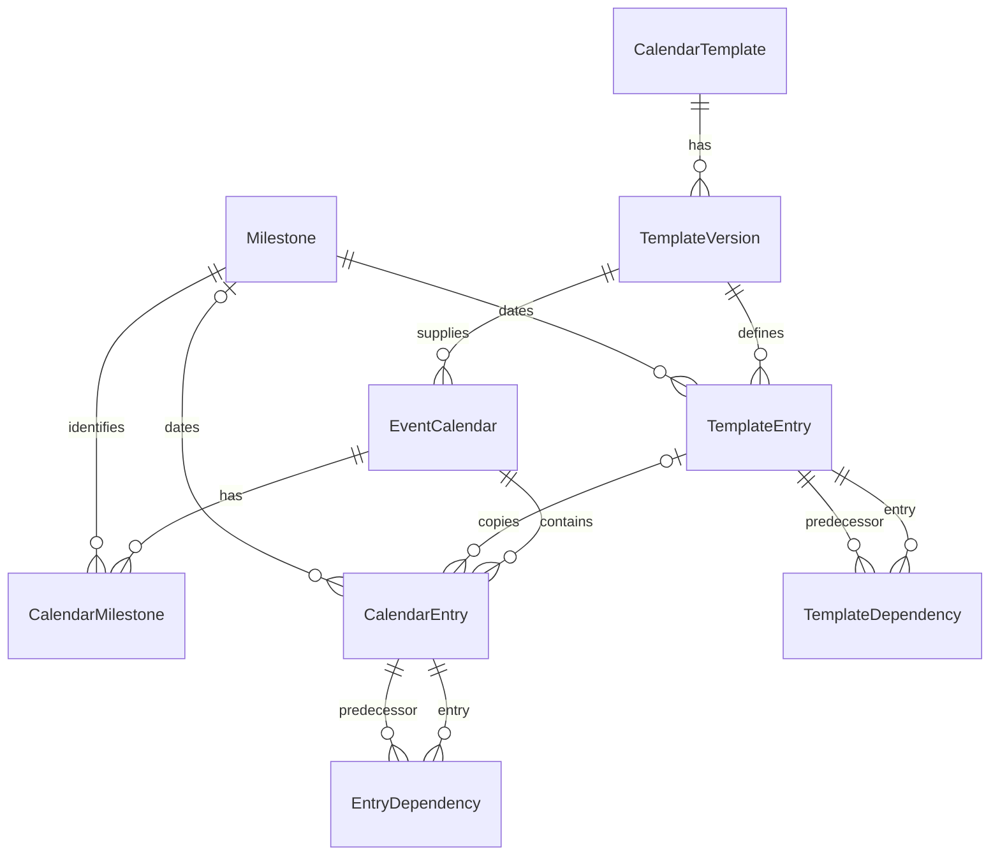

# Diary callable API

API module: `Diary.api`.
API version: `1`.

`close_calendar` closes an existing diary instance even when tasks remain open.

This implementation provides models, migrations, and a Python callable API.
It also provides a standalone task list template and its reusable content fragment.
It does not provide HTTP endpoints, routed pages, reminders, or automatic event callbacks.
The routed Diary pages and the host dashboard need a subsequent implementation step.
Diary is for configured DiaryUsers and DiaryManagers who have actions to complete for a successful event.
Diary has no public view.
Task role ownership alone does not grant Diary access.
Diary provides a generic capability to hold an event diary.
The selection of template tasks and their dates is outside the feature definition.
Template content is application data and does not prevent implementation of the feature.
Task progress through completion is required in the first feature release.
The V1 completion rules below define permissions and predecessor checks.
Any additional progress states and transitions still need definition.
The first release uses a simple date-ordered list.
A month display is not required for the first release.
Milestone date changes and their impact review belong in V2.
The first release uses the milestone dates supplied during calendar creation.
Reminders are outside V1 scope.
No later release number is confirmed for reminders.
Only DiaryManagers can change calendar templates.
DiaryManagers approve new templates and template versions through the save action in V1.
A separate approval step is outside V1 scope.
Only DiaryManagers can modify tasks copied from a template into a calendar instance.
Task assignment does not grant permission to modify those tasks.
Permitted users can complete accessible tasks under the V1 predecessor rules.
Multiple sign-offs are outside V1 scope.
V1 keeps one completion record per task, including a role-owned task.
Personally added tasks are visible only to their owner and DiaryManagers within the host's permitted calendar scope.
Only DiaryManagers can add tasks owned by another person.
In V1, DiaryManagers can edit dependencies only in templates.
Template dependency changes do not propagate into live diaries.
DiaryManagers cannot remove or replace live diary predecessors through dependency editing.
Template changes leave existing diaries unchanged by default.
V1 must let a DiaryManager explicitly add a new template item to an existing active diary, including a late task.

## Remaining work

This list follows the [event calendar design](../docs/design/event-calendar.md), dated 2 November 2026.
The design contains confirmed requirements and proposals that still need approval.
The previews use sample data and do not complete application requirements.

### Requirements still to implement

- [ ] List open predecessors throughout the blocking chain when a user attempts task completion.
- [ ] Add “Complete” for permitted users when no open predecessors remain.
- [ ] Add the DiaryManager “Close all” action for a task with open predecessors.
- [ ] Complete the blocking chain and selected task together with explanatory predecessor comments.
- [ ] Keep completion records, due dates at completion, and dependency links consistent during concurrent changes.
- [ ] Implement task progress and completion through the callable API and Diary pages in the first feature release.
- [ ] Preserve completion records and due dates at completion when milestone dates change.
- [ ] Add URL routes and browser views for personal tasks, the event calendar, and the template editor.
- [ ] Show calendar entries in a simple date-ordered list.
- [ ] Highlight Late tasks with a red shadowed border in every task view.
- [ ] Highlight Blocked tasks with an amber shadowed border when a direct predecessor is late.
- [ ] Give the red highlight priority when the task itself is late.
- [ ] Keep text state labels and a dashed border for other Blocked tasks.
- [ ] Make the personal task view the default Diary page for a logged-in user.
- [ ] Add navigation to the full event calendar for users with view permission.
- [ ] Connect the pages to the callable API with trusted identity and current role membership.
- [ ] Enforce separate calendar view, template view, and entry creation permissions on each request.
- [ ] Support personal tasks across all host-permitted calendar instances or one selected instance in the callable API.
- [ ] Add an authenticated HTTP API with the same instance selection and access rules.
- [ ] Identify the calendar instance in each task result from a list that includes multiple instances.
- [ ] Use configurable DiaryManager and DiaryUser role names within Diary.
- [ ] Enforce DiaryManager-only template changes in pages, the callable API, and the HTTP API.
- [ ] Restrict changes to template-sourced instance tasks to DiaryManagers through every interface.
- [ ] Add a DiaryManager action to copy a selected new template item into an existing active diary.
- [ ] Show the target diary, selected item, and calculated date before the save.
- [ ] Permit late additions with the original calculated date and normal Late highlighting.
- [ ] Prevent duplicate additions through the template item's stable entry key.
- [ ] Preserve existing tasks, completion records, and other diaries during the addition.
- [ ] Approve the resulting template version through the DiaryManager's save action in V1.
- [ ] Show the event name and event date on the current calendar page.
- [ ] Show “No current event” or “Calendar not prepared” when applicable.
- [ ] Keep calendar reads free from calendar creation actions.
- [ ] Add the personal entry form with the current user as its enforced owner.
- [ ] Restrict personal entry visibility to its owner and DiaryManagers in every view and API.
- [ ] Exclude other users' personal entries from searches and predecessor choices.
- [ ] Add the DiaryManager entry form with person and role choices.
- [ ] Add the DiaryManager choice “Add to template for future events”, initially off.
- [ ] Show the reusable date rule and owner choice before a combined save.
- [ ] Save one event entry and one new template entry together without repeated additions.
- [ ] Keep other event calendars unchanged after a template addition.
- [ ] Show person names, current role members, and whole-team ownership.
- [ ] Show “No role members” with the role name when applicable.
- [ ] Add the template predecessor editor with safe choices for proposed unsaved links.
- [ ] Restrict dependency editing to templates in every V1 interface, including the callable API.
- [ ] Keep server checks for circular dependencies and concurrent changes.
- [ ] Add the dashboard's personal Late, Ready, and Blocked counts with matching task filters.
- [ ] Check Diary availability before the dashboard imports or calls its API.
- [ ] Use the current event's stored Diary key for the dashboard.
- [ ] Show the missing-calendar state and keep zero counts as links.
- [ ] Use complete Diary pages and reusable content fragments for the new views.
- [ ] Use existing team navigation and styles with keyboard access and text state labels.
- [ ] Document each new styling class and CSS variable.

### Proposals and decisions still open

These items do not authorize implementation.
[Section 11](../docs/design/event-calendar.md#11-open-decisions) contains the full decision list.

- [ ] Define the review procedure for open tasks when their person owner leaves ExecMember.
- [ ] Define other task editing rules, owner changes, and any additional progress states.
- [ ] Define handling of absent milestones and predecessor tasks during an explicit template item addition.
- [ ] Define any broader template replacement workflow separately from item additions.
- [ ] Decide whether to add calendar exports for permitted ExecMembers and define their access rules.

### Garage Sale integration

The host decides when to call the calendar creation API.
Diary does not define event creation or activation callbacks.
The [Garage Sale integration design](../GarageSale/DIARY_INTEGRATION.md) records the lifecycle proposal and remaining host work.
It includes calendar creation timing, activation checks, and storage of the returned Diary key.
These decisions are outside the generic Diary feature definition.

### Reminders: deferred beyond V1

Reminder design does not prevent the V1 release.
These items remain deferred until a later release:

- [ ] Define reminder recipients, including recipients for whole-team tasks.
- [ ] Define timing, delivery channels, retries, and cancellation rules.
- [ ] Define reminder permissions and send records before implementation.

### V2 completion review

- [ ] Review the V1 “Close all” behavior and decide which force completion features V2 needs.

Dependency editing in live diaries remains a separate review item for a future release.
It is outside V1 scope.

### V2 milestone date changes

The user deferred milestone date changes and their impact review to V2.
These changes can affect whether the team can complete all diary tasks.
The following work remains necessary for V2:

- [ ] Design the presentation of changed dates and their effects on tasks and dependencies.
- [ ] Define the review, approval, and permission rules before changed dates are applied.
- [ ] Define the caller's API workflow for changed milestone dates.
- [ ] Preserve completion records and their due dates during changes.

The current API can update milestone dates without an impact review.
The preview milestone editor also permits direct changes for demonstration.
Neither interface completes the V2 design or approves a first-release date change workflow.

### Documentation review

The official ASD-STE100 Issue 9 PDF initially returned HTTP 403.
An existing local copy was available for the task highlighting update.
A full dictionary and technical-name review remains necessary.
This update does not claim full ASD-STE100 compliance.

## App boundary

Diary's only host dependencies are Django settings and the configured Django user model.
Use `django.contrib.auth.get_user_model()` when Diary needs the user model class.
Do not import a host user model class directly.
Diary has no dependency on host event models or custom request attributes.
Its current models have no foreign keys to other project apps.
The host supplies event references, dates, person references, and role names.
All foreign keys in Diary point to Diary models.
All database operations use PostgreSQL.

A reference is an opaque string, such as `GarageSale:event:17` or `user:42`.
The host must use a stable namespace for these references.
The Diary key is a UUID that identifies an event calendar.
The host stores it in `EventData.diary_key` without a foreign key.

## Access configuration

### Confirmed role and calendar scope

DiaryManager and DiaryUser are technical names for configurable Diary roles.
They are not fixed Django group names.
The host maps its groups through `settings.py`.
Garage Sale uses Officer for DiaryManager and ExecMember for DiaryUser.
Other projects can select different group names.

A DiaryManager can view any calendar instance that the host permits.
Diary adds no current-event restriction or separate calendar selection policy for managers.
A DiaryUser can view associated tasks in the instances permitted by the host.
Associated tasks include personal tasks and tasks owned by the user's current roles.

The callable API and HTTP API must support all permitted instances or one selected permitted instance.
The host supplies the trusted identity, role memberships, and permitted instance scope.
Diary enforces that scope on each request.
An all-instances selection cannot expand the host's permission grant.
These read rules do not grant task-change or completion permissions.
Only DiaryManagers can change templates, including their entries, date rules, owners, and dependencies.
DiaryUsers cannot change templates through any interface.
DiaryManagers approve new templates and versions through their save action in V1.
This includes an event entry addition to the template for future events.
V1 has no separate approval step.

The current implementation has a callable API with one required `calendar_key` for `personal_tasks`.
It has no HTTP API or task query across multiple instances yet.
The role terminology and expanded interface above are confirmed requirements, not descriptions of completed implementation.

### Current API configuration

The host supplies this configuration in settings:

```python
DIARY_PERMISSION_GROUPS = {
    'use': ('ExecMember', 'Officer'),
    'view': ('ExecMember', 'Officer'),
    'edit': ('Officer',),
    'view_template': ('Officer',),
}
DIARY_TIME_ZONE = 'Europe/London'
DIARY_TEMPLATE_NAME = 'Garage Sale calendar'
DIARY_TASK_OWNER_ROLES = ('ExecMember', 'Officer', 'SponsorshipManager')
DIARY_ROLE_LOOKUP = 'GarageSale.diary_roles.existing_task_owner_roles'
```

The `use` action permits personal entries and calendar creation from an approved template.
The `view` action permits calendar reads within the caller's calendar scope.
The `edit` action permits milestone definitions, template preparation, template approval, assigned entries, date updates, and dependency changes.
The `view_template` action permits template reads and the milestone lookup.
An absent action mapping denies access.

`DIARY_TEMPLATE_NAME` selects the default template by name.
Calls without an explicit template version use its highest approved version number.
A draft with a higher number does not replace an approved version.
The configured name can change when another application reuses Diary.
Existing calendars keep their original template version.
An absent template or approved version produces a validation error.
The API does not silently create or approve a template.

These action names are technical names for API permission checks.
They are not Django group names or automatic database permission grants.
The current defaults implement the confirmed Officer and ExecMember split.
These exact group names in the examples are Garage Sale configuration, not required Diary role names.

The host constructs an `Actor` from an authenticated, active identity.
It supplies the user's reference, current group names, and permitted calendar keys.
For a current-event request, the host supplies the permitted current calendar key.
For other requests, the host can supply multiple permitted calendar keys.
The current `personal_tasks` call still reads only its selected key.
The host must not take this information from an untrusted request body.

```python
from Diary.api import Actor

actor = Actor(
    reference='user:42',
    groups=frozenset({'ExecMember', 'Officer'}),
    calendar_keys=frozenset({stored_diary_key}),
)
```

The API is a trusted backend interface.
It is not an authentication service.
HTTP adapters must authenticate users and construct the Actor before an API call.

### Configurable task-owner roles

`DIARY_TASK_OWNER_ROLES` is the collection of role names permitted as task owners.
An absent or empty collection permits no role assignments.
Person ownership and whole-team ownership do not require a role from this collection.
Use exact role names without surrounding spaces.
`task_owner_roles()` returns the configured names as a `frozenset`.
Template and calendar entry additions reject unlisted role owners.
The caller's `OwnerDirectory.role_exists` check still verifies each role assignment.

`DIARY_ROLE_LOOKUP` is the dotted import path of a host database lookup callable.
It receives the configured names and returns the names that exist in the database.
It must return an iterable of exact role names.
The Garage Sale implementation queries Django's `Group` model.
Another host can supply a different database implementation without changes to Diary.
Diary does not import host user or role model classes directly.

Startup checks every configured role through this lookup.
Missing roles raise `ImproperlyConfigured` with their names and the relevant settings.
Invalid settings and database access failures also produce configuration errors.
The check does not create roles or change existing task ownership.

The `migrate` and `sync_access_policy` commands omit the database existence check so administrators can prepare the database.
They still check the form of `DIARY_TASK_OWNER_ROLES`.
After setup, restart the application to perform the full startup check.
All other startup paths perform the check when the configured collection is not empty.

## Named milestones

`define_milestones` takes a mapping from stable names to display labels.
It returns milestone UUIDs by name.
Repeated definitions reuse the same milestone.
A changed label does not change its stable name.

```python
from Diary import api

api.define_milestones(actor=actor, definitions={
    'event_date': 'Event date',
    'add_board_bookings_open': 'Advertising board bookings open',
})
```

Template entries refer to milestone names through `EntrySpec.milestone_name`.
`required_milestones` returns the distinct definitions used by one template version.
Each result contains `id`, `name`, and `label`.
It excludes definitions that this version does not use.

```python
required = api.required_milestones(
    actor=actor,
    template_version_key=version_key,
)
```

The caller gathers dates for those names before calendar creation.
Each template identifies the named milestones that its task date rules require.
The caller supplies a date for each required milestone when it creates a calendar through the API.
The caller determines the source and meaning of those dates.
For this website, the Garage Sale app supplies the dates.
Diary does not need knowledge of the caller's event fields or booking rules.

The current API also accepts missing milestone values.
A missing milestone value produces no due date.
The task list then sets `date_not_set` in its result.

## Template and calendar creation

This is a complete first setup example.
Run the setup once, with an authenticated caller that has edit access.
The example does not depend on another app's models.

```python
from dataclasses import replace
from datetime import date
from Diary import api
from Diary.choices import DateKind

actor = api.Actor('user:42', frozenset({'Officer', 'ExecMember'}))
api.define_milestones(actor=actor, definitions={
    'event_date': 'Event date',
    'add_board_bookings_open': 'Advertising board bookings open',
})
template_key = api.create_template(actor=actor)  # Uses DIARY_TEMPLATE_NAME.
version_key = api.create_template_version(
    actor=actor, template_key=template_key, number=1,
)
entry = api.EntrySpec(
    name='Inspect advertising boards',
    date_kind=DateKind.RELATIVE,
    milestone_name='add_board_bookings_open',
    day_offset=42,
)
entry_key = api.add_template_entry(
    actor=actor, template_version_key=version_key, spec=entry,
)
api.approve_template_version(actor=actor, template_version_key=version_key)

required = api.required_milestones(actor=actor)  # Uses the configured template.
assert [item['name'] for item in required] == ['add_board_bookings_open']

calendar_key = api.create_calendar(
    actor=actor,
    event_ref='GarageSale:event:17',
    name='Garage Sale 2027',
    event_year=2027,
    milestone_dates={
        'event_date': date(2027, 6, 27),
        'add_board_bookings_open': date(2027, 5, 1),
    },
)
actor = replace(actor, calendar_keys=frozenset({calendar_key}))
calendar = api.get_calendar(actor=actor, calendar_key=calendar_key)
tasks = api.active_tasks(actor=actor, calendar_key=calendar_key, today=date(2027, 6, 12))
assert tasks[0]['late'] is True  # The due date has been reached.
```

The example task is due on 12 June 2027.
The caller must save `calendar_key` against the event.
The host can include the API call and that save in one database transaction.
Diary does not save the key in another app.

For this website, the caller stores the key on its event record:

```python
event.diary_key = calendar_key
event.save(update_fields=['diary_key'])
```

Here, `event` is the caller's existing `EventData` instance.
That save belongs in the calling application, not in Diary.

To select a particular version, supply `template_version_key` to `create_calendar` or `required_milestones`.

Repeated calendar creation with the same reference and inputs returns the same key.
Different inputs for that reference raise `ValidationError`.
Use `set_milestone_dates` for a deliberate date update.
That call updates the supplied milestones and keeps other milestone values unchanged.

The date kinds are `source`, `relative`, `annual`, and `once`.
`source` uses a milestone directly.
`relative` adds a signed day count to a milestone.
`annual` uses a month, day, and offset from the event year.
`once` uses a full date and is permitted only in an event calendar.
An invalid annual occurrence, such as 29 February 2027, has no due date.

Approved template entries and their dependencies are immutable through the API.
A DiaryManager's save must create and approve the resulting version without a separate approval step in V1.
The current API exposes `approve_template_version` as a separate callable operation.
The V1 save workflow must include that operation rather than require another user action.
The preview's separate draft approval control remains a demonstration, not the confirmed V1 workflow.
A new version needs new entries before approval.
Event entries copy the rules, names, owners, and dependency links.
They do not read mutable template content after creation.
Template changes do not update those instance entries automatically.
A DiaryManager must be able to add a selected new template item to an active diary explicitly.
The item uses that diary's milestone dates and can be late when added.
This addition must not replace existing tasks or change their completion records.
The current API has no dedicated operation to copy a selected template item into an existing diary.
That action remains implementation work for V1.

## API calls

All call arguments are keyword arguments.
Every call except `permission_groups` and `task_owner_roles` requires `actor`.

| Call | Other arguments | Result |
| --- | --- | --- |
| `permission_groups` | None. | A copy of the group mapping. |
| `task_owner_roles` | None. | A `frozenset` of configured task-owner role names. |
| `define_milestones` | `definitions` | Milestone keys by name. |
| `create_template` | Optional `name`, optional `description` | Template UUID. |
| `create_template_version` | `template_key`, `number` | Template version UUID. |
| `get_template_version` | Optional `template_version_key` | Template rules, entry keys, and predecessor keys. |
| `required_milestones` | Optional `template_version_key` | Distinct milestone definitions. |
| `add_template_entry` | `template_version_key`, `spec`, optional `directory` | Stable entry key. |
| `approve_template_version` | `template_version_key` | Template version UUID. |
| `create_calendar` | `event_ref`, `name`, `event_year`, `milestone_dates`, optional `template_version_key` | Diary key. |
| `close_calendar` | `calendar_key` | The existing Diary key. |
| `set_milestone_dates` | `calendar_key`, `milestone_dates`, optional `event_year` | No result. |
| `add_entry` | `calendar_key`, `spec`, optional `directory` | Stable entry key. |
| `get_calendar` | `calendar_key` | Calendar data and entries. |
| `active_tasks` | `calendar_key`, optional `today` | Open tasks in date order, with late tasks first. |
| `personal_tasks` | `calendar_key`, optional `today`, optional `include_whole_team` | Open tasks for the caller or their roles. |
| `available_predecessors` | `scope_key`, `entry_key`, optional `template` | Safe predecessor choices. |
| `set_predecessors` | `scope_key`, `entry_key`, `predecessor_keys`, optional `template` | No result. |

For dependency calls, `scope_key` identifies a calendar unless `template=True`.
With `template=True`, it identifies a template version.
Entry keys remain stable when names change or templates become event calendars.
A caller can keep the same `EntrySpec.entry_key` to repeat a safe entry addition.
Different content with an existing entry key raises `ValidationError`.

## EntrySpec fields

`EntrySpec` is the input record for an entry addition.
Its technical field names match the date and ownership rules below.

| Field | Type | Default or rule |
| --- | --- | --- |
| `name` | String. | Required. Unique within its calendar or template version, without case differences. |
| `date_kind` | `DateKind` value or its string value. | Required. |
| `description` | String. | Empty string. |
| `milestone_name` | String. | Required for `source` and `relative`. Empty for other date kinds. |
| `day_offset` | Integer. | Zero. Signed day count for `relative`. |
| `month`, `day` | Integers or `None`. | Required for `annual`. Otherwise `None`. |
| `year_offset` | Integer. | Zero. Used only for `annual`. |
| `fixed_date` | `datetime.date` or `None`. | Required for `once`. Otherwise `None`. |
| `owner_kind` | `OwnerKind` value or its string value. | `team`. |
| `person_ref` | String. | Required only for `person`. Otherwise empty. |
| `role_ref` | String. | Required only for `role`. Otherwise empty. |
| `entry_key` | UUID. | A new UUID. Keep it to repeat an addition safely. |

## More callable examples

These examples continue from the setup example.
The example `actor` has edit access and includes the new calendar key.

An ExecMember can add a personal entry:

```python
from Diary.choices import OwnerKind

member = api.Actor('user:43', frozenset({'ExecMember'}), frozenset({calendar_key}))
personal = api.EntrySpec(
    name='Check my preparation notes',
    date_kind=DateKind.ONCE,
    fixed_date=date(2027, 6, 20),
    owner_kind=OwnerKind.PERSON,
    person_ref=member.reference,
)
personal_key = api.add_entry(actor=member, calendar_key=calendar_key, spec=personal)
my_tasks = api.personal_tasks(actor=member, calendar_key=calendar_key)
```

An Officer can use a host directory to assign a role-owned task:

```python
class ExampleDirectory:
    def person_in_groups(self, reference, group_names):
        return reference in {'user:42', 'user:43'} and 'ExecMember' in group_names

    def role_exists(self, reference):
        return reference == 'SponsorshipManager'

role_task = api.EntrySpec(
    name='Check sponsor details',
    date_kind=DateKind.ANNUAL,
    month=5,
    day=1,
    owner_kind=OwnerKind.ROLE,
    role_ref='SponsorshipManager',
)
role_key = api.add_entry(
    actor=actor, calendar_key=calendar_key, spec=role_task,
    directory=ExampleDirectory(),
)
```

`ExampleDirectory` contains sample data for this example only.
The host must supply its real identity directory in normal operation.
For a person assignment, select `OwnerKind.PERSON` and set `person_ref` instead of `role_ref`.

The current API can update a milestone date.
This example describes existing behavior, not an approved first-release workflow.
The impact review and the supported change workflow belong in V2.
The following call changes one milestone date:

```python
api.set_milestone_dates(
    actor=actor,
    calendar_key=calendar_key,
    milestone_dates={'add_board_bookings_open': date(2027, 5, 8)},
)
```

This changes open task dates that use that milestone.
It does not change fixed annual dates or completed due dates.

V1 permits dependency changes only in draft templates by DiaryManagers.
In this example, `draft_version_key` identifies a draft template version.
`task_entry_key` and `predecessor_entry_key` identify tasks in that version.

```python
choices = api.available_predecessors(
    actor=actor, scope_key=draft_version_key, entry_key=task_entry_key, template=True,
)
api.set_predecessors(
    actor=actor, scope_key=draft_version_key, entry_key=task_entry_key,
    predecessor_keys=[predecessor_entry_key], template=True,
)
```

`set_predecessors` replaces the entry's complete predecessor list.
An empty list removes all its predecessors.
That removal is permitted only in the draft template under the V1 requirements.
To change a draft template, use its version key as `scope_key` and set `template=True`.

## Close a diary instance

Use `close_calendar` to close an existing diary, regardless of its open tasks:

```python
api.close_calendar(actor=actor, calendar_key=calendar_key)
```

The caller needs the configured `edit` permission and the target key in `Actor.calendar_keys`.
Garage Sale maps that permission to its DiaryManager group.
The operation returns the existing Diary key.
Repeated calls keep the original closure time and caller reference.

Closing records `closed_at` and `closed_by_ref` on the calendar.
It does not complete, delete, or change tasks.
It preserves milestone dates, dependencies, and completion records.
`get_calendar` remains available within the host's permitted scope.
Its result includes `closed`, `closed_at`, and `closed_by_ref`.
`active_tasks` and `personal_tasks` return empty tuples for a closed diary.

The API rejects entry additions, milestone changes, and dependency changes after closure.
These writes and closure use the same calendar lock.
No reopen operation is provided.
A repeated `create_calendar` call cannot reopen the diary.
The caller decides when to close a diary.
Diary does not connect closure to an external event lifecycle automatically.

Apply migration `Diary/0003_calendar_closure` before using this operation.
Existing diaries remain open after the migration.

## Ownership

`EntrySpec.owner_kind` is `team`, `person`, or `role`.
A person entry has `person_ref` only.
A role entry has `role_ref` only.
A whole-team entry has neither reference.
The database enforces these combinations.
The template author can select a person, a role, or the whole team for each task.
A specific person or role is optional.
Calendar creation copies that ownership from the template.
The selection is template content, not a fixed Diary policy.

An ordinary DiaryUser can add only an entry that identifies themselves as the person owner.
An editor can add entries for people, roles, or the whole team.
The host must map the `edit` permission to its DiaryManager groups.
Only DiaryManagers can add tasks owned by another person.
These assignment checks already exist in the callable API.

A personal entry is a task that a user adds with themselves as its owner.
Only that owner and permitted DiaryManagers may view the entry.
The requirement applies to lists, details, searches, predecessor choices, and both API interfaces.
The current calendar read API does not yet enforce this personal entry visibility rule.
That visibility filter remains implementation work.

For person and role assignments, the editor supplies an `OwnerDirectory` implementation.
Its `person_in_groups(reference, group_names)` method checks person eligibility.
Its `role_exists(reference)` method checks the role reference.
Diary does not implement that directory through another app's models.

The personal list uses the Actor's current group membership for role-owned tasks.
The default logged-in Diary page must use `personal_tasks` for its task list.
The full event list from `active_tasks` is an explicit view choice, not the default landing page.
It excludes whole-team tasks unless `include_whole_team=True`.
The list returns each task once.
Membership changes take effect when the host supplies a new Actor.

## Readiness and lateness

`active_tasks` excludes completed entries.
Each result includes `state`, `late`, `date_not_set`, ownership references, and blocking predecessor keys.
The state is `ready` if all predecessors are complete.
Otherwise, the state is `blocked`.
An entry without predecessors is ready.

An open task is late if its due date is today or earlier.
A blocked task can also be late.
A missing date is not late.
There are no stored readiness or lateness flags.
The caller can supply `today` for a reproducible date comparison.
Otherwise, the API uses the date in `DIARY_TIME_ZONE`.

The model keeps completion time, the completing actor reference, and the due date at completion.
Completed records cannot change through normal model saves.
The completion API, pages, and DiaryManager “Close all” workflow are not implemented yet.

### Confirmed V1 task completion workflow

An attempt to complete a task lists all open predecessors in its blocking dependency chain.
The list includes indirect predecessors that block the open predecessors.
The display must preserve personal-entry visibility and host calendar permissions.

Every permitted DiaryUser and DiaryManager has a “Complete” button for a task they can access.
The action succeeds only when the open predecessor list is empty.
The server must check that condition again before saving completion.

A DiaryManager has a “Close all” button when open predecessors remain.
The action completes the blocking chain and the selected task in one transaction.
Each forced predecessor completion needs a comment that identifies the action and selected task.
Completion records keep the manager reference, completion time, and due date at completion.
The action preserves existing completion records and dependency links.
Ordinary DiaryUsers cannot use “Close all”.

These actions apply to tasks in an open diary.
`close_calendar` remains a separate instance operation and does not complete tasks.
The existing preview has no “Close all” action and remains incomplete for this requirement.
V2 must review whether this force completion behavior remains appropriate.

## Dependency integrity

The confirmed V1 policy permits dependency edits only in templates by DiaryManagers.
Existing diary dependency links must remain unchanged during template edits and task completion.
The current `set_predecessors` API also permits changes to open calendar instances.
Restricting that existing behavior remains implementation work for V1.
The preview's live entry dependency controls also need restriction.

The selector excludes the task itself and every direct or indirect successor.
It also excludes entries from other calendars or template versions.
The API checks links again before save.
It serializes dependency changes through a lock on the calendar or template version.
A failed replacement keeps the previous links.

The current selector reads saved links.
A future editor must calculate choices for its proposed unsaved links as well.
The API still rejects a circular link from an old form.

Callers must use the API instead of ORM bulk writes or direct many-to-many manager operations.
Those ORM operations can bypass model validation and graph locks.
Database constraints still enforce ownership shapes, date shapes, unique keys, and self-link prevention.

## Errors

The API raises `PermissionDenied` for failed access checks.
It raises `ValidationError` for invalid data or a conflicting repeated request.
An unknown reference raises the applicable model's `DoesNotExist` exception.
Database uniqueness constraints can raise `IntegrityError` if conflicting creations occur concurrently.
The caller must report the conflict and read the stored record before a retry.
A failed atomic call does not keep partial entries or dependency changes.

## Deployment and verification

The initial Diary migration has no dependency on another project app.
The GarageSale migration adds the nullable `EventData.diary_key` field.
Existing event records keep a null key.
No calendar or milestone data is seeded automatically.

Use the configured project interpreter and PostgreSQL credentials:

```sh
python manage.py test Diary.tests --noinput
python manage.py makemigrations --check --dry-run
python manage.py migrate
```

Apply migrations on the target site before callers use the API.
Follow `General Deployment Instructions` for deployment.
No migration was applied to application data during development of this feature.

## Default styles and host overrides

Diary includes `Diary/templates/Diary/base.html` and `Diary/static/Diary/styles/diary.css`.
These are the styling foundation for the subsequent Diary pages.
The stylesheet uses the `.diary` namespace to avoid changes to other pages.
It includes default cards, buttons, form controls, and task status styles.

The base template uses Django's `static` tag for its stylesheet URL.
The host does not need a special Diary stylesheet search function.
Django's normal static file finders select the file.
The first matching file wins with the configured finder order.
See [Django's static file guidance](https://docs.djangoproject.com/en/5.0/ref/contrib/staticfiles/).

### Files that the host can override

| Packaged file | Lookup name | Host change |
| --- | --- | --- |
| `Diary/static/Diary/styles/diary.css` | `Diary/styles/diary.css` | Replace the complete default stylesheet through the static file finders. |
| `Diary/templates/Diary/base.html` | `Diary/base.html` | Change the page shell or stylesheet links through the template loaders. |
| `Diary/templates/Diary/task_list.html` | `Diary/task_list.html` | Change the standalone task page. |
| `Diary/templates/Diary/partials/task_list.html` | `Diary/partials/task_list.html` | Change the task list content in standalone and host pages. |

The lookup name is the relative name used by `static`, `extends`, or `include`.
The host must keep that relative name when it replaces a packaged file.
A differently named host stylesheet needs its own link in the page.

### Static file selection and CSS rule order

Django selects a file for each requested static path.
It does not combine files with the same path.
It does not load duplicate files in reverse order.

With the default `STATICFILES_FINDERS`, the search order is:

1. `FileSystemFinder` searches the directories in `STATICFILES_DIRS`, in their listed order.
2. `AppDirectoriesFinder` searches app static directories in `INSTALLED_APPS` order.

The first matching file supplies that static path.
A custom finder configuration can change this order.
`collectstatic` uses the selected source to create the deployment copy under `STATIC_ROOT`.
The production static server serves that collected copy.
It does not repeat Django's source search for each browser request.

For example, these two source files have the same lookup name:

```text
site_static/Diary/styles/diary.css
Diary/static/Diary/styles/diary.css
```

With `site_static` in `STATICFILES_DIRS` and the default finders, only the first file supplies `Diary/styles/diary.css`.
Its content replaces the packaged stylesheet completely.
It does not inherit missing rules from the packaged file.

The browser can load multiple stylesheets only when the page links or imports them.
For example, a page can link to `Diary/styles/diary.css` and then `site/diary-overrides.css`.
Django resolves each path independently.
The browser then applies the CSS cascade to both files.
When origin, importance, layer, specificity, and scope proximity are equal, a later declaration wins.
A more specific earlier selector can still beat a less specific later selector.
See [the CSS cascade reference](https://developer.mozilla.org/en-US/docs/Web/CSS/CSS_cascade/Cascade).

The extra stylesheet approach keeps the packaged defaults available.
It is the first choice for small visual changes.

### Add host styles after the defaults

The usual first choice is an extra stylesheet with CSS variable overrides.
Put this template in a host template directory:

```text
templates/Diary/base.html
```

The template can extend the default with the same name:

```django



    <link rel="stylesheet" href="">

```

The host stylesheet can change colors without copying the default rules:

```css
.diary {
    --diary-accent: #263d68;
    --diary-accent-text: white;
    --diary-radius: .75rem;
}
```

The `diary_styles` block contains the default link.
The `diary_extra_styles` block follows it.
Other blocks are `diary_title`, `diary_head`, `diary_content`, and `diary_scripts`.
The host can replace the complete base template to use its own page structure.
It must retain those blocks for child pages.
Each reusable fragment supplies its own `.diary` content wrapper.

### CSS variables

The default stylesheet defines these variables on `.diary`.
The host can redefine them on the same selector in its extra stylesheet.

| Variable | Default | Effect |
| --- | --- | --- |
| `--diary-background` | `#fff` | Component background. |
| `--diary-surface` | `#fff` | Card and form control backgrounds. |
| `--diary-text` | `#111` | Main text and default button text. |
| `--diary-muted` | `#505050` | Secondary text. |
| `--diary-accent` | `darkslategray` | Heading and primary button backgrounds. |
| `--diary-accent-text` | `#fff` | Text on accent backgrounds. |
| `--diary-border` | `#bbb` | Card, control, button, and task divider borders. |
| `--diary-focus` | `#3333dd` | Keyboard focus outline. |
| `--diary-radius` | `.5rem` | Card, heading, button, and control corner radius. |

Status colors and the default button background currently use direct CSS values.
The host can change those values through the selectors below.

### CSS classes and selectors

Class names are the public styling interface for Diary HTML.
Every visible component, content role, form control, and task state must have a stable, descriptive class.
New component classes use the `diary-` prefix within the `.diary` namespace.
The standalone document also has named classes for its outer layout.

Host overrides must not depend on IDs, text values, element positions, or a particular choice of HTML tag.
Diary templates must not use inline style attributes for presentation.
Semantic tags and accessibility attributes remain part of the markup.
They do not replace the class-based styling interface.

These selectors form the current styling interface.
Some form and button classes are available for subsequent Diary pages.

| Selector | Purpose | Examples of host changes |
| --- | --- | --- |
| `.diary` | Component root and CSS variables. | Font, width, spacing, and theme variables. |
| `.diary .diary-card` | Bordered content panel. | Surface, border, padding, and corners. |
| `.diary .diary-heading` | Section heading bar. | Background, text color, and heading spacing. |
| `.diary .diary-actions` | Button container. | Gap, alignment, and row or column layout. |
| `.diary .diary-button` | Default button or link appearance. | Background, border, text, and padding. |
| `.diary .diary-button-primary` | Primary action appearance. | Primary action colors. Use with `diary-button`. |
| `.diary .diary-muted` | Secondary text and empty-state text. | Text color and font size. |
| `.diary .diary-task-list` | Task list container. | List spacing and list markers. |
| `.diary .diary-task` | One task row. | Row spacing and divider border. |
| `.diary .diary-status` | Shared task status label. | Label border, padding, and corners. |
| `.diary .diary-status-ready` | Ready label. | Ready status color. |
| `.diary .diary-status-blocked` | Blocked label. | Blocked status color. |
| `.diary .diary-status-late` | Late label. | Late status color. |
| `.diary .errorlist` | Django form error list. | Error text color and list layout. |
| `.diary label` | Form field label. | Label spacing and font weight. |
| `.diary input:not([type="checkbox"]):not([type="radio"])` | Text and other non-toggle inputs. | Control surface, border, font, and padding. |
| `.diary select` | Select control. | Control surface, border, font, and padding. |
| `.diary textarea` | Multiline input. | Control surface, border, font, and padding. |
| `.diary :focus-visible` | Keyboard focus indicator. | Outline color, width, and offset. |
| `.diary .diary-button:disabled` | Disabled button state. | Opacity and cursor. |

`diary-shell` identifies the standalone page's main element.
It has no packaged CSS rule.
The host can style it when it changes the standalone page layout.

The templates also provide these specific content and state hooks.
They do not need a default CSS rule to be valid host override targets.

| Class | Purpose |
| --- | --- |
| `diary-document` | Standalone `html` element. |
| `diary-page` | Standalone `body` element. |
| `diary-shell` | Standalone main content wrapper. |
| `diary-task-panel` | Reusable task section. Use with `diary`. |
| `diary-task-card` | Card containing the task list. Use with `diary-card`. |
| `diary-task-heading` | Task section heading. Use with `diary-heading`. |
| `diary-task-title` | Task name. |
| `diary-task-description` | Task description. |
| `diary-task-meta` | Due date and status information. |
| `diary-task-date` | Due date value. |
| `diary-date-unset` | Missing due date message. |
| `diary-task-owner` | Person, role, or whole-team owner information. |
| `diary-empty-state` | Empty task list message. |
| `diary-task-ready` | Ready task row. Use with `diary-task`. |
| `diary-task-blocked` | Blocked task row. Use with `diary-task`. |
| `diary-task-late` | Late task row. It can also have `diary-task-ready` or `diary-task-blocked`. |

For example, these rules change specific task content and a blocked row without reference to its HTML tags:

```css
.diary .diary-task-title {
    font-size: 1.1rem;
}

.diary .diary-task-owner {
    font-style: italic;
}

.diary .diary-task-blocked {
    border-inline-start: .25rem solid #704100;
    padding-inline-start: .75rem;
}
```

Future form templates must also give controls and labels their own named classes.
The generic form selectors above provide fallback defaults.
They are not a substitute for those specific classes.
Class name changes must include a guide update and an explanation of the effect on host overrides.

Class names are technical names and must keep their spelling.
Use selectors with at least the same specificity as the default rule for a reliable host override.
For example, `.diary-status-late` alone is less specific than `.diary .diary-status-late`.

```css
.diary .diary-task {
    padding-block: 1.25rem;
    border-bottom-style: dotted;
}

.diary .diary-button {
    background: #e8edf3;
}

.diary .diary-status-late {
    color: #8a1020;
    font-weight: bold;
}
```

The defaults reduce root padding and stack action buttons when the viewport is at most `40rem` wide.
Host overrides must keep a usable narrow-screen layout and a visible keyboard focus indicator.
Task states also have text labels, so color is not their only indication.

### Replace the default stylesheet

The host can supply the same relative path in its static directory:

```text
site_static/Diary/styles/diary.css
```

With Django's default finders, this configuration searches that directory before app static directories:

```python
STATICFILES_DIRS = [BASE_DIR / 'site_static']
```

Do not use the collected `STATIC_ROOT` as the source directory.
An earlier app in `INSTALLED_APPS` can also supply the same relative static path.
The finder order determines which matching file Django uses.

### Template search order

The host can set `TEMPLATES[0]['DIRS']` to include `BASE_DIR / 'templates'`.
With the default loaders, project directories have priority over app template directories.
An earlier app in `INSTALLED_APPS` can also override a template with the same relative name.
See [Django's template override guidance](https://docs.djangoproject.com/en/5.0/howto/overriding-templates/).

The default template has no dependency on a host base template or stylesheet.
The settings name `DIARY_TEMPLATE_NAME` selects calendar data, not a Django HTML template.

### Standalone pages and reusable fragments

Every Diary page must have a complete browser document through `Diary/base.html`.
The page content belongs in a reusable fragment under `Diary/partials/`.
For example, `Diary/task_list.html` includes `Diary/partials/task_list.html`.
The standalone page loads the default stylesheet.
The fragment contains no document shell or stylesheet link.

The caller supplies `tasks` from `active_tasks` or `personal_tasks`.
It can also supply `diary_heading` for the section title.
An optional `owner_label` on each task can replace its opaque person or role reference in the display.

A host template can include the fragment inside its own page:

```django



    {{ block.super }}
    <link rel="stylesheet" href="">


    <h1>Event dashboard</h1>
    

```

`host/base.html`, `extra_styles`, and `content` are example host template names.
The host uses its actual template and block names.
It must include the content fragment rather than the complete Diary browser page.
This avoids nested document elements and repeated stylesheet links.

### Deployment check

Use these commands on the target site after a stylesheet change:

```sh
python manage.py findstatic Diary/styles/diary.css --first
python manage.py findstatic Diary/styles/diary.css --verbosity 2
python manage.py collectstatic --noinput
```

Then reload the app and refresh the browser.
`--first` shows the selected source.
The second command shows all matches and the search locations for diagnosis.
Multiple matches in its output do not mean that the browser loads every match.
Follow the project's deployment instructions for its static mapping and cache checks.

## Data relationships



## UI mock-up class catalog

The [interactive UI mock-up](design/ui/index.html) is separate from the routed application.
Its [review guide](design/ui/README.md) describes the pages and sample workflows.
The preview loads the packaged stylesheet before `Diary/design/ui/preview.css`.
These additional classes belong only to the preview.
They are not yet part of the production template interface.
Classes without a CSS rule remain available as content hooks.

| Class | Purpose |
| --- | --- |
| `diary-preview` | Standalone preview root. |
| `diary-preview-back` | Back navigation link. |
| `diary-preview-badges` | Task status label container. |
| `diary-preview-banner` | Sample-data notice and reset action. |
| `diary-preview-banner-text` | Banner text. |
| `diary-preview-banner-title` | Banner title. |
| `diary-preview-brand` | Diary name and icon link. |
| `diary-preview-brand-icon` | Brand icon. |
| `diary-preview-brand-name` | Brand name. |
| `diary-preview-check-label` | Checkbox label and control layout. |
| `diary-preview-checkbox` | Checkbox. |
| `diary-preview-columns` | Task details column layout. |
| `diary-preview-completion-form` | Completion form. |
| `diary-preview-completion-note` | Completion note. |
| `diary-preview-completion-record` | Completion record. |
| `diary-preview-control` | Named form control. |
| `diary-preview-date` | Task row date container. |
| `diary-preview-date-day` | Date day. |
| `diary-preview-date-year` | Date year. |
| `diary-preview-dependency-item` | Dependency item. |
| `diary-preview-dependency-list` | Dependency list. |
| `diary-preview-detail-description` | Detail description. |
| `diary-preview-detail-main` | Detail main. |
| `diary-preview-detail-side` | Detail side. |
| `diary-preview-editor` | Template list and editor layout. |
| `diary-preview-editor-card` | Editor card. |
| `diary-preview-empty` | Empty. |
| `diary-preview-entry-form` | Entry form. |
| `diary-preview-error` | Form validation message. |
| `diary-preview-eyebrow` | Eyebrow. |
| `diary-preview-fact-name` | Fact name. |
| `diary-preview-fact-value` | Fact value. |
| `diary-preview-facts` | Facts. |
| `diary-preview-field` | Field. |
| `diary-preview-field-label` | Field label. |
| `diary-preview-field-wide` | Field wide. |
| `diary-preview-fieldset` | Form control group. |
| `diary-preview-filter` | Task status filter. |
| `diary-preview-form-grid` | Form field grid. |
| `diary-preview-graph` | Read-only dependency connection list. |
| `diary-preview-graph-edge` | Graph edge. |
| `diary-preview-graph-row` | Graph row. |
| `diary-preview-graph-task` | Graph task. |
| `diary-preview-graph-title` | Graph title. |
| `diary-preview-header` | Header. |
| `diary-preview-header-actions` | Header actions. |
| `diary-preview-header-text` | Header text. |
| `diary-preview-help` | Field help or explanatory text. |
| `diary-preview-hidden-field` | Hidden form value. |
| `diary-preview-layout` | Navigation and page grid. |
| `diary-preview-list` | List. |
| `diary-preview-main` | Active page content. |
| `diary-preview-milestone-description` | Milestone description. |
| `diary-preview-milestone-form` | Milestone form. |
| `diary-preview-milestone-key` | Milestone key. |
| `diary-preview-milestone-row` | Milestone row. |
| `diary-preview-nav` | Primary navigation. |
| `diary-preview-nav-icon` | Nav icon. |
| `diary-preview-nav-label` | Nav label. |
| `diary-preview-nav-link` | Nav link. |
| `diary-preview-noscript` | Noscript. |
| `diary-preview-note` | Context message. |
| `diary-preview-optional` | Optional field indication. |
| `diary-preview-persona` | Sample user selector area. |
| `diary-preview-persona-note` | Persona note. |
| `diary-preview-predecessor-choice` | Predecessor choice. |
| `diary-preview-predecessor-name` | Predecessor name. |
| `diary-preview-predecessors` | Scrollable predecessor choices. |
| `diary-preview-reset` | Sample reset button. |
| `diary-preview-row-arrow` | Row arrow. |
| `diary-preview-rule-caption` | Rule caption. |
| `diary-preview-rule-fields` | Rule fields. |
| `diary-preview-search` | Task search input. |
| `diary-preview-section-title` | Section title. |
| `diary-preview-sidebar` | Sidebar container. |
| `diary-preview-sidebar-caption` | Sidebar caption. |
| `diary-preview-sidebar-note` | Sidebar note. |
| `diary-preview-status-completed` | Status completed. |
| `diary-preview-status-neutral` | Status neutral. |
| `diary-preview-subtitle` | Subtitle. |
| `diary-preview-summary` | Task count summary. |
| `diary-preview-summary-item` | Summary item. |
| `diary-preview-summary-number` | Summary number. |
| `diary-preview-task-content` | Task content. |
| `diary-preview-task-link` | Task link. |
| `diary-preview-task-owner` | Task owner. |
| `diary-preview-task-row` | One event task row. |
| `diary-preview-task-late` | Red shadowed border for a Late task. |
| `diary-preview-task-blocked-late` | Amber shadowed border for a task blocked by a late direct predecessor. |
| `diary-preview-task-blocked` | Dashed border for other Blocked tasks. |
| `diary-preview-status-blocked-late` | Text label for a late predecessor. |
| `diary-preview-template-list` | Template list. |
| `diary-preview-template-switch` | Template switch. |
| `diary-preview-template-task` | Template entry selection button. |
| `diary-preview-title` | Title. |
| `diary-preview-toast` | Noninteractive result notification. |
| `diary-preview-toolbar` | Search and filter layout. |
| `diary-preview-warning` | Warning variant of a context message. |

### Preview task highlights

The Diary UI preview loads `design/ui/task-states.css` after its layout stylesheet.
No existing styling class was renamed.
The new state classes also apply to task details, edit forms, and dependency items.
Red takes priority when a task is both Late and Blocked.
Amber identifies a Blocked task with a late direct predecessor.
Other Blocked tasks use a dashed border.
Completed tasks have no task highlight.
Template definitions have no instance dates and receive no lateness highlight.
Text labels remain visible with the borders.

The preview defines these CSS variables within `.diary`.
The shadow variables contain complete CSS `box-shadow` values.

| Variable | Default | Purpose |
| --- | --- | --- |
| `--diary-preview-late-border` | `#b42318` | Red border color. |
| `--diary-preview-late-shadow` | `0 0 0 1px #b4231840, 0 3px 9px #b4231838` | Red shadow. |
| `--diary-preview-blocked-late-border` | `#a66300` | Amber border color. |
| `--diary-preview-blocked-late-shadow` | `0 0 0 1px #a6630040, 0 3px 9px #a6630038` | Amber shadow. |
| `--diary-preview-blocked-border` | `#65756f` | Dashed border color for other Blocked tasks. |

## Dashboard count mock-up

The [dashboard preview](design/dashboard/index.html) reuses the existing dashboard styles and chart renderer with sample data.
Its [review guide](design/dashboard/README.md) explains the clickable personal task counts.
The Late, Ready, and Blocked links open the matching personal Diary filter for the selected sample user.
Each open task contributes to one count only.
Late counts tasks due today or earlier, including tasks with unfinished predecessors.
Ready counts other tasks with no unfinished predecessors.
Blocked counts other tasks with unfinished predecessors.
The counts include tasks owned by the selected user or their current roles.
They exclude completed tasks and whole-team tasks.
Each zero count still opens its corresponding empty task list.
The production dashboard is unchanged.

These class hooks belong to the mock-up panel.
The surrounding host shell uses `dashboard-preview-` classes.

| Class | Purpose |
| --- | --- |
| `diary-dashboard` | Diary count panel root. |
| `diary-dashboard-counter` | Counter. |
| `diary-dashboard-counter-arrow` | Counter arrow. |
| `diary-dashboard-counter-blocked` | Blocked counter. |
| `diary-dashboard-counter-description` | Counter description. |
| `diary-dashboard-counter-label` | Counter label. |
| `diary-dashboard-counter-late` | Counter late. |
| `diary-dashboard-counter-ready` | Counter ready. |
| `diary-dashboard-counter-value` | Counter value. |
| `diary-dashboard-counts` | Counts. |
| `diary-dashboard-eyebrow` | Eyebrow. |
| `diary-dashboard-footer` | Footer. |
| `diary-dashboard-header` | Header. |
| `diary-dashboard-heading` | Heading. |
| `diary-dashboard-open` | Open. |
| `diary-dashboard-panel` | Panel. |
| `diary-dashboard-title` | Title. |
| `diary-dashboard-user` | User. |
