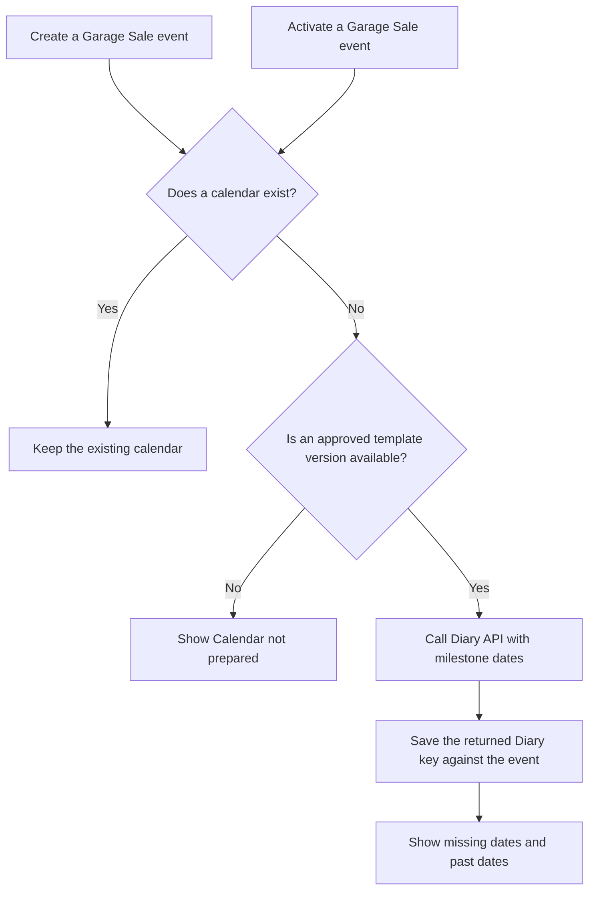

# Garage Sale integration with Diary

Status: Design proposal. The lifecycle decision remains open.
Date: 2 November 2026.

## Scope and technical names

This document records Garage Sale responsibilities when the application uses the generic Diary app.
Calendar creation timing is a host integration decision, not a generic Diary requirement.
This document replaces open decision 11 in the [event calendar design](../docs/design/event-calendar.md#11-open-decisions).

An event is a Garage Sale occasion represented by `EventData`.
The activation date is the `use_from` value used by the host's current-event selection rules.
The Diary key is the UUID returned by `Diary.api.create_calendar`.
The host stores that key in `EventData.diary_key`.
An approved template version supplies the entries and rules for a new calendar.

## Open lifecycle decision

Should Garage Sale create the Diary calendar during event creation?
Should event activation also check for an absent calendar?
These questions do not prevent implementation of the generic Diary app.

## Proposed event creation and activation

The proposal creates the calendar when Garage Sale creates the event.
The team can then see tasks before the activation date.
Some tasks can occur in the year before the event.

Activation must preserve an existing calendar and its completion records.
It must not create a second calendar or expand access beyond the host's permitted scope.

The proposed activation check also covers events created before Diary integration exists.
An absent calendar needs an approved template version before creation.
The host must not select an unapproved version as a substitute.
Repeated host requests must not create duplicate calendars or entries.

## Remaining integration work

- [ ] Confirm the event creation and activation procedure.
- [ ] Define the host callbacks that call `Diary.api.create_calendar`.
- [ ] Supply the named milestone dates required by the selected template version.
- [ ] Save the returned key against the correct `EventData` record.
- [ ] Preserve existing keys and completion records during repeated requests.
- [ ] Define the procedure for existing events without a Diary key.
- [ ] Keep the host's current-event selection rule unchanged by Diary integration.

Milestone date changes and their impact review belong in V2.
Reminders are outside V1 scope.
Neither feature is part of this proposed initial lifecycle connection.

## Language review

Reference: ASD-STE100, Issue 9.
A local copy of the standard was available.
A full dictionary and technical-name review remains necessary.
This document does not claim full ASD-STE100 compliance.
