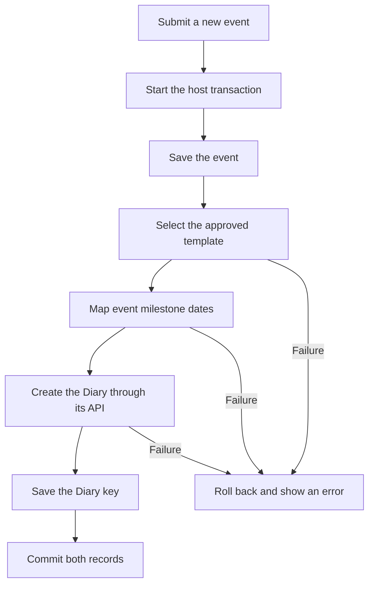

# Garage Sale integration with Diary

Status: Event creation and host-framed Diary pages are implemented. Dashboard integration and closure policy remain open.
Date: 3 November 2026.

## Scope and technical names

This document records Garage Sale responsibilities when the application uses the generic Diary app.
Garage Sale creates a Diary during event creation. This confirmed behavior belongs to the host integration.
Garage Sale treats Diary as an independently supplied dependency with the Python import name `Diary`.
This integration branch excludes Diary Python source, migrations, static files, and implementation history.
It contains host-owned template adaptations for the external Diary UI.
The current implementation remains on the separate `feature/event-calendar` branch.
Dependency installation or merging is a separate operation from Garage Sale integration.
Future package installation will replace that temporary delivery arrangement.
No published distribution name or package version is assumed.

## Dependency boundary and current implementation

The dependency must provide Diary API version 1 and `Diary.apps.DiaryConfig`.
Garage Sale configures that application and supplies its own routes and team-page template wrapper.
The nullable technical field `EventData.diary_key` stores the external Diary UUID without a foreign key.
The Garage Sale migration depends only on Garage Sale migrations.
The integration test calls the public Diary API. It does not import Diary models or private implementation functions.

The branch supplies event creation, milestone mapping, trusted HTML view context, UUID storage, and host-framed Diary pages.
Dashboard integration and the event closure policy remain separate work below.
The separately supplied Diary developer guide defines its public interface.

## Installation and first delivery

Supply the compatible Diary dependency before starting the configured Garage Sale application.
Dependency installation must make the Python import name `Diary` available to the deployment interpreter.
Keep Diary Python implementation files and migrations outside the Garage Sale integration changes.
The existing settings enable Diary through `INSTALLED_APPS` and configure the Garage Sale group names.
Apply both applications' migrations through Django's normal migration command.
Collect static files from the configured applications through Django's normal static collection command.

Create the configured DiaryManager and DiaryUser groups before application startup.
Add at least one user to each access group and each configured ownership group.
Diary rejects normal startup when those groups are missing or empty.
Create an approved task template through the supplied Diary template editor or its validated fixture-transfer command.
Diary does not create a task template automatically.
Keep milestone definitions, template choices, and event lifecycle rules within the integration plan.

The host test uses a separate PostgreSQL test database and the independently supplied Diary dependency.
No test must use application data. Package distribution tests remain the dependency's responsibility.

An event is a Garage Sale occasion represented by `EventData`.
The Use from date is the `use_from` value used by the host's current-event selection rules.
The creation factory `DiaryInstance.create()` returns an API object with its Diary key in `key`.
The host stores that key in `EventData.diary_key`.
An approved template version supplies the entries and rules for a new calendar.

## Source dates and event selection

Garage Sale owns the source date fields and their milestone mapping.
The `EventData` model keeps these source dates.
Garage Sale supplies their values through the Diary API when the selected template requires them.

| Existing field | Meaning in Garage Sale |
| --- | --- |
| `event_date` | The event date. |
| `use_from` | The Use from date for current-event selection. |
| `open_sales_bookings` | The first date for sale bookings. |
| `close_sales_bookings` | The last date for sale bookings. |
| `open_billboard_bookings` | The first date for advertising board bookings. |
| `close_billboard_bookings` | The last date for advertising board bookings. |

The event date and Use from date have different functions.
The integration must supply different labels when both appear as milestones.
The technical constant `MILESTONE_FIELDS` defines the supported source-to-milestone mapping.
Diary does not define that mapping.
Booking milestones use the stored `EventData` booking dates directly.
Diary does not calculate replacement values for those source fields.

| Template milestone name | Event source field |
| --- | --- |
| `event_date` | `event_date` |
| `ad_bookings_open` | `open_billboard_bookings` |
| `ad_bookings_closed` | `close_billboard_bookings` |
| `sales_bookings_open` | `open_sales_bookings` |
| `sales_booking_closed` | `close_sales_bookings` |
| `activation_date` or `use_from` | `use_from` |
| `add_board_bookings_open` or `open_billboard_bookings` | `open_billboard_bookings` |
| `add_board_bookings_close` or `close_billboard_bookings` | `close_billboard_bookings` |
| `sale_bookings_open` or `open_sales_bookings` | `open_sales_bookings` |
| `sale_bookings_close` or `close_sales_bookings` | `close_sales_bookings` |

Only milestone names used by the chosen approved template are supplied.
Other names stop event creation until the template or the host mapping is corrected.

## Demonstration template

The file `GarageSale/fixtures/diary_demo_template.json` contains the demonstration template named `Garage Sale calendar`.
This name matches the default `DIARY_TEMPLATE_NAME` setting.
The template contains eight tasks assigned to the `ExecMember` group.
It contains preparation tasks, booking tasks, final checks, and an event-day task.
Dependencies keep later tasks blocked until their preceding tasks are complete.
Select the Blocked status in My Diary to see those tasks.
The template uses the five milestone names in the first five rows of the mapping table.
It does not use `event_created` because `EventData` has no stored creation date.

Use an active member of the configured `DIARY_MANAGER` group as the import actor.
Replace `MANAGER_USERNAME` with that person's username.
Validate the file before import.

```bash
python manage.py transfer_diary_templates import GarageSale/fixtures/diary_demo_template.json --actor MANAGER_USERNAME --dry-run
python manage.py transfer_diary_templates import GarageSale/fixtures/diary_demo_template.json --actor MANAGER_USERNAME
```

Use `transfer_diary_templates` instead of `loaddata` to check ownership and dependencies.
The import creates an approved template version.
Repeated imports preserve an identical version.
Existing templates with different entries require review before use of `--new-version`.
Existing milestone labels and descriptions must match the file.
The import stops when those definitions differ.
Create a new demonstration event after import.
Existing event diaries remain unchanged.
The import does not create events or assign individual people.

Verification: `GarageSale/tests/test_diary_integration.py`: `EventDiaryIntegrationTests.test_demo_template_import_creates_event_tasks_with_booking_dates`.

## Current event selection

The adapter uses the existing host current-event selection without changing its rules.
Diary pages use only the current event from `request.current_event`.
The host provides no event selection control.
It supplies that event's stored Diary key to Diary.
Diary does not read this custom request attribute or select the current event.
A missing source value does not mean that its date has passed.
Diary shows “Date not set” when a necessary date has no value.

## Host group mapping and page context

Garage Sale sets `DIARY_MANAGER = 'Officer'` and `DIARY_USER = 'ExecMember'` in Django settings.
The manager setting also grants all Diary template permissions.
Task-owning roles use normal Django groups without a Garage Sale lookup callback.
Garage Sale uses `DIARY_TEMPLATE_NAME` to select an approved creation template and then supplies its version key.
This host setting must identify an approved template before event creation.
The automatic creation service checks the existing `GarageSale.add_eventdata` permission.
It uses the host service identity `garagesale:event-creation:user:<user_id>` for the narrowly scoped creation call.
That identity records the initiating user without claiming that the user has DiaryManager membership.
The service receives no existing diary scope. Interactive pages always use the requesting user's actual current groups.
An authorized event creator therefore needs no additional DiaryManager assignment.
Its access policy also makes each Officer an ExecMember.
These group names and that membership rule belong to Garage Sale.
Diary uses the configured Diary roles without those project-specific names.

The Garage Sale current-event adapter selects a permitted Diary key from its event record.
Host pages can display the event name and event date separately.
Diary pages identify their instance by its required diary name.
They do not require event metadata or an event date for the page heading.
An event date supplied as a named milestone remains an ordinary Diary input.

## Dashboard connection

The host dashboard shows the current user's Late, Ready, and Blocked counts when Diary is enabled.
The adapter uses the host-selected event's stored Diary key.
It must check Diary availability before importing the API.
It must omit the section and API calls when Diary is disabled.

The counts include personal tasks and tasks owned by the user's current groups.
They exclude completed tasks and whole-team tasks.
Late includes open tasks due today or earlier and takes priority over Blocked or Ready.
Each remaining task contributes to Blocked or Ready according to its open predecessors.
Each count links to the matching personal Diary filter.
A zero count remains a link to an empty result.
An absent Diary key has an explicit empty state.

The integration checklist in this document tracks this host work.
Garage Sale owns the clean destination routes and delegates task behavior to the generic Diary views.

## Confirmed event creation behavior

Garage Sale creates the Diary when its normal team-page or admin interface creates an event.
There is no separate event activation action.
The stored Use from date remains a source value and does not trigger Diary creation.

The technical host service `ensure_event_diary()` in `GarageSale/diary_integration.py` locks the event record.
It calls the public Diary API with an approved template and the event's mapped milestone dates.
It saves the returned UUID against the event in the same transaction.
A repeated call preserves an existing Diary key and its task history.
Unsupported milestone names stop creation rather than receive guessed source values.
Unavailable templates or rejected creation roll back the event and Diary together.
The normal team creation page shows a form error. Admin validates initial template selection before saving.

The host event creation view is `DiaryEventCreate` in `GarageSale/views/event_views.py`.
`GarageSale/team_urls.py` retains the existing `TeamPages:EventCreate` route name and URL.
The admin implementation is `SettingsAdmin.get_form()` and `SettingsAdmin.save_model()` in `GarageSale/admin.py`.
Model fixtures and direct low-level event saves do not infer a requesting user or create diaries automatically.
Other event-creation services must call `ensure_event_diary()` within their own event transaction.

Existing events without a Diary key remain unprepared.
No view creates a Diary during GET requests. No backfill command is supplied by this change.
Event editing preserves the stored Diary key and its milestone snapshot.
V1 does not propagate edited event dates into existing Diary milestones.
Automatic closure has no approved host lifecycle policy and is not added here.



## Host-owned Diary pages

`GarageSale/diary_urls.py` owns fixed Diary HTML routes under `/diary/`.
`DiaryTeamView` in `GarageSale/views/diary_views.py` resolves selected records before delegating to the dependency's supplied views.
Event identifiers, task keys, template names, and Diary UUIDs do not appear in these routes or their query strings.
Ordinary display filters can remain in query strings.

The host derives its event from the trusted `request.current_event` value on each request.
Old session event selections cannot change that scope.
The selection endpoint rejects event selection actions with HTTP 400.
Task buttons and template buttons also use POST actions. Their values belong in form data, not browser URLs.
The host validates each selection and records the selected task or template in the user's session.
The technical session field `diary_event_id` tracks task scope. It does not select an event.
The host resolves the Diary UUID from the current event's stored `diary_key` field on each request.
It passes `diary_key` and `permitted_diary_keys` through the delegated view's trusted context.
The permitted scope contains only that event's stored Diary UUID.
Template editing passes the selected template name through trusted context.
The dependency repeats its own permission, scope, and ownership checks.

Every edit form carries signed state for its originating user, event, task, and template.
The technical field `_diary_state` contains that signed state in the POST body.
A change of selection in another browser tab cannot redirect an edit to a different task.
An event change invalidates old event forms. The host returns HTTP 400 without changing either Diary.
An event change also clears the saved task selection.
Successful edits restore their originating selection before returning to the clean page URL.
Navigation selections are shared across tabs in one session. Refreshing a page uses the latest session selection.
Signed form state expires after 24 hours. Expired or changed state requires a reload and returns HTTP 400.
Missing or invalid CSRF tokens retain Django's HTTP 403 protection.

Active members of the configured DiaryUser or DiaryManager group can select event-specific personal pages.
Manager lists and template pages require the configured DiaryManager group.
The host applies that manager gate before showing an unprepared-event state.
Those configured groups can select Garage Sale events. Diary's personal-task privacy still applies within each event.
Unknown events or unavailable task selections return HTTP 404.
Missing Diary keys show Calendar not prepared without creating data.
A forged POST to an unprepared event returns HTTP 400.
Identifier query parameters return HTTP 400 and a WARNING through `GarageSale.views.diary_views`.

| Route | Page or action |
| --- | --- |
| `/diary/` | Personal tasks for the selected or current event. |
| `/diary/select/` | POST action for event, task, or template selection. |
| `/diary/manager/` | Full diary for the current event. |
| `/diary/tasks/new/` | Task creation for the current event. |
| `/diary/tasks/detail/` | Details and edits for the selected task. |
| `/diary/templates/` | Template chooser. |
| `/diary/templates/new/` | Template creation. |
| `/diary/templates/edit/` | Editing for the selected template. |

No record-specific URL aliases are supplied.
The host retains the `Diary` URL namespace because the supplied components use those route names.
These are Garage Sale routes, not an inclusion of the dependency's default URL configuration.
The host removes identifier parameters from dependency-generated redirects and status links.
Task-creation success is retained server-side instead of placing the new task key in the URL.
The read-only JSON routes are not mounted by this host HTML adapter.

## Team-page template interface

`GarageSale/templates/GarageSale/diary/base.html` provides the host document shell.
It extends `team_pages_base.html` and maps Diary content, styles, and scripts into the normal team-page blocks.
The existing header, top bar, sidebar, and responsive shell therefore surround every Diary HTML page.
The host selects `GarageSale/diary/base.html` through the trusted `diary_base_template` context value.
Template editing retains the dependency's JavaScript through the host `PageScripts` block.

Diary supplies every content partial directly from its package.
Garage Sale has no templates under `GarageSale/templates/Diary/partials/`.
The host supplies the trusted `diary_ui` context dictionary instead of copies of package markup.
Its `trusted_scope` value removes Diary selectors from rendered links and filter forms.
Its `selection_url` value enables task and template selection through POST forms.
Its `task_detail_url` value supplies the fixed task reload URL.
Its `form_fields` dictionary carries `_diary_state` in each edit and selection form.
The package escapes these fields. Garage Sale checks their signatures before it delegates a POST request.

The dependency still supplies the forms, field fragments, task validation, date calculation, ownership checks, and storage API.
The host template editor uses `TaskFormSet`, `TemplateForm`, and `DiaryTemplate.save_version()` with a fixed success URL.
No dependency Python implementation or migrations are included in this branch.
The installed Diary version must provide these embedding controls.
The host omits the hidden `diary-personal-selector` and `diary-manager-selector` controls because their keys no longer belong in GET forms.
The existing `diary-task-detail-link` and `diary-template-link` classes now identify selection buttons instead of anchors.
Other dependency class names remain unchanged. Host styles must target classes without requiring a particular element tag.

The package partial `Diary/partials/selection_forms.html` provides hidden task and template selection forms.
The package partial `Diary/partials/form_fields.html` renders signed hidden form state from trusted context.
`GarageSale/templates/GarageSale/diary/unprepared.html` provides a host-framed empty state.
The technical stylesheet `GarageSale/styles/diary_host.css` keeps the toolbar within narrow screen widths.
The selectors `.diary.diary-personal` and `.diary.diary-manager` use the full available host content width.
The selector `.diary.diary-personal .diary-task-panel` also removes the nested task panel width limit.
The selector `.diary .diary-personal-status-links` adds a top margin of `1rem`.
The status links and `.diary-personal-result-count` share a line when sufficient width is available.
They move to separate lines when the available width is too small.
These host rules preserve the package classes and use no additional CSS variables.
The package manager filter panel includes Apply filters and Clear filters within its control row.
Its checkboxes and buttons share one row when sufficient width is available. They wrap on narrow screens.
Its rules remain within the `.diary` namespace. They add no CSS variables and change no dependency class names.
The existing `ToolBar` class is used only inside the host toolbar wrapper for its scoped sizing correction.
Static form IDs associate selection buttons with their shared forms. They are not styling selectors.

| Host class | Purpose |
| --- | --- |
| `diary-host-topbar` | Scoped wrapper for the normal team toolbar. |
| `diary-host-sidebar` | Diary page links in the team sidebar. |
| `diary-host-sidebar-entry` | One standard team sidebar entry. |
| `diary-host-sidebar-icon` | Sidebar entry icon. |
| `diary-host-sidebar-label` | Sidebar entry label. |
| `diary-host-sidebar-tooltip` | Sidebar entry tooltip. |
| `diary-host-personal` | Personal Diary navigation link. |
| `diary-host-manager` | Manager diary navigation link. |
| `diary-host-templates` | Template chooser navigation link. |
| `diary-host-unprepared` | Unprepared calendar or unselected task component. |
| `diary-host-event` | Selected event or absent-current-event explanation. |
| `diary-host-guidance` | Selection or manager assistance instruction. |

My Diary, Manager Diary, and Templates appear in the left sidebar on Diary pages.
Only managers see Manager Diary and Templates.
The event selector and its submit button are removed.
The removed classes are `diary-host-navigation`, `diary-host-event-form`, `diary-host-event-label`, `diary-host-event-control`, `diary-host-event-option`, and `diary-host-event-submit`.
Host styles for those classes no longer apply.
The package also replaces `diary-host-selection-form`, `diary-host-selection`, and `diary-host-state`.
Their replacements are `diary-selection-form`, `diary-selection-kind`, and `diary-host-field`.
The existing page link classes now belong to sidebar links. They no longer use `diary-button`.
Sidebar template: `GarageSale/templates/GarageSale/diary/sidebar.html`.
The host base template includes this template in its `sidebar` block.
Verification: `EventDiaryIntegrationTests.test_diary_page_links_use_sidebar_with_current_manager_access` and `HostDiaryBrowserTests.test_diary_screens_keep_team_shell_and_template_editor_scripts`.

## Integration checklist

These host items belong to Garage Sale and are excluded from the generic Diary application checklist.
Their identifiers remain unchanged.

- [ ] **HOST-001: Event lifecycle.**
  Creation is confirmed and implemented in the team-page and admin event interfaces.
  Implementation: `GarageSale/diary_integration.py`: `event_creation_actor`, `event_diary_definition`, and `ensure_event_diary`.
  Team implementation: `GarageSale/views/event_views.py`: `DiaryEventCreate.form_valid`. `GarageSale/team_urls.py`: `urlpatterns`.
  Admin implementation: `GarageSale/admin.py`: `SettingsAdmin.get_form` and `SettingsAdmin.save_model`.
  Verification: `GarageSale/tests/test_diary_integration.py`: `EventDiaryIntegrationTests` creation, rollback, admin, and permission tests.
  Remaining: Define the host policy for closing event diaries. No automatic closure is implemented.

- [x] **HOST-002: Event source dates and saved Diary key.**
  Implementation: `GarageSale/diary_integration.py`: `MILESTONE_FIELDS`, `event_diary_definition`, and `ensure_event_diary`.
  Storage: `GarageSale/models.py`: `EventData.diary_key`. Migration: `GarageSale/migrations/0026_eventdata_diary_key.py`: `Migration`.
  Verification: `EventDiaryIntegrationTests.test_bookings_and_activation_date_values_come_from_event_fields` and `test_creation_rejects_unsupported_milestones_without_partial_event`.
  UUID verification: `GarageSale/tests/test_diary_key.py`: `EventDiaryKeyTests.test_event_stores_the_api_key_without_a_foreign_key`.

- [x] **HOST-003: Trusted host scope, clean URLs, and team-page presentation.**
  Implementation: `GarageSale/views/diary_views.py`: `DiaryTeamView` and `EventTemplateEditorView`.
  Routes: `GarageSale/diary_urls.py`: `urlpatterns`. Base template: `GarageSale/templates/GarageSale/diary/base.html`: `TopBar` and `SnappableSections`.
  Package content configuration: `GarageSale/views/diary_views.py`: `DiaryTeamView.show_page`, `diary_base_template`, and `diary_ui`.
  Current-event scope: `GarageSale/views/diary_views.py`: `DiaryTeamView.current_event` and `DiaryTeamView.select`.
  Scope verification: `EventDiaryIntegrationTests.test_current_event_ignores_saved_selection_and_rejects_event_switching` and `EventDiaryIntegrationTests.test_current_event_change_rejects_an_old_form`.
  Team Pages shows a Diary entry beside Dashboard in the Overview group.
  Icon file: `GarageSale/static/GarageSale/images/icons/navigation/diary-svgrepo-com.svg`.
  The unchanged notebook icon comes from [SVG Repo](https://www.svgrepo.com/svg/527821/notebook) under the CC0 license.
  The Overview tiles share one horizontal row through `.team-overview` and `.team-overview .category-list` in `team_pages/styles/team_page.css`.
  The entry opens the personal Diary through its fixed URL.
  Active members of `DIARY_USER` or `DIARY_MANAGER` can see the entry.
  The entry is absent when the Diary app is not installed.
  Entry implementation: `GarageSale/templatetags/diary_navigation.py`: `diary_entry` and `team_pages/templates/navigation.html`: `SnappableSections`.
  Entry verification: `EventDiaryIntegrationTests.test_team_diary_entry_matches_group_access_and_uses_clean_url` in `GarageSale/tests/test_diary_integration.py`.
  Form state: The package partial `Diary/partials/form_fields.html`: `.diary-host-field`.
  Styling: `GarageSale/static/GarageSale/styles/diary_host.css`: `.diary-host-topbar` and `.diary-host-sidebar`.
  Verification: `GarageSale/tests/test_diary_integration.py`: `EventDiaryIntegrationTests` selection, privacy, CSRF, redirect, and cross-tab tests.
  Browser verification: `GarageSale/tests/browser_diary_integration.py`: `HostDiaryBrowserTests.test_diary_screens_keep_team_shell_and_template_editor_scripts`.

- [ ] **HOST-004: Dashboard Diary counts.**
  Remaining: Connect compact Late, Ready, and Blocked counts to the personal task filters through the selected event's trusted context.
  Omit Diary imports and content when the app is disabled.
  Exclude whole-team tasks and completed tasks. Give Late priority so the counts do not overlap.
  Preserve zero-count links and the explicit absent-Diary state.

Existing event records without a Diary key remain unprepared. No automatic backfill is implemented.
The current-event selection rule remains unchanged.
Milestone changes and their impact review remain outside the supported V1 host workflow.
Reminders are not added by this integration change.

## Verification of the dependency boundary

The technical test `EventDiaryKeyTests.test_event_stores_the_api_key_without_a_foreign_key` passed against a separate PostgreSQL database.
Diary was supplied from a temporary directory outside the Garage Sale checkout.
The test used the implementation preserved at feature commit `619e961`.
This verifies the public API dependency boundary without merging Diary implementation files into this branch.
It does not verify installation of a published distribution. No published Diary distribution is required by this change.

The host regression run passed 67 tests, including its Chrome integration case, against a separate PostgreSQL database.
That run covers event creation, source dates, team and admin forms, access policy, existing dashboard behavior, and charity selection.
The browser case verifies clean task and template URLs, the normal team shell, phone layout, and template-editor JavaScript.
The disabled configuration passed 30 host tests with no Diary API available on the interpreter path.
The final 16 integration tests also verify signed edit targets and safe rejection of malformed selection values.
No migration was applied to application data, and no deployed service changed during verification.
This change requires collection of the new `GarageSale/styles/diary_host.css` asset and the supplied Diary static assets.
It adds no database migration beyond the existing host UUID migration.

## Language review

Reference: ASD-STE100, Issue 9.
A local copy of the standard was available.
A full dictionary and technical-name review remains necessary.
This document does not claim full ASD-STE100 compliance.
