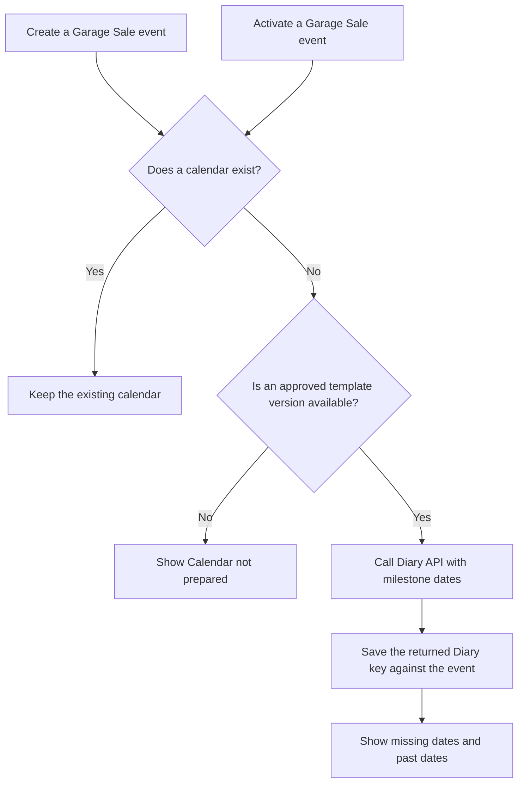

# Garage Sale integration with Diary

Status: Design proposal. The lifecycle decision remains open.
Date: 2 November 2026.

## Scope and technical names

This document records Garage Sale responsibilities when the application uses the generic Diary app.
Calendar creation timing is a host integration decision, not a generic Diary requirement.
Garage Sale treats Diary as an independently supplied dependency with the Python import name `Diary`.
This integration branch does not contain Diary source code, migrations, templates, static files, or implementation history.
The current implementation remains on the separate `feature/event-calendar` branch.
Dependency installation or merging is a separate operation from Garage Sale integration.
Future package installation will replace that temporary delivery arrangement.
No published distribution name or package version is assumed.

## Dependency boundary and current implementation

The dependency must provide Diary API version 1 and `Diary.apps.DiaryConfig`.
Garage Sale configures that application and mounts its supplied URL configuration.
The nullable technical field `EventData.diary_key` stores the external Diary UUID without a foreign key.
The Garage Sale migration depends only on Garage Sale migrations.
The integration test calls the public Diary API. It does not import Diary models or private implementation functions.

The branch currently supplies application settings, URL mounting, UUID storage, and its integration test.
The lifecycle, source-date adapter, trusted view scope, and dashboard connection remain implementation work below.
The separately supplied Diary developer guide defines its public interface.

## Installation and first delivery

Supply the compatible Diary dependency before starting the configured Garage Sale application.
Dependency installation must make the Python import name `Diary` available to the deployment interpreter.
Do not copy Diary implementation files into the Garage Sale integration changes.
The existing settings enable Diary through `INSTALLED_APPS` and configure the Garage Sale group names.
Apply both applications' migrations through Django's normal migration command.
Collect static files from the configured applications through Django's normal static collection command.

Create the configured DiaryManager and DiaryUser groups before application startup.
Add at least one user to each access group and each configured ownership group.
Diary rejects normal startup when those groups are missing or empty.
Create an approved task template through the supplied Diary template editor or its validated fixture-transfer command.
Diary does not create a task template automatically.
Keep milestone definitions, template choices, and event lifecycle rules within the integration plan.

The host test uses a separate PostgreSQL test database and the independently supplied Diary dependency.
No test must use application data. Package distribution tests remain the dependency's responsibility.

An event is a Garage Sale occasion represented by `EventData`.
The activation date is the `use_from` value used by the host's current-event selection rules.
The creation factory `DiaryInstance.create()` returns an API object with its Diary key in `key`.
The host stores that key in `EventData.diary_key`.
An approved template version supplies the entries and rules for a new calendar.

## Source dates and event selection

Garage Sale owns the source date fields and their milestone mapping.
The `EventData` model keeps these source dates.
Garage Sale supplies their values through the Diary API when the selected template requires them.

| Existing field | Meaning in Garage Sale |
| --- | --- |
| `event_date` | The event date. |
| `use_from` | The activation date. |
| `open_sales_bookings` | The first date for sale bookings. |
| `close_sales_bookings` | The last date for sale bookings. |
| `open_billboard_bookings` | The first date for advertising board bookings. |
| `close_billboard_bookings` | The last date for advertising board bookings. |

The event date and activation date have different functions.
The integration must supply different labels when both appear as milestones.
Garage Sale must define the mapping from source fields to the template's named milestones.
Diary does not define that mapping.
Booking milestones use the stored `EventData` booking dates directly.
Diary does not calculate replacement values for those source fields.

The repository contains different rules for selection of the current event.
This design does not select a new rule for the website.
The proposed host event selector permits selection only from events available to the user.
The Garage Sale adapter can obtain its current event from `request.current_event`.
It supplies that event's stored Diary key to Diary.
Diary does not read this custom request attribute or select the current event.
A missing source value does not mean that its date has passed.
Diary shows “Date not set” when a necessary date has no value.

## Host group mapping and page context

Garage Sale sets `DIARY_MANAGER = 'Officer'` and `DIARY_USER = 'ExecMember'` in Django settings.
The manager setting also grants all Diary template permissions.
Task-owning roles use normal Django groups without a Garage Sale lookup callback.
The adapter can supply a fixed template name or version key during diary creation.
`DIARY_TEMPLATE_NAME` is an optional default for calls without an explicit selector.
Its access policy also makes each Officer an ExecMember.
These group names and that membership rule belong to Garage Sale.
Diary uses the configured Diary roles without those project-specific names.

The Garage Sale current-event adapter selects a permitted Diary key from its event record.
Host pages can display the event name and event date separately.
Diary pages identify their instance by its required diary name.
They do not require event metadata or an event date for the page heading.
An event date supplied as a named milestone remains an ordinary Diary input.

## Dashboard connection

The host dashboard shows the current user's Late, Ready, and Blocked counts when Diary is enabled.
The adapter uses the host-selected event's stored Diary key.
It must check Diary availability before importing the API.
It must omit the section and API calls when Diary is disabled.

The counts include personal tasks and tasks owned by the user's current groups.
They exclude completed tasks and whole-team tasks.
Late includes open tasks due today or earlier and takes priority over Blocked or Ready.
Each remaining task contributes to Blocked or Ready according to its open predecessors.
Each count links to the matching personal Diary filter.
A zero count remains a link to an empty result.
An absent Diary key has an explicit empty state.

The checklist in this document tracks this host work.
The generic Diary app owns the destination task views.

## Open lifecycle decision

Should Garage Sale create the Diary calendar during event creation?
Should event activation also check for an absent calendar?
These questions do not prevent implementation of the generic Diary app.

## Proposed event creation and activation

The proposal creates the calendar when Garage Sale creates the event.
The team can then see tasks before the activation date.
Some tasks can occur in the year before the event.

Activation must preserve an existing calendar and its completion records.
It must not create a second calendar or expand access beyond the host's permitted scope.

The proposed activation check also covers events created before Diary integration exists.
An absent calendar needs an approved template version before creation.
The host must not select an unapproved version as a substitute.
Repeated host requests must not create duplicate calendars or entries.

## Remaining integration work

These host items belong to Garage Sale. They are excluded from the generic Diary application checklist.
Their identifiers remain unchanged after their transfer to this document.

- [ ] **HOST-001:** Decide when Garage Sale creates and closes diary instances.
- [ ] **HOST-002:** Map source dates to milestones and save returned Diary keys against the correct event records.
- [ ] **HOST-003:** Supply authenticated identity, current memberships, configured groups, and permitted diary scope.
- [ ] **HOST-004:** Connect the dashboard's compact Late, Ready, and Blocked counts to the personal task filters.

The dashboard must omit Diary imports and content when the app is disabled.
Counts exclude whole-team tasks and completed tasks.
Late has priority over Blocked or Ready. Each task contributes to one count.
Zero counts remain links. An absent Diary key has an explicit empty state.

The following steps describe the remaining integration details:

- [ ] Confirm the event creation and activation procedure.
- [ ] Define the host callbacks that call `DiaryInstance.create()` or `DiaryAPI.create_diary()`.
- [ ] Supply the named milestone dates required by the selected template version.
- [ ] Define the mapping from `EventData` source fields to the template's named milestones.
- [ ] Save the returned key against the correct `EventData` record.
- [ ] Preserve existing keys and completion records during repeated requests.
- [ ] Define the procedure for existing events without a Diary key.
- [ ] Keep the host's current-event selection rule unchanged by Diary integration.
- [ ] Read `request.current_event` only in the Garage Sale adapter and supply its permitted Diary key.

Milestone date changes and their impact review belong in V2.
The host can call `DiaryInstance.close()` to close an instance with open tasks.
The host must separately decide which lifecycle action calls that operation.
Reminders are outside V1 scope.
Neither feature is part of this proposed initial lifecycle connection.

## Verification of the dependency boundary

The technical test `EventDiaryKeyTests.test_event_stores_the_api_key_without_a_foreign_key` passed against a separate PostgreSQL database.
Diary was supplied from a temporary directory outside the Garage Sale checkout.
The test used the implementation preserved at feature commit `619e961`.
This verifies the public API dependency boundary without merging Diary implementation files into this branch.
It does not verify installation of a published distribution. No published Diary distribution is required by this change.

## Language review

Reference: ASD-STE100, Issue 9.
A local copy of the standard was available.
A full dictionary and technical-name review remains necessary.
This document does not claim full ASD-STE100 compliance.
