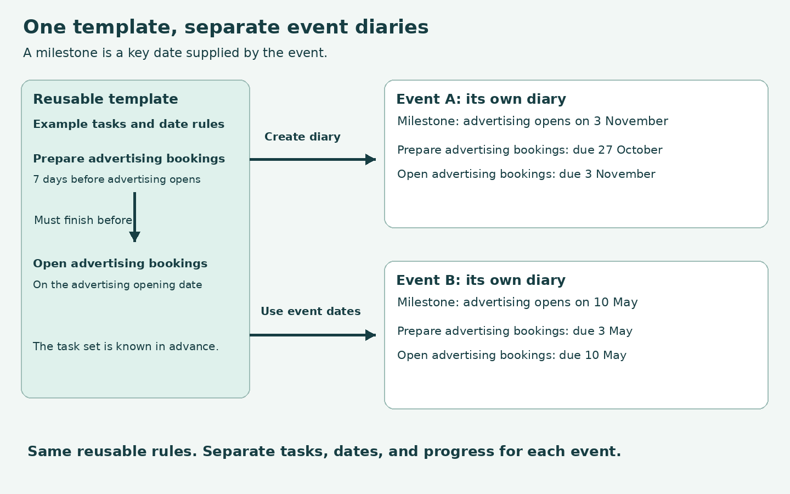
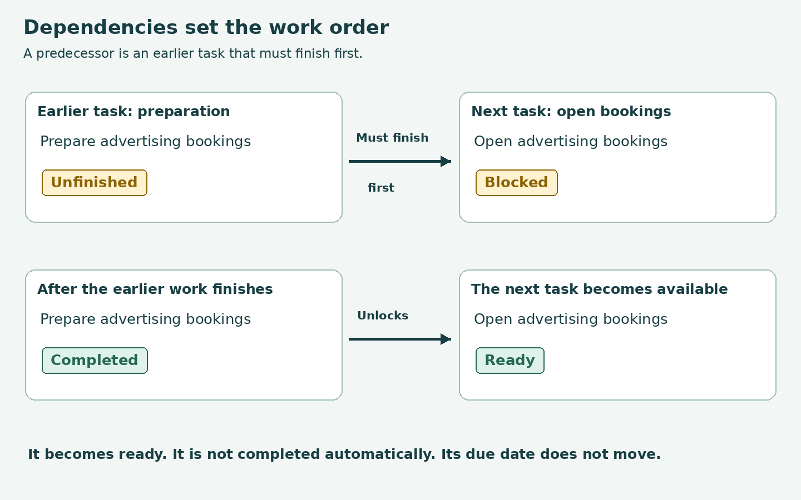
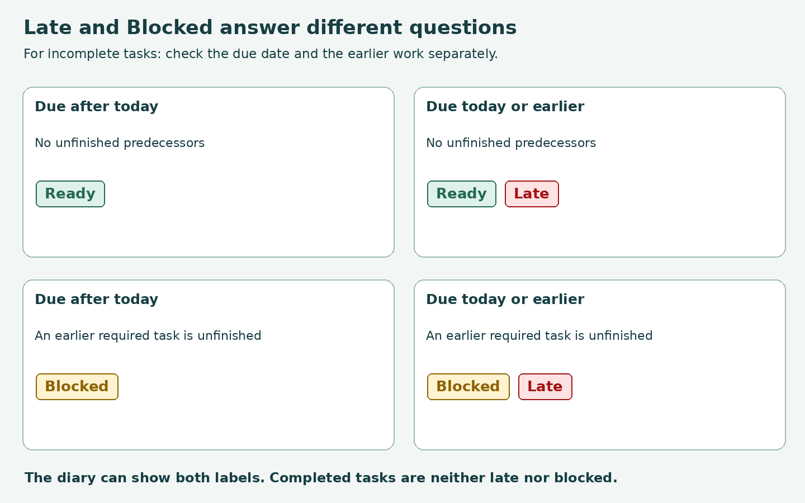

# Garage Sale Diary training

This training covers the Garage Sale Diary user and manager screens.
It uses actual browser interactions with the package UI and the normal Garage Sale page layout.

Open [the training video](../training/diary-training.mp4) in a video player.
Enable its English subtitle track when required.
[Download the complete bundle](../training/diary-training.zip) to share the video and supporting files.
Duration: 17 minutes 50 seconds. The video has 31 chapters.
[CHAPTERS.txt](../training/diary-0.1.5.1/CHAPTERS.txt) lists the chapter times.

[TRANSCRIPT.md](DIARY_TRAINING_TRANSCRIPT.md) contains the narration.
[diary-training.srt](../training/diary-0.1.5.1/diary-training.srt) and [diary-training.vtt](../training/diary-0.1.5.1/diary-training.vtt) contain separate caption files.
The narration uses the natural synthetic British English voice `en-GB-SoniaNeural`.
Orange outlines and pointer markers identify the controls used during the demonstration.
The video holds diagrams during explanations and shows each action result after its spoken instruction.

## Revised presentation

The opening diagrams explain templates, event milestone dates, dependencies, and the separate Ready, Blocked, and Late labels.
It names the destination page and the exact task during navigation.
Each task selection shows the task list before the named task and its button are highlighted.
Each control instruction has its own narration segment.
The resulting screen appears after that instruction finishes.
Definition sections use diagrams without filter interactions.
The visible titles, narration, and captions omit the package version.
Template creation and lifecycle details are outside this walkthrough.

## Coverage

- Templates, event milestones, calculated due dates, and dependencies between template tasks.
- My Diary for an ordinary user with late and upcoming activities.
- Personal filters, status counts, blocked tasks, and whole-team tasks.
- Private task creation, ownership, visibility, and date rules.
- Private-task limitations, including exclusion from dependency chains.
- Personal due-date changes and restrictions on template-task date edits.
- Progress notes on both template-generated tasks and private tasks, including author, time, and availability after completion.
- Normal completion, predecessors, blocking, and task progression.
- Manager filters, completed history, and late-task selection.
- Orphaned template tasks, their position in the list, and optional owner recovery.
- Manager date changes and person, ownership-group, or whole-team assignment choices.
- Manager task creation and the separate option for future template versions.
- Manager Close all, its effect on open predecessors, and completion history.

## Concept diagrams

The opening diagrams remain visible throughout their explanations. No filter actions occur during these definitions.

Late means an incomplete task is due today or earlier.
Blocked means an earlier required task is unfinished.
Ready means no required predecessor remains unfinished.
A task can display Ready and Late, or Blocked and Late, as separate labels.
Completed tasks are neither late nor blocked.

The private-task demonstration uses the default My Diary list, with blocked tasks hidden.
The personal task is Ready and has no open predecessors.
Notes apply to both template-generated tasks and private tasks.
Assigned users and managers can add notes under the normal task access rules.

Personal additions are private from other ordinary users. Diary Managers can inspect them within their permitted diary scope.
The demonstrated owner change uses orphan recovery. It does not imply unrestricted reassignment of every task.

## Demonstration data and verification

The recording uses the current example fixture `GarageSale/fixtures/diary_demo_template.json`.
The approved template name is `Garage Sale calendar`.
Demonstration milestone dates create a mixture of late and upcoming work.

One training template version assigns Close advertising bookings to a fictional person.
That person becomes inactive after diary creation, which produces an orphaned template task.
The other example task names and dependencies remain unchanged.
Additional fictional tasks demonstrate personal reminders and shared work.

Alex Green is the ordinary Diary User. Morgan Taylor is the Diary Manager.
Jamie Reed is the inactive original owner.
All three accounts are fictional and use addresses in `example.test`.

The recording uses the separate PostgreSQL test database `test_diary_training_video`.
The browser scenario checks saved notes, completion refusal, normal progression, orphan recovery, and forced completion history.
A separate browser check verifies private-task navigation with default filters and confirms that the task has no blockers.
The test database is removed after recording.
No application database, deployed service, or Diary package source is changed.

[production-manifest.json](../training/diary-0.1.5.1/production-manifest.json) records the version, demonstration dates, scene durations, and final task states.
The recording verifies these demonstrated interactions, not every Diary feature or deployment configuration.

## Language review

The reference is ASD-STE100, Issue 9.
The training materials have not received a full dictionary and technical-name review.
No claim of full ASD-STE100 compliance is made.

## Artifact location

The local video and captions are in `training/diary-0.1.5.1/`.
The project intentionally excludes the root `training/` directory from Git.
Transfer those media files separately when sharing the recording.
The guide, transcript, and concept diagrams remain in the repository.
