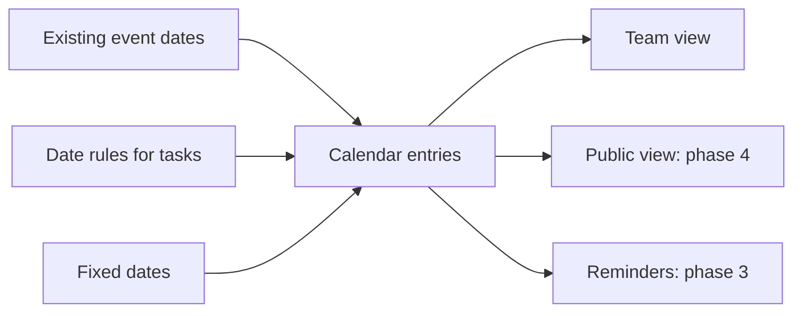
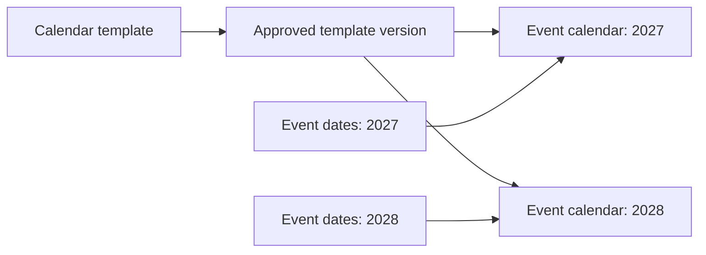
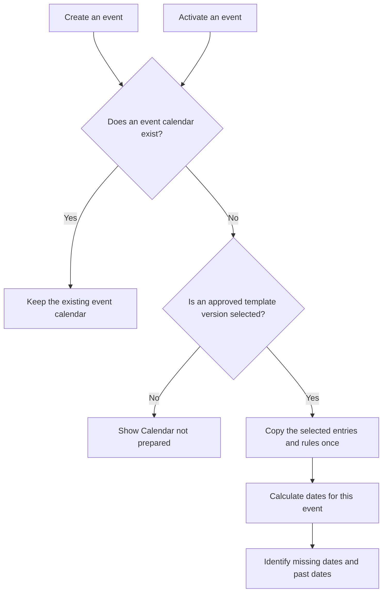
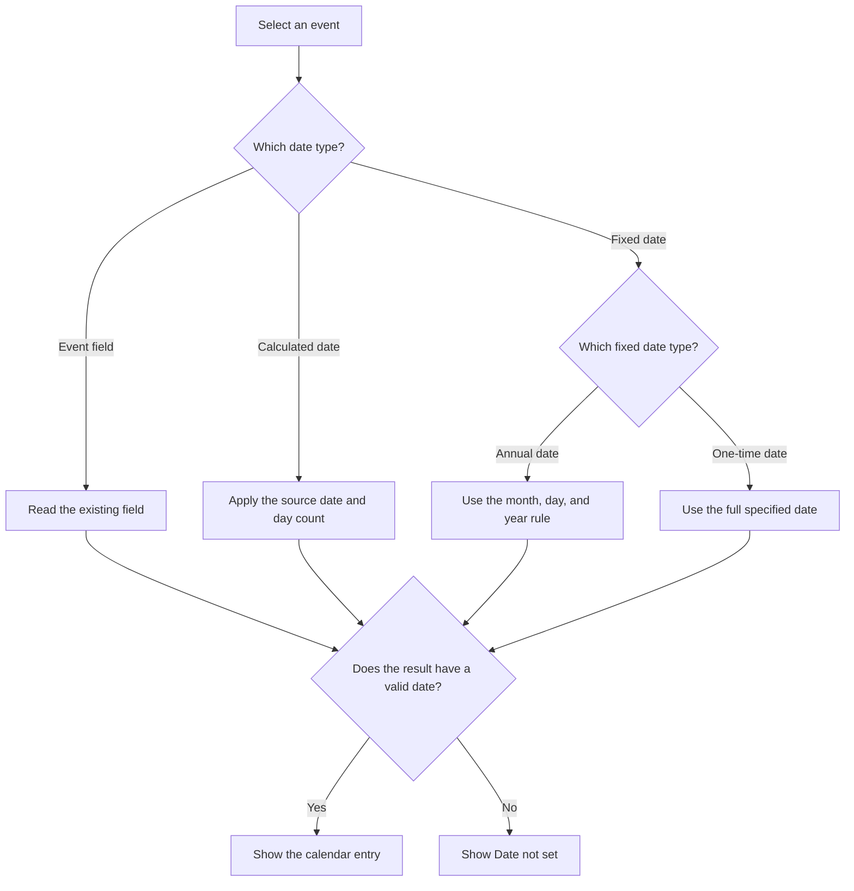
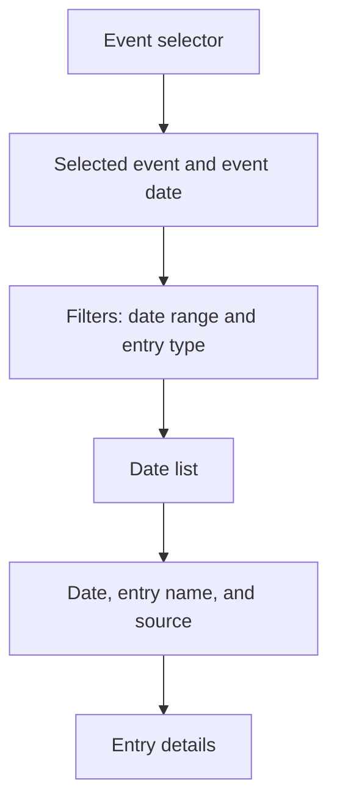
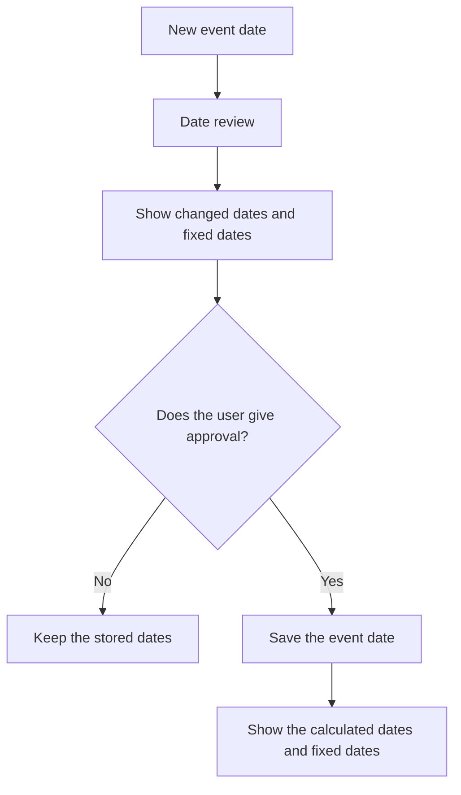
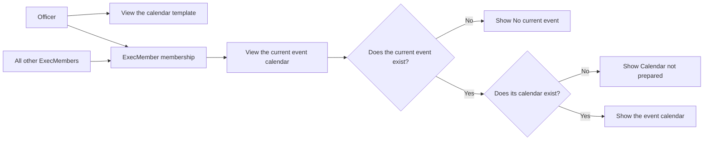
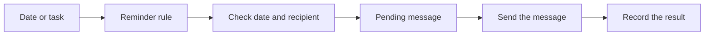

# Event calendar: design for discussion

Date: 2 November 2026.

Status: Draft with confirmed requirements.
Section 8 records the confirmed access requirements.
The other design proposals still need approval unless the text identifies a confirmed requirement.

Scope: Design documents only. This work does not change the application.

Language reference: ASD-STE100, Issue 9. Section 12 records the language review.

## 1. Purpose

The calendar shows important dates for each Garage Sale event.
It helps the team see what work is necessary before and after the event.

The first proposal is a calendar that the team can read.
The first version does not send messages or change booking controls.

The backlog includes this task list request.
The task list uses dates calculated from the event date.

The user confirmed that events generally occur in late June.
Some calendar entries have fixed dates.
The calendar must show fixed dates and calculated dates together.

The user confirmed that the basic calendar is common to different events.
A calendar template defines those common entries and their date rules.

The first calendar includes a team view.
Public access is an open decision.
Section 11 includes questions for the next discussion.

## 2. Technical names

These technical names have the same meaning throughout this document.
The names apply to the calendar system and the existing website.

| Technical name | Meaning |
| --- | --- |
| Event | One Garage Sale occasion. |
| Event date | The date on which the Garage Sale occurs. |
| Activation date | The date from which an event can become the current event. |
| Booking date | A date that starts or stops permission to make a booking. |
| Calendar | The website function that shows dates and tasks for an event. |
| Calendar entry | One item that the calendar shows. |
| Calendar template | The common entries and date rules for future event calendars. |
| Template version | An identified set of template entries that the team can approve. |
| Entry key | An identifier that stays the same for the same template entry across template versions. |
| Event calendar | The entries and date rules copied for one event from an approved template version. |
| Date rule | A calculation that gives the date for a calendar entry. |
| Fixed date | A specified date that does not use a day count from the event date. |
| Annual date | A fixed month and day with one occurrence in each applicable year. |
| One-time date | A full date that includes the year. It has no annual repetition. |
| Task | Work that a team member must do. |
| Due date | The date by which a task must be complete. |
| Task owner | The person who must do a task. |
| Reminder | A message that tells a person about a date or task. |
| Public view | Calendar information that a visitor can read without an account. |
| Team view | Calendar information for users with the applicable team permissions. |
| Officer | The existing `Officer` permission group in this project. |
| ExecMember | The existing `ExecMember` permission group in this project. |
| Current event | The event that the application supplies as `request.current_event`. |
| Date review | A comparison of old dates and proposed new dates. |
| PostgreSQL | The database system that this project uses in all environments. |

Exact field names, group names, and file names identify existing application items.
Mermaid is the diagram format in this document.

## 3. Existing information

The `EventData` model already keeps these dates.
The calendar must use these fields for the same dates.

| Existing field | Meaning in the calendar |
| --- | --- |
| `event_date` | The event date. |
| `use_from` | The activation date. |
| `open_sales_bookings` | The first date for sale bookings. |
| `close_sales_bookings` | The last date for sale bookings. |
| `open_billboard_bookings` | The first date for advertising board bookings. |
| `close_billboard_bookings` | The last date for advertising board bookings. |

The event date and the activation date have different functions.
The calendar must show different labels for these dates.

A missing field does not mean that a date has passed.
The calendar shows “Date not set” for a necessary date that has no value.

The repository contains different rules for selection of the current event.
The design does not select a new rule for the website.
An event selector lets the user select the event for the calendar display.

## 4. Three possible designs

| Alternative | First version | Main benefit | Main limit |
| --- | --- | --- | --- |
| A | Show the existing event dates. | The team can check dates in one place. | The calendar does not show tasks. |
| B | Show existing dates, fixed dates, and calculated task dates. | The team can see the work sequence. | The team cannot record task completion. |
| C | Add task owners, completion records, and reminders. | The team can control the work through the calendar. | More rules and permissions are necessary. |

Alternative B is the first proposal.
It agrees with the task list request in the backlog.
Alternative C can start after the team gives approval for the dates and tasks.

The public view must receive only approved public entries.
It must not receive private task details or contact data.

### Calendar template and event calendars

One calendar template defines the basic calendar across events.
Each event has its own event calendar.
The event calendar identifies the template version that supplied its entries.

The template keeps the entry names, descriptions, entry keys, and date rules.
An annual date keeps its month, day, and year rule.
A calculated date keeps its source field and day count.
An existing event field keeps its field reference.

The template does not keep calculated dates for a particular event year.
A one-time date belongs to one event calendar.
The system must not copy that date to every new event.

The event calendar copies the template entries and rules.
It reads the applicable dates from its own event.
Thus, a template change cannot silently change an existing event calendar.
An event date change still uses the copied rules to calculate dates again.

The read-only first version can keep these copies in PostgreSQL.
Task owners and completion records are additions for a subsequent phase.

### Creation and activation

The proposal creates the event calendar when the user creates the event.
The team can then see tasks before the activation date.
Some tasks can occur in the year before the event.

Activation must not create a second event calendar.
It must not reset entries or completed task records.
It must not give public access to private entries.

The activation check also covers events created before the calendar feature exists.
An event without a calendar needs a selected template version before the system can prepare its calendar.
The system must not select an unapproved template version as a substitute.

Repeated creation or activation requests must not add the same entry twice.
The event and entry key identify each copied entry.
The database must enforce that identity.

If a calculated date is already past, the calendar shows that condition.
It does not change the date or record the task as completed.
Calendar preparation does not send reminders for past dates.

### Template changes

A template change creates a new template version.
New events use a selected approved version.
Existing event calendars keep their copied entries and rules.

A user can apply a new template version to an existing event only after a date review.
That review must show added entries, removed entries, changed text, and changed rules.
The entry key connects each existing entry to the same entry in the new version.

The update must keep completed task records unchanged.
The user must give explicit approval before the update changes event-specific entries.
It must not repeat completed work or send the same reminder again.
The system must record the user, time, and selected template version for the update.

The first version does not need this update function.
The team can improve the template for future events without that function.

## 5. Date rules

Each calendar entry identifies its date type.
The date type can be an existing event field, a fixed date, or a calculated date.

Each calculated date has one source date and one day count.
The day count can be before or after the source date.

Existing booking dates use direct values from `EventData`.
The calendar does not calculate replacement values for these fields.

### Fixed dates

A fixed date can be an annual date or a one-time date.
An annual date repeats on the same month and day.
A one-time date includes its year.

For example, an annual task can occur on 1 March.
Its date does not move when the event moves from 20 June to 27 June in the same year.

The first proposal uses the event year for an annual date.
An annual date before the event year needs an explicit year rule.
For example, 1 December in the previous year uses the event year minus one.

The system must identify an annual date that does not exist in the selected year.
For example, 29 February does not exist in 2027.
The calendar shows “Date not set” until the team selects a permitted date rule.
It must not silently change the date to 28 February or 1 March.

### Example entries

| Example entry | Source | Rule | Example result |
| --- | --- | --- | --- |
| Event day | `event_date` | Use the stored date. | 27 June 2027 |
| Annual preparation task | Annual date | Use 1 March in the event year. | 1 March 2027 |
| Previous-year preparation task | Annual date | Use 1 December in the previous year. | 1 December 2026 |
| One-time team meeting | One-time date | Use the full specified date. | 12 May 2027 |
| Check advertising boards | Event date | Subtract 42 days. | 16 May 2027 |
| Check the location map | Event date | Subtract 7 days. | 20 June 2027 |
| Check the event records | Event date | Add 7 days. | 4 July 2027 |

These task names and dates are examples.
They are not agreed operating instructions.

The proposal uses calendar days for date rules.
They include weekends and public holidays.
Business days are a different alternative.
A different date rule with team approval is necessary.

Dates without times use the local date in `Europe/London`.
They do not represent midnight in UTC.
UTC is the time reference for message times in the database.

## 6. Page design

The default display is a date list.
The list works on a phone and shows long task names without small calendar cells.
A month display is an alternative for a subsequent version.

Each entry shows its date source.
For example, it can show “Event date minus 42 days”.
An annual entry can show “Fixed date: 1 March each year”.
A one-time entry shows its full date and “One-time date”.

The confirmed ExecMember view opens the calendar for `request.current_event`.
Access to other events is an open decision.
An event selector must show only events that the user has permission to view.
The page shows the selected event name at all times.
It does not silently change to the current event.

The page uses the existing team page styles.
Labels must explain each state without color alone.
The user must be able to use the keyboard for all actions.

## 7. Changes to an event date

A change to the event date changes dates that depend on it.
It does not change the booking dates or the activation date.
It does not change fixed dates within the same event year.

| Change | Calculated date | Annual date | One-time date |
| --- | --- | --- | --- |
| Event moves within the same year. | Calculate the date again. | Keep the same date. | Keep the same date. |
| Event moves to a different year. | Calculate the date again. | Use the new event year and the year rule. | Keep the full date. |

A change to the event year needs a date review for all entries.
An unchanged one-time date can be incorrect for the new event year.
The date review must identify that condition without an automatic date change.

The date review is part of the proposal for the event edit procedure.
It is not part of the present application.

In a subsequent version, a date change must keep completed task records unchanged.
The system must identify open tasks for a date review.

Cancellation of an event must stop future reminders.
It must keep the earlier records available to users with the applicable permissions.

## 8. Access

Calendar access must use the existing permission system.
An account or team membership alone does not give calendar access.

### Confirmed access requirements

The user confirmed these read permissions.

| User group | View the calendar template | View the calendar for the current event |
| --- | --- | --- |
| `Officer` | Yes. | Yes, through `ExecMember` membership. |
| `ExecMember` without `Officer` membership | No grant from this requirement. | Yes, for all members of the group. |

The existing access policy makes each Officer an ExecMember.
Thus, each Officer can also view the calendar for the current event.
Other group permissions must use the existing access policy or a subsequent explicit decision.

The template view shows its entries, date rules, and template version.
The current calendar view shows the entries for `request.current_event`.
The page must show the event name and event date.

Opening the view must not create a calendar or copy template entries.
The page must not substitute another event if the current event is absent.

### Server checks and other actions

The server must check the applicable permission on each request.
A hidden navigation item alone does not prevent access.
The same checks apply to direct page URLs, downloads, and calendar feeds.

The current calendar permission does not give access to another event through a changed event identifier.
The template permission does not give permission to change the template or approve a template version.
The calendar permission does not give permission to change tasks or send reminders.

Task changes and reminder controls must have their own access rules.
The design does not grant these additional rights.

The project access matrix must include the confirmed view permissions before implementation.
The template view and current calendar view need distinct permission checks.

If the public view is added, each entry needs an explicit public status.
An entry has a private status until a user with the applicable permissions gives approval for public access.
The server must apply this rule to pages, downloads, and calendar feeds.

## 9. Reminders: subsequent design

Reminders are a separate phase.
The first version does not send them.

The team must give approval for each recipient and message channel.
Email to the task owner is one possible channel.

Each reminder must have a record of the entry, recipient, and scheduled send time.
The system must use this record to prevent repeated messages.
The team must be able to see an email failure.
The system must limit the number of attempts to send that email again.
An accepted email does not prove receipt in the recipient's inbox.

If the service starts after a scheduled send time, a rule must control the missed reminder.
A completed task must stop subsequent reminders for that task.
A date change must cancel pending messages that use the old date.

## 10. Proposed phases

| Phase | Result | Decision before the next phase |
| --- | --- | --- |
| 1 | Template copies and a team date list with fixed dates and calculated dates. | Give approval for the template, creation step, and display. |
| 2 | Task owners and completion records in PostgreSQL. | Give approval for task states and permissions. |
| 3 | Reminders with send records. | Give approval for recipients, timing, retries, and message content. |
| 4 | Optional public view or calendar export. | Give approval for public data and update rules. |

These phases are proposals.
They do not give approval for implementation work.

## 11. Open decisions

1. Must a subsequent version include a public view as well as the confirmed team view?
2. Which tasks must appear before and after an event?
3. Can task dates use booking dates as well as the event date?
4. Must the first version record task completion?
5. Is a date list sufficient, or is a month display also necessary?
6. Is a date review necessary before the user saves a changed event date?
7. Which users can view other event calendars or change tasks?
8. Which people must receive reminders, and at which times?
9. Which entries have annual dates, and which have one-time dates?
10. Which annual entries occur in the year before the event?
11. Is event creation the correct step to copy the template, with activation as a check for an absent event calendar?
12. Who can change a calendar template and give approval for a template version?
13. Can an event calendar have extra entries or changes to template entries?
14. Must the first version apply new template versions to existing event calendars?

The first three questions give the next design step.

## 12. Language review

The author got the official Issue 9 PDF on 2 November 2026.
The review used its writing rules and dictionary.
The glossary identifies the necessary technical names.

The document uses short sentences, active voice, and consistent technical names.
The diagrams use the same names as the text.

Status: Draft language inspection.
A full inspection of word meanings and technical names is necessary.
This draft does not claim full ASD-STE100 compliance.

## 13. References

- [ASD-STE100, Issue 9](https://www.asd-ste100.org/assets/files/ASD-STE100_ISSUE9.pdf).
- [Existing event fields](../../GarageSale/models.py).
- [Original task list request](../../Future%20Feature%20List).
- [Current access policy](../../PERMISSION_ACCESS_MATRIX.md).
- [Deployment instructions](../../General%20Deployment%20Instructions).
