# Event calendar: design for discussion

Date: 2 November 2026.

Status: Draft with confirmed requirements.
Section 8 records the confirmed access and entry creation requirements.
Section 6 records the confirmed task owner requirement.
Section 4 records the separate Diary app requirement.
Section 6 also records the rule that excludes circular predecessor choices.
The other design proposals still need approval unless the text identifies a confirmed requirement.

Scope: Design and the initial Diary data layer.
The app, models, migrations, and callable API now exist.
The standalone task list template and its reusable fragment also exist.
The routed pages and event lifecycle connections still need implementation.

Language reference: ASD-STE100, Issue 9. Section 12 records the language review.

## 1. Purpose

The calendar shows important dates for each Garage Sale event.
It helps the team see what work is necessary before and after the event.

The calendar includes read access and the confirmed entry creation actions.
The first version does not send messages or change booking controls.

The backlog includes this task list request.
The task list uses dates calculated from the event date.

The user confirmed that events generally occur in late June.
Some calendar entries have fixed dates.
The calendar must show fixed dates and calculated dates together.

The user confirmed that the basic calendar is common to different events.
A calendar template defines those common entries and their date rules.

The first calendar includes a team view.
Public access is an open decision.
Section 11 includes questions for the next discussion.

## 2. Technical names

These technical names have the same meaning throughout this document.
The names apply to the calendar system and the existing website.

| Technical name | Meaning |
| --- | --- |
| Event | One Garage Sale occasion. |
| Event date | The date on which the Garage Sale occurs. |
| Activation date | The date from which an event can become the current event. |
| Booking date | A date that starts or stops permission to make a booking. |
| Calendar | The website function that shows dates and tasks for an event. |
| Calendar entry | One item that the calendar shows. |
| Diary | The separate Django app for calendar templates, event calendars, entries, and task dependencies. |
| Diary key | The UUID that the API returns for an event calendar. |
| Milestone | A named date definition that a template can use. |
| Milestone date | The value of a named milestone in one event calendar. |
| Actor | The trusted caller identity, group names, and permitted calendar keys supplied to the API. |
| Personal entry | A calendar entry that an ExecMember creates with themselves as its owner. |
| Calendar template | The common entries and date rules for future event calendars. |
| Template version | An identified set of template entries that the team can approve. |
| Entry key | An identifier that stays the same for the same template entry across template versions. |
| Event calendar | The entries and date rules copied for one event from an approved template version. |
| Date rule | A calculation that gives the date for a calendar entry. |
| Fixed date | A specified date that does not use a day count from the event date. |
| Annual date | A fixed month and day with one occurrence in each applicable year. |
| One-time date | A full date that includes the year. It has no annual repetition. |
| Task | Work that a team member must do. |
| Due date | The date by which a task must be complete. |
| Task owner | An optional person or role that must do a task for an event. |
| Owner type | The choice of a person, a role, or the whole team for a task. |
| Role owner | A selected project role whose members must do a task. |
| Whole-team task | A task for the whole team, with no selected person or role. |
| Predecessor | A task that must be completed before another task becomes ready. |
| Successor | A task that uses another task as a predecessor, directly or through other tasks. |
| Circular dependency | A chain of task dependencies that returns to its first task. |
| Reminder | A message that tells a person about a date or task. |
| Public view | Calendar information that a visitor can read without an account. |
| Team view | Calendar information for users with the applicable team permissions. |
| Officer | The existing `Officer` permission group in this project. |
| ExecMember | The existing `ExecMember` permission group in this project. |
| SponsorshipManager | The existing `SponsorshipManager` permission group in this project. |
| Current event | The event that the application supplies as `request.current_event`. |
| Date review | A comparison of old dates and proposed new dates. |
| PostgreSQL | The database system that this project uses in all environments. |

Exact field names, group names, and file names identify existing application items.
Mermaid is the diagram format in this document.

## 3. Existing information

The `EventData` model already keeps these dates.
The calling application supplies these dates through the Diary API when the template needs them.

| Existing field | Meaning in the calendar |
| --- | --- |
| `event_date` | The event date. |
| `use_from` | The activation date. |
| `open_sales_bookings` | The first date for sale bookings. |
| `close_sales_bookings` | The last date for sale bookings. |
| `open_billboard_bookings` | The first date for advertising board bookings. |
| `close_billboard_bookings` | The last date for advertising board bookings. |

The event date and the activation date have different functions.
The calendar must show different labels for these dates.

A missing field does not mean that a date has passed.
The calendar shows “Date not set” for a necessary date that has no value.

The repository contains different rules for selection of the current event.
The design does not select a new rule for the website.
An event selector lets the user select the event for the calendar display.

## 4. Three possible designs

### Separate Diary app: confirmed requirement

The user confirmed that the Diary needs a separate Django app.
The app name is `Diary`.
The initial app, models, migrations, and callable API implement the data layer.
Diary pages are a subsequent implementation step.

The Diary app owns calendar templates, template versions, event calendars, entries, and task dependencies.
It also owns the calendar pages and the applicable permission checks.
Completion records and reminder rules belong to Diary when those features are added.

Diary is independent of other project apps.
Its models have no foreign keys to event, user, or group models in other apps.
Its migration has no dependency on those apps.
Its API receives references and date values from the caller.

`GarageSale.EventData` is the source for this website's event dates and booking dates.
The host stores the returned Diary key in `EventData.diary_key`.
That field is a nullable UUID, not a foreign key.
The API does not import or change `EventData`.
The caller must save the returned key against the correct event.

Milestone dates in Diary are input values from the caller.
The caller must supply changed values through the API when the source dates change.
Diary uses those values to calculate task dates.

The caller supplies person references, role references, and current group membership.
Diary stores those references without a database link to another app.
It must not create another user list or role system.
All Diary database tables use PostgreSQL.

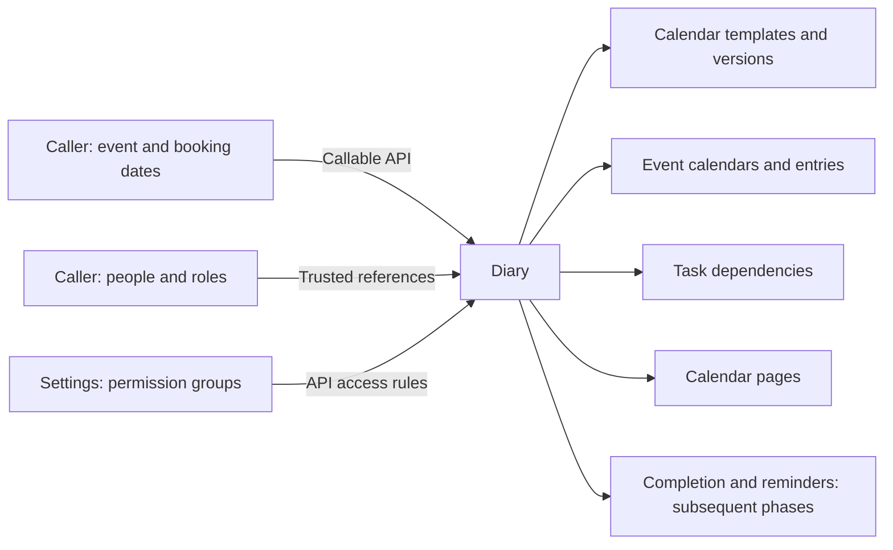

The API uses the permission group mapping in settings.
Diary must use the existing team page styles and navigation conventions.
The app must not change the rule that selects `request.current_event`.

### Callable API, milestones, and calendar keys

The user confirmed that Diary needs a formal callable API.
The API is `Diary.api`, version 1.
It is a Python interface, not an HTTP endpoint.

The caller can define multiple named milestones.
For example, `add_board_bookings_open` identifies the date on which advertising board bookings open.
A milestone has a stable name and a human-readable label.
Each event calendar has its own milestone date values.

The template can use a milestone directly or apply a day count to it.
For example, a task can be due 42 days after `add_board_bookings_open`.
The task rule uses that milestone and a day count of positive 42.

`required_milestones` enumerates the milestones used by a selected template version.
It returns each milestone once, with its name and label.
It excludes milestones used only by other template versions.
Annual dates and one-time dates do not add a milestone requirement.

`DIARY_TEMPLATE_NAME` selects the default template by name in settings.
The API uses that template's highest approved version when the caller does not select a version.
A changed setting affects new calendars, not existing calendars.
This permits reuse of Diary with a different template in another application.
The API reports an error if the configured template has no approved version.

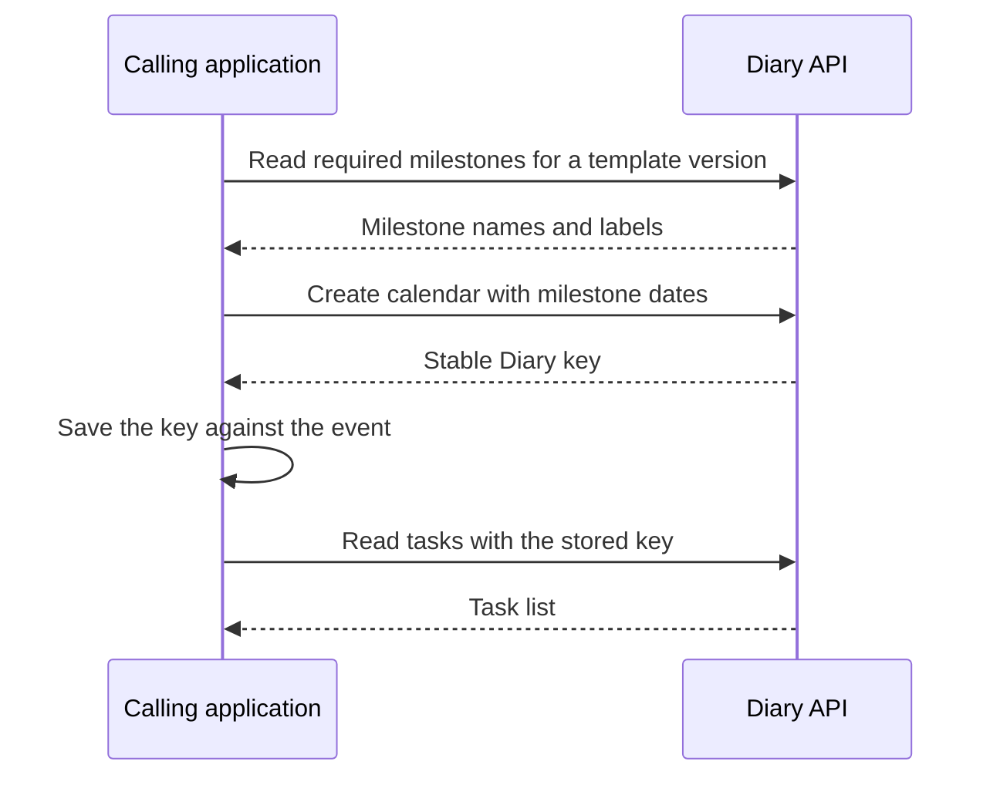

Repeated creation with the same event reference and the same inputs returns the same key.
Different inputs for that reference need an explicit update through the API.

`DIARY_PERMISSION_GROUPS` defines the groups for use, view, edit, and template view actions.
The host currently uses ExecMember and Officer for use and view actions.
It uses Officer for edit and template view actions.
The API denies an action if its group mapping is absent.

The caller must supply a trusted Actor from its authenticated identity system.
It must not accept Actor group names or permitted keys from an untrusted request body.
The API limits calendar access to the keys in that Actor.
See [the callable API guide](../../Diary/README.md) for exact signatures and examples.

### Calendar functions

| Alternative | First version | Main benefit | Main limit |
| --- | --- | --- | --- |
| A | Show the existing event dates. | The team can check dates in one place. | The calendar does not show tasks. |
| B | Show dates and task owners. Include the confirmed entry creation actions. | The team can see the work sequence and add entries. | The team cannot record task completion. |
| C | Add task changes, completion records, and reminders. | The team can control the work through the calendar. | More rules and permissions are necessary. |

Alternative B is the first proposal.
It agrees with the task list request in the backlog.
Alternative C can start after the team gives approval for the dates and tasks.

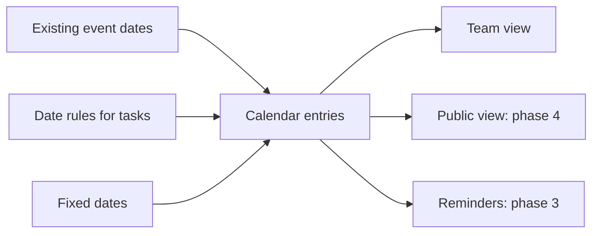

The public view must receive only approved public entries.
It must not receive private task details or contact data.

### Calendar template and event calendars

One calendar template defines the basic calendar across events.
Each event has its own event calendar.
The event calendar identifies the template version that supplied its entries.

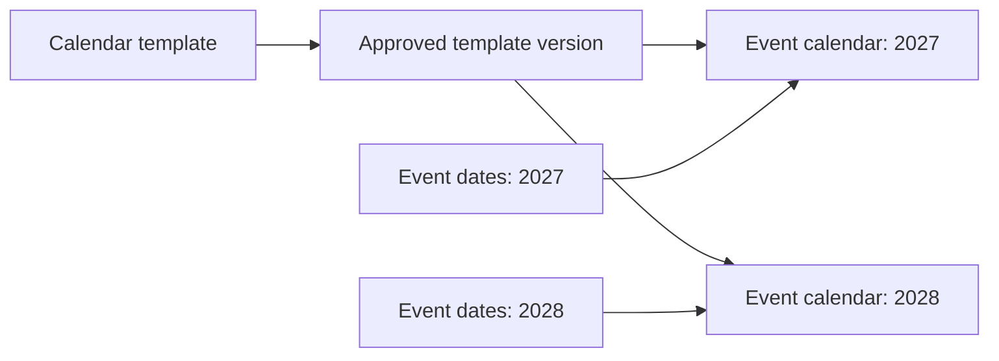

The template keeps the entry names, descriptions, entry keys, and date rules.
An annual date keeps its month, day, and year rule.
A calculated date keeps its milestone reference and day count.
A source date entry keeps its milestone reference.

The template does not keep calculated dates for a particular event year.
A one-time date belongs to one event calendar.
The system must not copy that date to every new event.

The event calendar copies the template entries and rules.
It reads the applicable dates from its own event.
Thus, a template change cannot silently change an existing event calendar.
An event date change still uses the copied rules to calculate dates again.

The first version can keep these copies in PostgreSQL.
Each task can have an optional task owner.
Section 8 defines the entry creation actions.
Other task changes and completion records are additions for a subsequent phase.

### Creation and activation

The proposal creates the event calendar when the user creates the event.
The team can then see tasks before the activation date.
Some tasks can occur in the year before the event.

Activation must not create a second event calendar.
It must not reset entries or completed task records.
It must not give public access to private entries.

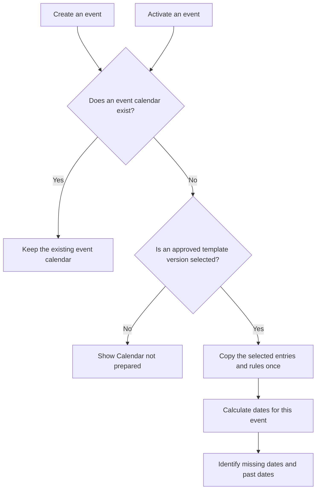

The activation check also covers events created before the calendar feature exists.
An event without a calendar needs a selected template version before the system can prepare its calendar.
The system must not select an unapproved template version as a substitute.

Repeated creation or activation requests must not add the same entry twice.
The event and entry key identify each copied entry.
The database must enforce that identity.

If a calculated date is already past, the calendar shows that condition.
It does not change the date or record the task as completed.
Calendar preparation does not send reminders for past dates.

### Template changes

A template change creates a new template version.
New events use a selected approved version.
Existing event calendars keep their copied entries and rules.

A user can apply a new template version to an existing event only after a date review.
That review must show added entries, removed entries, changed text, and changed rules.
The entry key connects each existing entry to the same entry in the new version.

The update must keep completed task records unchanged.
The user must give explicit approval before the update changes event-specific entries.
It must not repeat completed work or send the same reminder again.
The system must record the user, time, and selected template version for the update.

The first version does not need this update function.
The team can improve the template for future events without that function.

## 5. Date rules

Each calendar entry identifies its date type.
The date type can be an existing event field, a fixed date, or a calculated date.

Each calculated date has one source date and one day count.
The day count can be before or after the source date.

Existing booking dates use direct values from `EventData`.
The caller supplies those values as named milestone dates.
The calendar does not calculate replacement values for the external fields.

### Fixed dates

A fixed date can be an annual date or a one-time date.
An annual date repeats on the same month and day.
A one-time date includes its year.

For example, an annual task can occur on 1 March.
Its date does not move when the event moves from 20 June to 27 June in the same year.

The first proposal uses the event year for an annual date.
An annual date before the event year needs an explicit year rule.
For example, 1 December in the previous year uses the event year minus one.

The system must identify an annual date that does not exist in the selected year.
For example, 29 February does not exist in 2027.
The calendar shows “Date not set” until the team selects a permitted date rule.
It must not silently change the date to 28 February or 1 March.

### Example entries

| Example entry | Source | Rule | Example result |
| --- | --- | --- | --- |
| Event day | `event_date` | Use the stored date. | 27 June 2027 |
| Annual preparation task | Annual date | Use 1 March in the event year. | 1 March 2027 |
| Previous-year preparation task | Annual date | Use 1 December in the previous year. | 1 December 2026 |
| One-time team meeting | One-time date | Use the full specified date. | 12 May 2027 |
| Check advertising boards | Event date | Subtract 42 days. | 16 May 2027 |
| Check the location map | Event date | Subtract 7 days. | 20 June 2027 |
| Check the event records | Event date | Add 7 days. | 4 July 2027 |

These task names and dates are examples.
They are not agreed operating instructions.

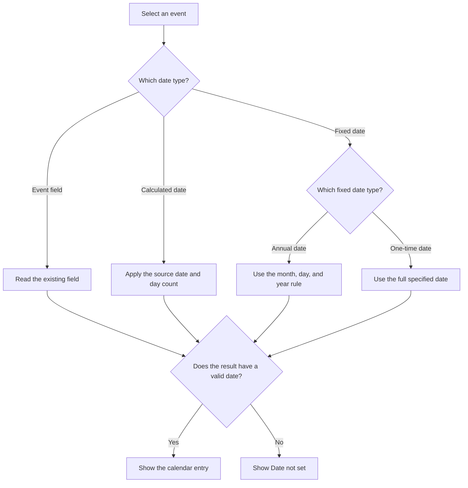

The proposal uses calendar days for date rules.
They include weekends and public holidays.
Business days are a different alternative.
A different date rule with team approval is necessary.

Dates without times use the local date in `Europe/London`.
They do not represent midnight in UTC.
UTC is the time reference for message times in the database.

## 6. Page design

The default display is a date list.
The list works on a phone and shows long task names without small calendar cells.
A month display is an alternative for a subsequent version.

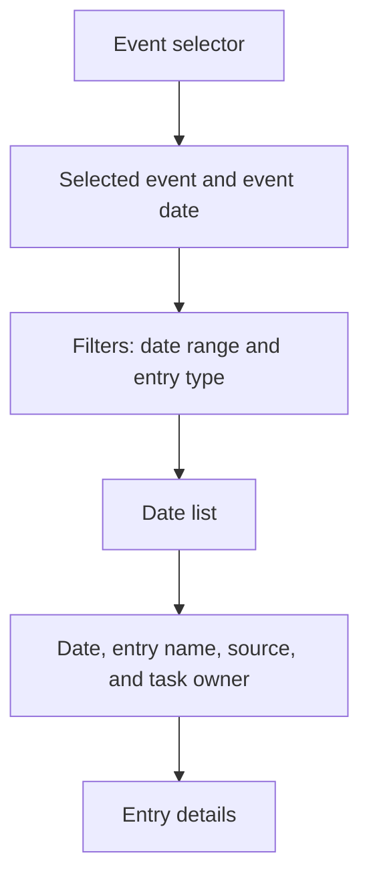

Each entry shows its date source.
For example, it can show “Event date minus 42 days”.
An annual entry can show “Fixed date: 1 March each year”.
A one-time entry shows its full date and “One-time date”.

The confirmed ExecMember view opens the calendar for `request.current_event`.
Access to other events is an open decision.
An event selector must show only events that the user has permission to view.
The page shows the selected event name at all times.
It does not silently change to the current event.

The page uses the existing team page styles.
Labels must explain each state without color alone.
The user must be able to use the keyboard for all actions.

### Task owners: confirmed requirement

The user confirmed that a task can have an optional task owner.
The task owner can be a specific ExecMember or a role.
A role owner includes all members of the selected role.
A task without a selected person or role is for the whole team.

| Owner type | Meaning | Display label |
| --- | --- | --- |
| Person | One selected ExecMember must do the task. | Show the person's name. |
| Role | All members of the selected role must do the task. | Show the role name, for example, “All SponsorshipManagers”. |
| Whole team | The task has no selected person or role. The task is for the whole team. | Show “Whole team”. |

Each task has one owner type at a time.
A person-owned task has one selected ExecMember and no selected role.
A role-owned task has one selected role and no selected person.
A whole-team task has neither selection.
An absent person does not mean “Whole team” when the task has a role owner.

The calendar must not show a whole-team task as an incorrect or missing owner.
The task date does not change when its task owner changes.
Task ownership does not grant permission to change a task or record its completion.
Section 8 defines the confirmed view permissions.
The permission to change tasks is an open decision.

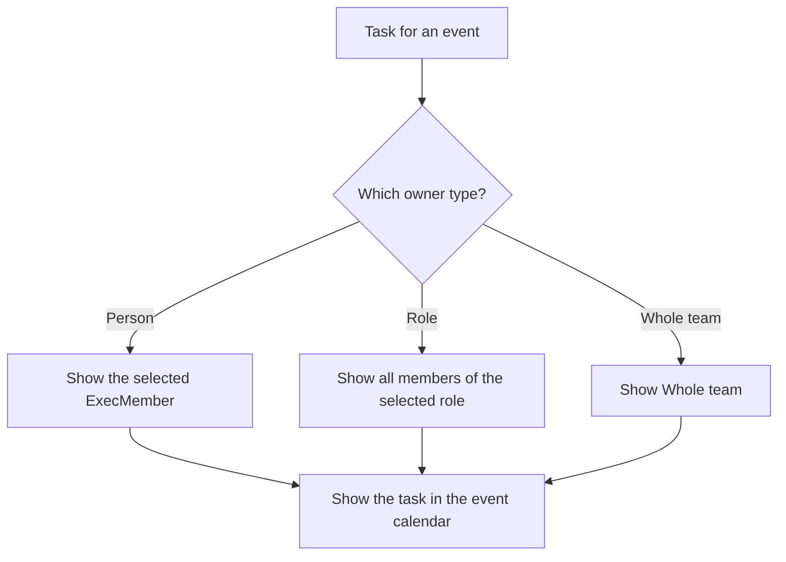

The optional owner belongs to the task in its event calendar.
Different events can have different owners for the same template task.
The template rule for an initial task owner is an open decision.
It can identify a person, identify a role, or leave the task for the whole team.

### Role membership and access

The proposal keeps the role reference in the task.
It does not replace the role with a fixed list of people when the calendar is created.
The calendar shows the current role members.
Thus, a new SponsorshipManager becomes a task owner through role membership.
A person outside that role is not a task owner through that role.

The system must identify a selected role with no current members.
The display must show “No role members” with the role name.
It must not change that task into a whole-team task.

Some role members are not ExecMembers.
Role ownership does not grant calendar access or task change permissions.
Calendar access for role members outside ExecMember is an open decision.

If a selected person leaves ExecMember, the system must identify their open tasks for review.
The system must not silently change those tasks into whole-team tasks.
The rule for that change needs approval before implementation.
Whether each role member must confirm task completion is also an open decision.

### Diary pages and dashboard section

An [interactive UI mock-up](../../Diary/design/ui/index.html) shows the main Diary pages with sample data.
Its [review guide](../../Diary/design/ui/README.md) includes page descriptions and example workflows.
This preview has no Garage Sale integration or database writes.

The user confirmed that Diary owns all calendar UI except the dashboard summary.
Its pages include the personal task view, template editor, event calendar, and task completion actions.
The app must use the callable API for those actions.

Diary includes a default base template and a namespaced stylesheet.
Each Diary page must be a complete browser view through that base template.
Its reusable content belongs in a fragment that a host can include in its own page.
The host must not include a complete Diary document inside another HTML document.
The host can override them through Django's normal template loaders and static file finders.
Every visible component, content role, form control, and state must have a stable, descriptive class.
Those classes are the public styling interface and use the `diary-` prefix.
Host overrides must not depend on IDs, text values, element positions, or specific HTML tags.
Diary must not use inline style attributes for presentation.
The styling guide must document the classes and any changes to their names.
An extra stylesheet can change the default CSS variables without replacing the complete stylesheet.
The API guide includes search-order examples and deployment checks for these overrides.
`DIARY_TEMPLATE_NAME` selects calendar data, not the HTML base template.

The personal view includes tasks assigned to the user and tasks assigned to any role that includes that user.
The user confirmed that this personal view is the default page for a logged-in user.
The default must not include tasks owned only by other people or other roles.
`personal_tasks` supplies that list for one Diary key.
The caller supplies the current role memberships through the Actor.
Whole-team tasks can appear through an explicit list option.
The full event calendar remains an explicit navigation choice for users with calendar view permission.

The dashboard has an active tasks section only when the Diary app is enabled.
The dashboard must test app availability before it imports the Diary API.
If Diary is disabled, the dashboard does not show the section or call its API.
The dashboard uses the current event's stored Diary key.
It shows clickable Late and Ready counts for the current user, not an embedded task list.
Each count opens the matching filter in the personal Diary view.
An [interactive dashboard mock-up](../../Diary/design/dashboard/index.html) demonstrates that presentation.

`personal_tasks` returns the user's open tasks for that key, including tasks owned by their roles.
The dashboard counts ready tasks and late tasks from that result.
The counts exclude whole-team tasks and completed tasks.
Each result identifies whether the task is ready or blocked.
A separate result value identifies lateness.
These values are calculations, not database flags.

A task is late when its due date is today or earlier and the task is not completed.
A blocked task can also be late.
A task with no due date shows “Date not set” and is not late.
Date comparisons use the Diary time zone in settings.

Completed tasks do not contribute to either count.
The API keeps their completion records and their due dates at completion.
The dashboard must show an explicit empty state when the event has no Diary key.
A zero count links to the corresponding empty personal task list.

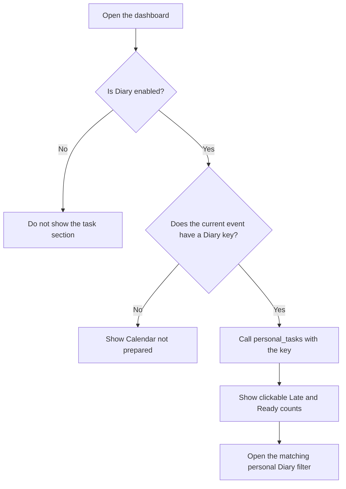

### Predecessor editor

The dependency feature is a design proposal.
The user confirmed that the predecessor selector must exclude choices that create circular dependencies.
The editor must prevent those choices before save.

Each task has a human-readable name and a stable entry key.
The proposal requires a unique task name within its template version or event calendar.
Dependencies use the entry key, so a name change does not break a link.
Each task can have zero or more predecessors.

The first editor proposal uses a task list and a details form.
The form has a searchable predecessor list with checkboxes.
Selected predecessors stay visible when the search changes.
The form also shows the tasks that use this task as a predecessor.
A read-only diagram is an additional inspection aid.
A graphical connection editor is not necessary for the first version.

When the user edits a task, the selector must exclude these choices:

- The task itself.
- Every direct successor of the task.
- Every indirect successor of the task.
- Tasks from another template version or event calendar.

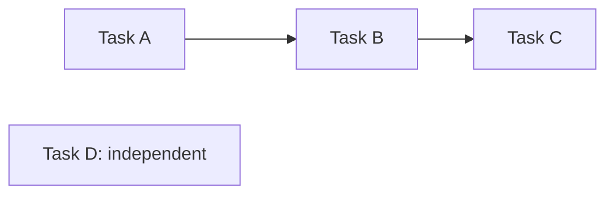

An arrow means that the first task is a predecessor of the next task.
When the user edits Task A, the selector excludes Task A, Task B, and Task C.
Task D is an available predecessor choice.
When the user edits Task C, Task A and Task B are available choices.

The selector must calculate available choices again after a dependency change.
It must use the proposed links in the form, including changes that the user did not save yet.
It must not show invalid choices with only a warning.

The server must also examine all dependencies before save.
An old form or a direct request must not create a circular dependency.
Concurrent saves must not combine into a circular dependency.
The proposal serializes dependency changes within the affected template version or event calendar.
If another edit makes a selection invalid, the server rejects the save and supplies an updated list.

Task readiness, completion rules, and Officer overrides still need approval.
Dependency editing does not change due dates automatically.

## 7. Changes to an event date

A change to the event date changes dates that depend on it.
It does not change the booking dates or the activation date.
It does not change fixed dates within the same event year.

| Change | Calculated date | Annual date | One-time date |
| --- | --- | --- | --- |
| Event moves within the same year. | Calculate the date again. | Keep the same date. | Keep the same date. |
| Event moves to a different year. | Calculate the date again. | Use the new event year and the year rule. | Keep the full date. |

A change to the event year needs a date review for all entries.
An unchanged one-time date can be incorrect for the new event year.
The date review must identify that condition without an automatic date change.

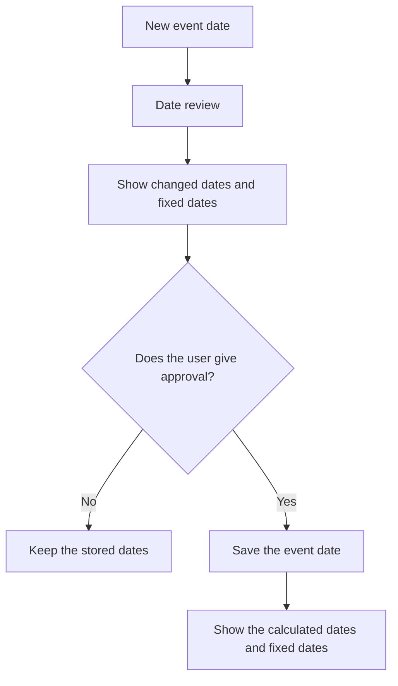

The date review is part of the proposal for the event edit procedure.
It is not part of the present application.

In a subsequent version, a date change must keep completed task records unchanged.
The system must identify open tasks for a date review.

Cancellation of an event must stop future reminders.
It must keep the earlier records available to users with the applicable permissions.

## 8. Access

Calendar access must use the configured Diary permission groups and trusted caller identity.
An account or team membership alone does not give calendar access.

### Confirmed access requirements

The user confirmed these read permissions.

| User group | View the calendar template | View the calendar for the current event |
| --- | --- | --- |
| `Officer` | Yes. | Yes, through `ExecMember` membership. |
| `ExecMember` without `Officer` membership | No grant from this requirement. | Yes, for all members of the group. |

The existing access policy makes each Officer an ExecMember.
Thus, each Officer can also view the calendar for the current event.
Other group permissions must use the existing access policy or a subsequent explicit decision.

The template view shows its entries, date rules, and template version.
The current calendar view shows the entries for `request.current_event`.
The page must show the event name and event date.

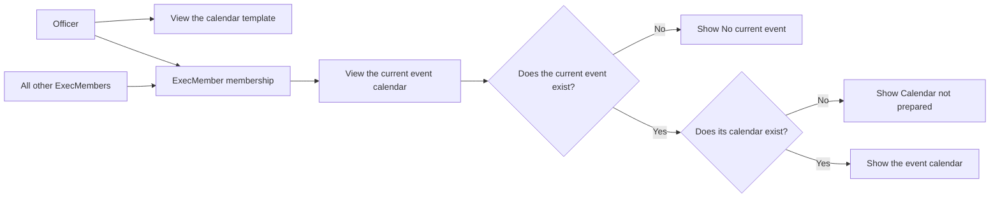

Opening the view must not create a calendar or copy template entries.
The page must not substitute another event if the current event is absent.

### Entry creation: confirmed requirements

The user confirmed these entry creation permissions.
They apply to the calendar for the current event.

| Action | ExecMember without Officer membership | Officer |
| --- | --- | --- |
| Add a personal entry for themselves. | Yes. | Yes, through ExecMember membership. |
| Add an entry for a specific person. | Only for themselves. | Yes. |
| Add an entry for all members of a selected user role. | No grant. | Yes. |
| Also add the new entry to the template for future events. | No grant. | Yes. |

The server sets the owner of an ExecMember's personal entry to that ExecMember.
The user cannot select another person or role through the personal entry action.
The server must enforce this rule if a request contains another owner identifier.

An Officer can select a specific person or a user role for the new entry.
The existing person ownership rule uses a selected ExecMember.
Role ownership includes all members of the selected role.

The Officer form includes an “Add to template for future events” choice.
That choice is off initially.
If the Officer selects it, the save adds the entry to this event calendar and to a new template version.
Without that choice, the save adds the entry only to this event calendar.

The template addition must keep a reusable date rule.
A one-time date needs an annual date rule or calculated date rule before the entry can become a recurring template entry.
The form must show the future date rule and owner choice before save.
It must not change an exact date into an annual date without the Officer's selection.

The new template entry must have an entry key.
The current event entry must identify that key when the Officer also adds it to the template.
The save must not create a second current event entry from the template addition.
Other existing event calendars must stay unchanged.

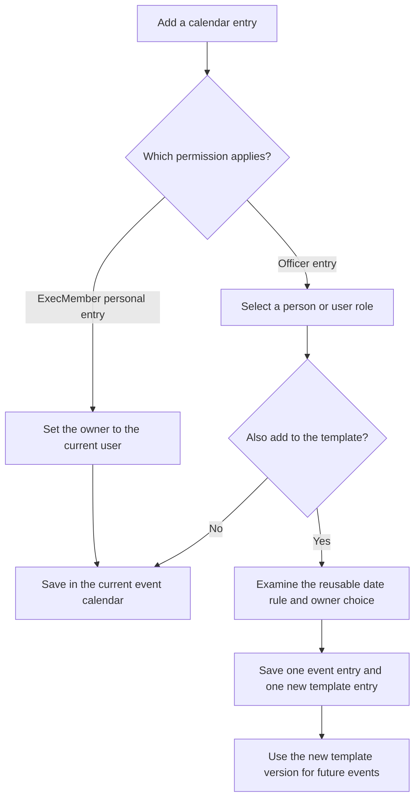

The save must prevent repeated requests from adding the same entry twice.
If the template addition fails, the system must not report a successful combined save.
The proposal saves both additions in one database transaction.

Personal ownership does not by itself define private visibility.
The visibility of personal entries is an open decision.
The permission to add an entry does not settle permission to edit, delete, or complete it.

### Server checks and other actions

The server must check the applicable permission on each request.
A hidden navigation item alone does not prevent access.
The same checks apply to direct page URLs, downloads, and calendar feeds.

The current calendar permission does not give access to another event through a changed event identifier.
The template view permission does not give permission to change the template or approve a template version.
The Officer entry creation permission includes the template addition defined above.
Other template changes and version approval rules are open decisions.
The calendar view permission does not give permission to change tasks or send reminders.

The confirmed entry creation actions need their own permission checks.
Other task changes and reminder controls must also have their own access rules.
The design does not grant those additional rights.

The host configuration must preserve the confirmed view and entry creation rules.
The template view and current calendar view need distinct permission checks.

If the public view is added, each entry needs an explicit public status.
An entry has a private status until a user with the applicable permissions gives approval for public access.
The server must apply this rule to pages, downloads, and calendar feeds.

## 9. Reminders: subsequent design

Reminders are a separate phase.
The first version does not send them.

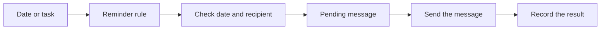

The team must give approval for each recipient and message channel.
Email to the task owner is one possible channel.
For a person-owned task, the recipient is the selected ExecMember.
For a role-owned task, the proposal uses all current members of the selected role.
The system must identify the recipients when it prepares the reminder.
The send record must keep the actual recipients after a role membership change.
Whole-team tasks have no individual task owner for that channel.
The recipient rule for whole-team reminders is an open decision.
An absent owner must not automatically cause an email to every team member.

Each reminder must have a record of the entry, recipient, and scheduled send time.
The system must use this record to prevent repeated messages.
The team must be able to see an email failure.
The system must limit the number of attempts to send that email again.
An accepted email does not prove receipt in the recipient's inbox.

If the service starts after a scheduled send time, a rule must control the missed reminder.
A completed task must stop subsequent reminders for that task.
A date change must cancel pending messages that use the old date.

## 10. Proposed phases

| Phase | Result | Decision before the next phase |
| --- | --- | --- |
| 1 | Template copies, the team date list, optional task owners, and the confirmed entry creation actions. | Give approval for the template, creation step, and display. |
| 2 | Other task changes and completion records in PostgreSQL. | Give approval for task states and permissions. |
| 3 | Reminders with send records. | Give approval for recipients, timing, retries, and message content. |
| 4 | Optional public view or calendar export. | Give approval for public data and update rules. |

These phases are proposals.
They do not give approval for implementation work.

## 11. Open decisions

1. Must a subsequent version include a public view as well as the confirmed team view?
2. Which tasks must appear before and after an event?
3. Can task dates use booking dates as well as the event date?
4. Must the first version record task completion?
5. Is a date list sufficient, or is a month display also necessary?
6. Is a date review necessary before the user saves a changed event date?
7. Which users can view other event calendars or change tasks?
8. Which people must receive reminders, and at which times?
9. Which entries have annual dates, and which have one-time dates?
10. Which annual entries occur in the year before the event?
11. Is event creation the correct step to copy the template, with activation as a check for an absent event calendar?
12. Beyond Officer additions, who can change a calendar template and give approval for a template version?
13. Who can change entries copied from the template?
14. Must the first version apply new template versions to existing event calendars?
15. Must a template identify an initial owner by person or role, or leave that choice to each event?
16. Who can change a task owner or complete a role-owned or whole-team task?
17. Who must receive reminders for whole-team tasks?
18. Can role members outside ExecMember view tasks that their role owns?
19. Does a role-owned task need one completion record or confirmation from every role member?
20. Are personal entries visible to all ExecMembers, or only to the owner and permitted Officers?
21. Does an Officer's template addition approve its new version, or is a separate approval step necessary?
22. Must dependencies prevent completion, or only identify tasks that are not ready?
23. Can Officers override a dependency, and what record must that action create?

The first three questions give the next design step.

## 12. Language review

The author got the official Issue 9 PDF on 2 November 2026.
The review used its writing rules and dictionary.
The glossary identifies the necessary technical names.

The document uses short sentences, active voice, and consistent technical names.
The diagrams use the same names as the text.

Status: Draft language inspection.
A full inspection of word meanings and technical names is necessary.
This draft does not claim full ASD-STE100 compliance.

## 13. References

- [ASD-STE100, Issue 9](https://www.asd-ste100.org/assets/files/ASD-STE100_ISSUE9.pdf).
- [Existing event fields](../../GarageSale/models.py).
- [Original task list request](../../Future%20Feature%20List).
- [Current access policy](../../PERMISSION_ACCESS_MATRIX.md).
- [Deployment instructions](../../General%20Deployment%20Instructions).
