# Event calendar: design for discussion

Date: 2 November 2026.

Status: Draft with confirmed requirements.
Section 8 records the confirmed access and entry creation requirements.
Section 9 records the confirmed startup and ownership validation requirements.
Section 6 records the confirmed task owner requirement.
Section 6 also records the confirmed first-release requirement for task progress and completion.
Section 4 records the separate Diary app requirement.
Section 6 also records the rule that excludes circular predecessor choices.
The other design proposals still need approval unless the text identifies a confirmed requirement.

Scope: Design and the initial Diary data layer.
The app, models, migrations, and callable API now exist.
The standalone task list template and its reusable fragment also exist.
The routed pages and event lifecycle connections still need implementation.
The [Diary V1 checklist](../../Diary/TODO_V1.md) tracks implemented components and each remaining V1 item.

Language reference: ASD-STE100, Issue 9. Section 13 records the language review.

## 1. Purpose

Diary provides a generic capability to store and display an event diary.
The selection of template tasks is outside the feature definition.
Template content is application data, not a requirement for implementation of the feature.

The calendar shows important dates for each Garage Sale event.
It helps the team see what work is necessary before and after the event.

The calendar includes read access and the confirmed entry creation actions.
The first version does not send messages or change booking controls.

The backlog includes this task list request.
The task list uses dates calculated from the event date.

The user confirmed that events generally occur in late June.
Some calendar entries have fixed dates.
The calendar must show fixed dates and calculated dates together.

The user confirmed that the basic calendar is common to different events.
A calendar template defines those common entries and their date rules.

Diary is for configured DiaryUsers and DiaryManagers who have actions to complete for a successful event.
For Garage Sale, these roles use the ExecMember and Officer groups defined in `settings.py`.
The user confirmed that Diary has no public view.
Section 12 includes questions for the next discussion.

## 2. Technical names

These technical names have the same meaning throughout this document.
The list defines Diary concepts, roles, and interface names.
Host applications define their own business terms and group mappings in their integration documents.

| Technical name | Meaning |
| --- | --- |
| Calendar | The Diary view that shows dated entries and tasks. |
| Calendar entry | One item that the calendar shows. |
| Diary | The reusable Django app for templates, diary instances, entries, and task dependencies. |
| Diary instance | The entries and date rules created from an approved template version, with their own milestone values and task records. |
| Diary key | The UUID that identifies a diary instance through the API. |
| Diary name | The required name of a diary instance, displayed as its heading and task group label. |
| Milestone | A named date definition that a template can use. |
| Milestone date | The caller-supplied value of a named milestone in one diary instance. |
| Actor | The trusted caller identity, group names, and permitted Diary keys supplied to the API. |
| DiaryAPI | The callable API class that holds caller context and provides factories and shared services. |
| DiaryInstance | The callable API reference to one diary instance, identified by its key. |
| DiaryTemplate | The callable API reference to one named calendar template. |
| DiaryTemplateVersion | The callable API reference to one template version and its entry operations. |
| API factory | A method that creates or looks up a Diary API reference. |
| Personal entry | A calendar entry that a DiaryUser creates with themselves as its owner. |
| Calendar template | The reusable entries and date rules used to create diary instances. |
| Template version | An identified set of entries and rules within a calendar template. |
| Entry key | An identifier that stays the same for the same template entry across template versions. |
| Date rule | A calculation that gives the date for a calendar entry. |
| Fixed date | An annual or one-time date that does not depend on a milestone date. |
| Annual date | A fixed month and day that selects one occurrence after diary creation, with an optional year offset. |
| One-time date | A full date that includes the year. It has no annual repetition. |
| Task | Work recorded in a diary instance that a user can progress to completion. |
| Due date | The date by which a task must be complete. |
| Task owner | The selected person or role responsible for a task, when a specific owner is assigned. |
| Owner type | The choice of a person, a role, or the whole team for a task. |
| Task ownership role | A configured role permitted to own tasks through `DIARY_TASK_OWNER_ROLES`. |
| Role owner | A selected task ownership role whose current members are associated with the task. |
| Whole-team task | A task with no selected person or ownership role. |
| Predecessor | A task that must be completed before another task becomes ready. |
| Successor | A task that uses another task as a predecessor, directly or through other tasks. |
| Circular dependency | A chain of task dependencies that returns to its first task. |
| Completion record | The recorded caller, time, and due date at task completion. V1 uses one record per task. |
| Close all | The V1 DiaryManager action that completes the blocking predecessor chain and selected task. |
| Reminder | A proposed Diary message about a date or task. Reminders are outside V1 scope. |
| Full diary view | The view of permitted entries in one selected diary instance. |
| Personal task view | The user's open personal and role-owned tasks, grouped by diary name when no instance is selected. |
| DiaryManager | The configurable Diary role permitted to manage templates and diary tasks. |
| DiaryUser | The configurable Diary role permitted to access associated tasks within the host's permitted diary scope. |
| Selected diary | The diary instance identified by a permitted key supplied by the caller. |
| Date review | A V2 comparison of stored and proposed milestone dates and their effects on tasks. |

Exact code names identify Diary API arguments, settings, models, and interface labels where necessary.

## 3. Caller inputs and integration boundary

Diary receives the named milestone dates required by the selected template through its API.
The caller determines their sources and meanings.
Diary does not need knowledge of the caller's event models, booking fields, or activation rules.
The host determines which diary instances the caller can access.

An absent milestone date does not mean that the date has passed.
Diary shows “Date not set” when a necessary date has no value.

The [Garage Sale integration document](https://github.com/TonyFlury/GarageSale/blob/integration/event-calendar/GarageSale/DIARY_INTEGRATION.md#source-dates-and-event-selection) records that host's source fields and event selection considerations.
Those details are outside the generic Diary feature definition.

## 4. Chosen design

### Separate Diary app: confirmed requirement

The user confirmed that the Diary needs a separate Django app.
The app name is `Diary`.
The initial app, models, migrations, and callable API implement the data layer.
Diary pages are a subsequent implementation step.

The Diary app owns calendar templates, template versions, event calendars, entries, and task dependencies.
It also owns the calendar pages and the applicable permission checks.
Task progress and completion records belong to Diary in the first feature release.

Diary is independent of other project apps.
Its only host dependencies are Django settings and the configured Django user model.
Diary must retrieve the user model through `django.contrib.auth.get_user_model()` when it needs the model class.
It must not import a host user model class directly.
Diary has no dependency on a host event model or custom request attributes.
Diary assumes the standard Django authentication, group, and permission system is available.
Its models have no foreign keys to event, user, or group models in other apps.
Its migration has no dependency on those apps.
Its API receives references and date values from the caller.

The caller supplies named milestone dates and stores the returned Diary key against its own record.
Diary does not import or change that record.
The host integration document defines any project-specific storage or event selection rules.

Milestone dates in Diary are input values from the caller.
The V2 design must define how the caller supplies changed milestone dates through the API.
Diary uses those values to calculate task dates.

The caller supplies person references, role references, and current group membership.
Person and role references identify task owners in the host's identity system.
The caller also supplies the authenticated user's identity and permitted diary keys through a trusted Actor.
Diary uses current group membership for access checks and role-owned task selection.
Permitted diary keys limit the instances that the caller can access.
Diary stores those references without a database link to another app.
It must not create another user list or role system.
All Diary database tables use PostgreSQL.

`DIARY_TASK_OWNER_ROLES` lists the roles that can own tasks.
Diary does not contain a fixed list of host role names.
Diary checks the configured role names directly against Django's standard `Group` model during application startup.
No project-supplied role lookup is required.
Missing roles cause an `ImproperlyConfigured` exception that names the roles and relevant settings.
Diary does not create missing roles automatically.
Database migration and host role setup commands can run before this existence check.
The assignment API also rejects roles outside `DIARY_TASK_OWNER_ROLES`.

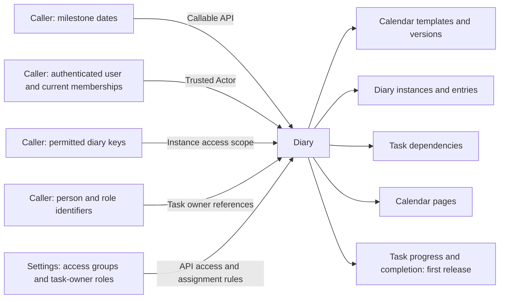

The API uses `DIARY_MANAGER` and `DIARY_USER` from Django settings.
Diary provides default page styles and permits host overrides.
The caller selects the diary instance through a permitted Diary key.

### Callable API, milestones, and calendar keys

The user confirmed that Diary needs a formal callable API.
The API is `Diary.api`, version 1.
Its public interface uses API classes and class-level factory methods.
`DiaryAPI` holds a trusted Actor and provides shared services and object factories.
`DiaryInstance`, `DiaryTemplate`, and `DiaryTemplateVersion` provide operations on their corresponding objects.
Factories return API references with a stable UUID in the `key` property.
The host stores that key against its own record.

An API reference keeps its Actor and key without caching Django model instances or permission decisions.
Each operation checks its permission and reads current database state.
The host supplies fresh identity, membership, and scope when constructing the Actor for each request.
Creation does not automatically expand that Actor's permitted diary keys.

The callable API is a Python interface.
The technical view class `DiaryDataView` now provides authenticated, read-only HTTP data resources.
The [HTTP data guide](../../Diary/README.md#http-data-api) identifies routes, selectors, trusted scope, and JSON response fields.
DV1-031 applies personal-entry privacy to searches, task details, collections, and related references.
Default data routes grant no diary scope.

The caller can define multiple named milestones.
For example, `add_board_bookings_open` identifies the date on which advertising board bookings open.
A milestone has a stable name and a human-readable label.
Each event calendar has its own milestone date values.

Each template identifies the named milestones that its task date rules require.
When the API creates a calendar from that template, the caller supplies a date for each required milestone.
The Garage Sale app is the caller for this website.
The caller determines the source and meaning of each milestone date.
Diary uses the supplied dates without knowledge of booking fields or event selection rules.
This interface keeps Diary independent of the application that uses it.

The template can use a milestone directly or apply a day count to it.
For example, a task can be due 42 days after `add_board_bookings_open`.
The task rule uses that milestone and a day count of positive 42.

`DiaryTemplateVersion.required_milestones()` enumerates the milestones used by that version.
It returns each milestone once, with its name and label.
It excludes milestones used only by other template versions.
Annual dates and one-time dates do not add a milestone requirement.
Calling `DiaryTemplateVersion.required_milestones()` is an optional safety check.
The caller can supply the expected named milestone dates without first reading this list.

`DIARY_TEMPLATE_NAME` is an optional default template name in settings.
The caller can instead supply an explicit template name or version key.
The API uses the highest approved version of the selected name.
Supplying a name and a version key together is invalid.
Without a selector or configured default, the API reports a validation error.
A changed setting affects new calendars, not existing calendars.
This permits reuse of Diary with a different template in another application.
The API reports an error if the configured template has no approved version.

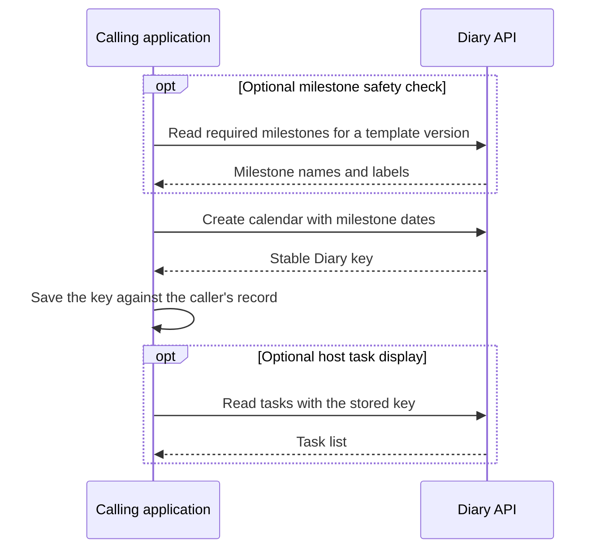

The calling project does not need to read task lists.
It can use Diary's own UI for task display and actions.
The caller must still supply the expected milestone dates when it creates the calendar.

Repeated creation with the same event reference and the same inputs returns the same key.
The creation API requires a nonempty diary name.
The task views use that name as the heading for the diary's task group.
Different inputs for that reference need an explicit update through the API.

V1 requires only `DIARY_MANAGER` and `DIARY_USER` for access configuration.
Each setting contains one Django group name.
DiaryManagers inherit DiaryUser capabilities and have all template permissions.
DiaryUsers cannot access templates through their user role.
Missing or invalid setting values raise `ImproperlyConfigured`.
V1 does not use a configurable action-to-group mapping.
Finer-grained permissions may be offered as an option in a later version.
That option is outside V1 scope and has no confirmed release number.

The caller must supply a trusted Actor from its authenticated identity system.
It must not accept Actor group names or permitted keys from an untrusted request body.
The API limits calendar access to the keys in that Actor.
See [the callable API guide](../../Diary/README.md) for exact signatures and examples.

### Calendar functions: V1

The confirmed first release includes dates, task owners, entry creation, and task progress through completion.
The task display uses a simple date-ordered list.
Section 6 defines the task highlighting and completion controls.
The first release does not include reminders.

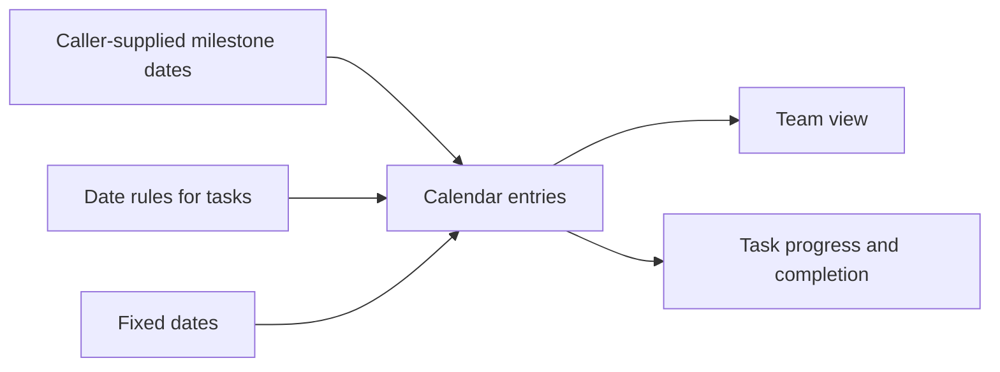

Diary must restrict calendar access to configured DiaryUsers and DiaryManagers with the applicable host permissions.

### Calendar template and event calendars

One calendar template defines the basic calendar across events.
Each event has its own event calendar.
The event calendar identifies the template version that supplied its entries.

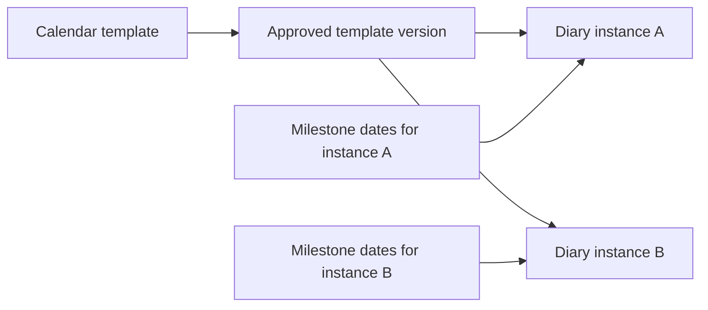

The template keeps the entry names, descriptions, entry keys, and date rules.
An annual date keeps its month, day, and year rule.
A calculated date keeps its milestone reference and day count.
A source date entry keeps its milestone reference.

The template does not keep calculated dates for a particular diary.
A one-time date belongs to one event calendar.
The system must not copy that date to every new event.

The event calendar copies the template entries and rules.
Only DiaryManagers can modify tasks copied from a template into a calendar instance.
DiaryUsers cannot modify those tasks, including tasks assigned to themselves.
An instance task change does not change its source template or other calendar instances.
Section 6 defines separate V1 task completion permissions.
It reads the applicable dates from its own event.
Thus, a template change cannot silently change an existing event calendar.
An event date change still uses the copied rules to calculate dates again.

The first version stores these copies in PostgreSQL.
Each task can have an optional task owner.
Section 8 defines the entry creation actions.
Task progress and completion records are required in the first feature release.
Other task changes still need approved rules.

### Calendar creation: generic interface

The caller chooses when to create a calendar through the API.
Diary does not define event creation, event activation, or host lifecycle callbacks.
The caller supplies an event reference and the required milestone dates.
The API returns a stable Diary key.
Repeated creation with the same reference and inputs must return the same calendar.
The database must prevent duplicate copied entries within that calendar.

The [Garage Sale integration design](https://github.com/TonyFlury/GarageSale/blob/integration/event-calendar/GarageSale/DIARY_INTEGRATION.md) records the host-owned event creation connection.
That host decision is outside the generic Diary feature definition.

If a calculated date is already past, Diary shows that condition.
It does not change the date or record the task as completed.
Calendar creation does not send reminders.

### Close a diary instance: confirmed requirement

The caller can close an existing diary through `DiaryInstance.close()`.
Open tasks must not prevent closure.
The operation requires membership in `DIARY_MANAGER` and the host's permitted calendar scope.
It records the closure time and caller reference.
Repeated calls preserve the original closure record.

Closing does not complete or delete tasks.
It preserves milestone dates, dependencies, and completion records.
The closed diary remains available for permitted reads.
Its tasks no longer appear in active or personal open-task results.
The API rejects further entry, milestone, and dependency changes.
No reopen operation is included.
The host decides when to call this operation.

### Template changes

The user confirmed that only DiaryManagers can change a calendar template.
This restriction applies to template entries, date rules, owners, and dependencies.
DiaryUsers cannot change templates through pages, the callable API, or the HTTP API.
The host settings identify the groups that have the DiaryManager role.
DiaryManagers approve new templates and template versions.
V1 has no separate approval step.
The DiaryManager's save approves the resulting template version for future calendar creation.
This rule also applies when the DiaryManager adds an event entry to the template.
Existing event calendars keep their copied entries and rules.

A template change creates a new template version.
New events use a selected approved version.
Existing event calendars keep their copied entries and rules.

The user confirmed that copying existing template tasks into existing diaries is not required.
Template changes leave existing diaries unchanged.
No template-to-diary copying interface is required.
DV1-034 is removed from required work, and DEC-003 is closed.

A manager can create a new task in a selected diary and optionally add it to a template for future diaries.
DV1-033 implements that operation.
It does not apply template changes to other existing diaries.

## 5. Date rules

Each calendar entry identifies its date type.
The date type can be a named milestone, a fixed date, or a calculated date.

Each calculated date has one source date and one day count.
The day count can be before or after the source date.

The caller supplies named milestone dates through the API.
Diary uses those values without knowledge of the caller's source models or fields.
The [Garage Sale integration document](https://github.com/TonyFlury/GarageSale/blob/integration/event-calendar/GarageSale/DIARY_INTEGRATION.md#source-dates-and-event-selection) defines that project's source-field mapping.

### Fixed dates

A fixed date can be an annual date or a one-time date.
An annual rule specifies a month and day for one occurrence in each diary.
A one-time date includes its year.

For example, an annual task can occur on 1 March.
Its date does not move when a milestone changes within the same calendar year.

Diary creation requires no diary year.
An annual rule selects the nearest matching date strictly after the diary creation date.
For example, 1 April becomes 1 April 2027 when creation occurs on 3 November 2026.
Diary stores that date and then uses it for later reads.
A year offset changes the selected occurrence by the specified number of years.
Diary does not infer later occurrences for diaries that span more than 12 months.
Future implementations will address this limitation.

February 29 selects the next valid leap day after diary creation.
A year offset can produce an invalid date.
The calendar shows “Date not set” until the team selects a permitted date rule.
It must not silently change the date to 28 February or 1 March.

### Example entries

| Example entry | Source | Rule | Example result |
| --- | --- | --- | --- |
| Target milestone | Named milestone `target_date` | Use the supplied date. | 27 June 2027 |
| Annual preparation task | Annual date | Use 1 March in the supplied calendar year. | 1 March 2027 |
| Previous-year preparation task | Annual date | Use 1 December in the previous year. | 1 December 2026 |
| One-time team meeting | One-time date | Use the full specified date. | 12 May 2027 |
| Preparation check | Named milestone `target_date` | Subtract 42 days. | 16 May 2027 |
| Final check | Named milestone `target_date` | Subtract 7 days. | 20 June 2027 |
| Records review | Named milestone `target_date` | Add 7 days. | 4 July 2027 |

These task names and dates are examples.
They are not agreed operating instructions.

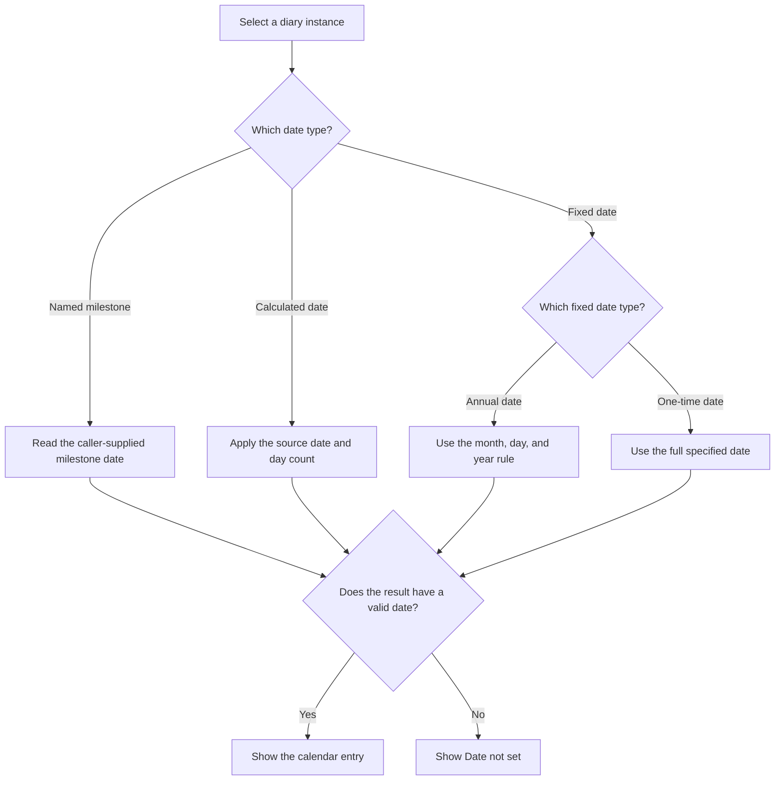

The proposal uses calendar days for date rules.
They include weekends and public holidays.
Business days are a different alternative.
A different date rule with team approval is necessary.

Dates without times use the local date in `DIARY_TIME_ZONE` when that optional setting is present.
Otherwise, they use the project-default Django `TIME_ZONE` setting.
They do not represent midnight in UTC.
UTC is the time reference for stored timestamps.

## 6. Page design

The user confirmed that a simple date-ordered list is sufficient for the first release.
DEC-005 adds one ordering exception for the full manager diary view.
Show orphaned template tasks before other tasks. Keep the normal ordering within each category.
An orphaned task is an incomplete template copy without an eligible person or ownership group member.
Diary additions do not qualify as orphaned tasks.
Managers can leave these tasks unresolved. Their incomplete predecessor links continue to block dependent tasks.
Managers can assign replacements through the existing task editor. No separate popup is required.
Person replacements must be active members of the configured `DIARY_USER` group.
Authorized ownership groups and Whole team are also permitted.
The selected ownership group must have an eligible active member.

The list works on a phone and shows long task names without small calendar cells.
A month display is not required for the first release.

### Calendar list navigation

This diagram shows how a DiaryManager opens entry details from a permitted diary's date-ordered list.
The existing manager diary provides this full list.
The personal task view remains the default page for a logged-in user.
The host supplies the selected diary key and its permitted scope.
The implemented manager filters follow DV1-052.

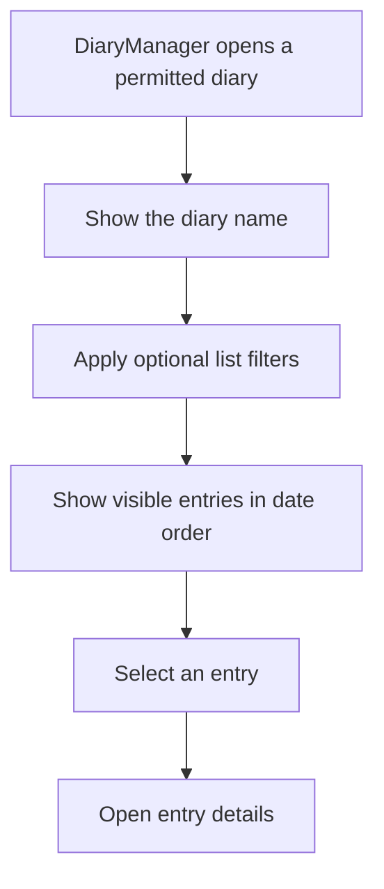

Each list row shows the date, entry name, date source, task owner, and applicable status labels.
Each entry shows its date source.
For example, it can show “Target milestone minus 42 days”.
An annual entry can show “Fixed date: 1 March each year”.
A one-time entry shows its full date and “One-time date”.

The calendar view opens the diary instance identified by the permitted key supplied by the host.
The host determines which instances the user can select.
A diary selector must show only instances that the user has permission to view.
The page shows the selected diary name at all times.
It must preserve that selection until the user or host explicitly changes it.

The page uses Diary's default styles or the host's configured overrides.
Labels must explain each state without color alone.
The user must be able to use the keyboard for all actions.

### Task highlighting: confirmed requirement

All views must distinguish Late and Blocked tasks from normal tasks.
A Late task has a red border with a red shadow.
A Blocked task has an amber border with an amber shadow when a direct predecessor is late.
The red border takes priority when the task itself is late.
A completed predecessor does not cause an amber border.
Other Blocked tasks have a dashed border and a Blocked label.
Text labels identify Late, Blocked, and Late predecessor states without color alone.
Lists, task details, entry edit forms, and dependency lists use the same rules.
The display calculates these states again after date, dependency, or completion changes.
Template definitions have no instance dates and do not receive lateness highlights.

### V1 diary dependency freeze

DV1-028 enforces immutable dependency links after diary creation.
The API, model methods, and PostgreSQL reject live graph changes.
Initial diary creation still copies the approved template graph.
Template changes, date edits, and task completion keep existing links unchanged.
DFUT-004 records possible later controlled editing without an assigned release.

### Task owners: confirmed requirement

The user confirmed that task progress through completion is required in the first feature release.
The implemented transitions keep a task open or complete it once.
Additional progress states and reopening have no V1 interface.
The following completion rules define the V1 permissions and dependency behavior.

### Task completion and blocking predecessors: confirmed V1 requirements

When a user attempts task completion, Diary lists all open predecessors in the blocking dependency chain.
The display must preserve personal-entry visibility and the host's permitted calendar scope.
Each permitted DiaryUser and DiaryManager has a “Complete” button for a task they can access.
That action completes the selected task only when its open predecessor list is empty.
The server checks the predecessor state again before the save.

When open predecessors remain, a DiaryManager also has a “Close all” button.
This is the V1 force completion option.
The action completes all open predecessors in the blocking chain and then completes the selected task.
It includes indirect predecessors that block those open predecessors.
The save records the manager, completion time, and due date at completion for each affected task.
Each forced predecessor completion includes a comment that identifies the “Close all” action and selected task.
The action preserves existing completion records and dependency links.
The save must complete all affected tasks together or leave them unchanged.
Ordinary DiaryUsers cannot use “Close all”.

These actions complete tasks within an open diary.
The separate `DiaryInstance.close()` operation closes a diary instance without completing its tasks.
The V1 force completion behavior must be reviewed for V2.
Its inclusion in V1 does not approve the same feature set for V2.

The user confirmed that a task can have an optional task owner.
The task owner can be a specific DiaryUser or a role.
A role owner includes all members of the selected role.
A task without a selected person or role is for the whole team.

| Owner type | Meaning | Display label |
| --- | --- | --- |
| Person | One selected DiaryUser must do the task. | Show the person's name. |
| Role | All members of the selected role must do the task. | Show the role name, for example, “All SponsorshipManagers”. |
| Whole team | The task has no selected person or role. The task is for the whole team. | Show “Whole team”. |

Each task has one owner type at a time.
A person-owned task has one selected DiaryUser and no selected role.
A role-owned task has one selected role and no selected person.
A whole-team task has neither selection.
An absent person does not mean “Whole team” when the task has a role owner.

The calendar must not show a whole-team task as an incorrect or missing owner.
The task date does not change when its task owner changes.
Task ownership alone does not grant permission to edit copied template-task dates.
The V1 completion rules above apply separately to tasks the user can access.
Section 8 defines the confirmed view permissions.
Due-date editing now permits self-owned diary additions for DiaryUsers and copied template-task dates for DiaryManagers.
Managers can also change due dates on other tasks within their permitted diary scope.
Completed tasks and closed diaries reject date changes.
The original rule, source template, ownership, dependencies, and other diaries remain unchanged.
V1 does not warn managers when a due-date change causes a conflict.
DEC-002 also permits managers to edit orphaned template-task ownership through the existing task editor under DEC-005.
Ownership changes are ordinary task edits. No separate popup or approval step is required.
Other content edits and extra progress states remain outside this editing interface.
The [implementation record](diary-v1-remaining-work.md#task-editing-and-completion-dv1-023-dv1-032-and-dv1-035-through-dv1-038) identifies storage, API methods, view classes, and verification.

The optional owner belongs to the task in its event calendar.
Different events can have different owners for the same template task.
The template author can optionally select a specific person, a role, or the whole team for each task.
The template does not require a specific person or role.
The selection is template content, not a fixed Diary policy.
Calendar creation copies the selected ownership with the task.

### Role membership and access

The proposal keeps the role reference in the task.
It does not replace the role with a fixed list of people when the calendar is created.
The calendar shows the current role members.
Thus, a new SponsorshipManager becomes a task owner through role membership.
A person outside that role is not a task owner through that role.

During template editing, the system must identify a selected role with no current members.
The warning must show “No role members” with the role name.
It must not change that task into a whole-team task.

Some role members are not DiaryUsers.
Role ownership does not grant calendar access or task change permissions.
Task role membership alone does not grant Diary access.
The settings mapping and host permissions determine access through DiaryUser or DiaryManager membership.

If a selected person leaves DiaryUser, the system must identify their open tasks for review.
The system must not silently change those tasks into whole-team tasks.
The rule for that change needs approval before implementation.
Multiple sign-offs are outside V1 scope.
V1 keeps one completion record for each task, including a role-owned task.
The V1 completion rules above define who can record that completion.

### Diary pages and dashboard section

An [interactive UI mock-up](../../Diary/design/ui/index.html) shows the main Diary pages with sample data.
Its [review guide](../../Diary/design/ui/README.md) includes page descriptions and example workflows.
This preview has no Garage Sale integration or database writes.

The user confirmed that Diary owns all calendar UI except the dashboard summary.
Its pages include the personal task view, template editor, event calendar, and task completion actions.
The app must use the callable API for those actions.

### HTTP views and object selection: confirmed requirements

Diary's HTML views accept the applicable object selector through a URL parameter or a named context variable.
Use the technical name `diary_key` for a diary instance.
Use the technical name `template_name` for a calendar template.
Context variables are values supplied to the view by trusted server code.
The view supplies `diary_key` as `key` to `DiaryAPI.diary()` or `DiaryInstance.from_key()`.
Neither selection method grants access beyond the caller's permissions.

| View | Selector | Required behavior |
| --- | --- | --- |
| Personal tasks | `diary_key` supplied | Show this user's open tasks and current role-owned tasks in the selected permitted diary. |
| Personal tasks | No `diary_key` | Show those tasks across all permitted open diaries, grouped by diary name. |
| Template | `template_name` supplied | Show the most recent version of that named template. |
| Template | No `template_name` | Show all templates available to the user for selection. |

Each task group retains its diary key and displays the diary name as its heading.
The API requires a name when the caller creates a diary.
The task view excludes completed tasks and tasks in closed diaries.
The normal personal-entry visibility rules apply in both task view modes.
The personal task view without a diary key is the default logged-in view.

The most recent template version is the version with the highest version number, including a draft if one exists.
Only DiaryManagers can edit the selected template under the confirmed template rules.
An absent template name opens the chooser rather than selects `DIARY_TEMPLATE_NAME` automatically.
That setting continues to select the default template for calendar creation.
These view requirements do not change the current callable API's approved-version default.

### Page structure and styling

Diary includes a default base template and a namespaced stylesheet.
Each Diary page must be a complete browser view through that base template.
Its reusable content belongs in a fragment that a host can include in its own page.
The host must not include a complete Diary document inside another HTML document.
The host can override them through Django's normal template loaders and static file finders.
Every visible component, content role, form control, and state must have a stable, descriptive class.
Those classes are the public styling interface and use the `diary-` prefix.
Host overrides must not depend on IDs, text values, element positions, or specific HTML tags.
Diary must not use inline style attributes for presentation.
The styling guide must document the classes and any changes to their names.
An extra stylesheet can change the default CSS variables without replacing the complete stylesheet.
The API guide includes search-order examples and deployment checks for these overrides.
`DIARY_TEMPLATE_NAME` selects calendar data, not the HTML base template.

The personal view includes tasks assigned to the user and tasks assigned to any role that includes that user.
The user confirmed that this personal view is the default page for a logged-in user.
The default must not include tasks owned only by other people or other roles.

The “My Diary” view shows only ready tasks by default.
The “show blocked also” checkbox is clear by default.
Selecting it also shows blocked tasks assigned to the user or their groups.
A task remains blocked while any required predecessor is incomplete, regardless of that predecessor’s owner.
The checkbox does not grant access to other users’ tasks or private predecessor details.
This display filter does not change the callable API task results.

The current `DiaryInstance.personal_tasks()` method supplies that list for one instance.
`DiaryAPI.personal_tasks()` now supplies personal tasks across all instances permitted by the host.
The caller can instead select one permitted instance.
`PersonalDiaryView` implements the default personal page and its display filters.
The [implementation record](diary-v1-remaining-work.md#dv1-020-dv1-021-and-dv1-049-personal-diary) identifies completed work and privacy verification.
Without a diary key, the HTTP view groups the user's open tasks by diary name across all permitted open instances.
The caller supplies the current role memberships through the Actor.
Whole-team tasks can appear through an explicit list option.
DiaryManagers use the full diary list for a selected permitted diary.
DiaryUsers need only the existing assigned-task view. V1 requires no additional full diary page for ordinary users.

The dashboard has an active tasks section only when the Diary app is enabled.
The dashboard must test app availability before it imports the Diary API.
If Diary is disabled, the dashboard does not show the section or call its API.
The dashboard uses the current event's stored Diary key.
It shows compact clickable Late, Ready, and Blocked counts for the current user, not an embedded task list.
Each count opens the matching filter in the personal Diary view.
An [interactive dashboard mock-up](../../Diary/design/dashboard/index.html) demonstrates that presentation.

`DiaryInstance.personal_tasks()` returns the user's open tasks for that instance, including tasks owned by their roles.
The dashboard gives each task one category from that result.
An incomplete task due today or earlier contributes to Late, even if it has unfinished predecessors.
Other tasks with unfinished predecessors contribute to Blocked.
Other tasks with no unfinished predecessors contribute to Ready.
Thus, the counts do not overlap.
The counts exclude whole-team tasks and completed tasks.
Each result identifies whether the task is ready or blocked.
A separate result value identifies lateness.
These values are calculations, not database flags.

A task is late when its due date is today or earlier and the task is not completed.
A blocked task can also be late.
A task with no due date shows “Date not set” and is not late.
Date comparisons use the Diary time zone in settings.

Completed tasks do not contribute to any count.
The API keeps their completion records and their due dates at completion.
The dashboard must show an explicit empty state when the event has no Diary key.
A zero count links to the corresponding empty personal task list.

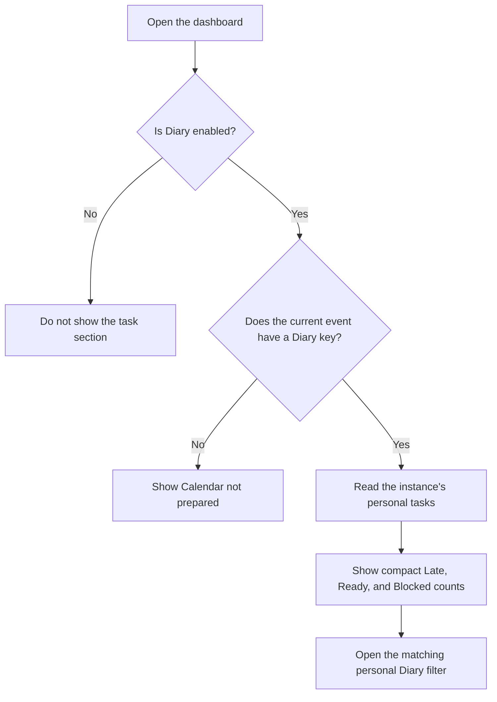

### Predecessor editor

The user confirmed that V1 permits dependency editing only in templates by DiaryManagers.
DiaryManagers cannot add, remove, or replace predecessor links through dependency editing in live diaries.
Template dependency changes do not propagate into existing diary instances.
The “Close all” action completes tasks and preserves their dependency links.
Dependency editing in live diaries can be reviewed for a future release.
The editor layout below remains a design proposal for template editing.
The user confirmed that the predecessor selector must exclude choices that create circular dependencies.
The editor must prevent those choices before save.

Each task has a human-readable name and a stable entry key.
The proposal requires a unique task name within its template version or event calendar.
Dependencies use the entry key, so a name change does not break a link.
Each task can have zero or more predecessors.

The first editor proposal uses a task list and a details form.
The form has a searchable predecessor list with checkboxes.
Selected predecessors stay visible when the search changes.
The form also shows the tasks that use this task as a predecessor.
A read-only diagram is an additional inspection aid.
A graphical connection editor is not necessary for the first version.

When the DiaryManager edits a template task, the selector must exclude these choices:

- The task itself.
- Every direct successor of the task.
- Every indirect successor of the task.
- Tasks outside the selected template version.

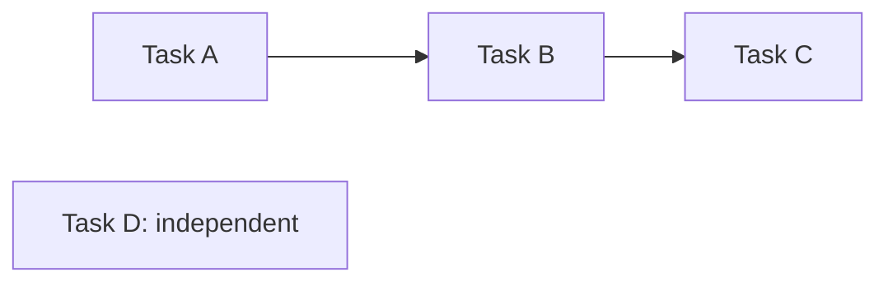

An arrow means that the first task is a predecessor of the next task.
When the user edits Task A, the selector excludes Task A, Task B, and Task C.
Task D is an available predecessor choice.
When the user edits Task C, Task A and Task B are available choices.

The selector must calculate available choices again after a dependency change.
It must use the proposed links in the form, including changes that the user did not save yet.
It must not show invalid choices with only a warning.

The server must also examine all dependencies before save.
An old form or a direct request must not create a circular dependency.
Concurrent saves must not combine into a circular dependency.
The proposal serializes dependency changes within the affected template version.
If another edit makes a selection invalid, the server rejects the save and supplies an updated list.

The V1 completion rules define readiness checks and the DiaryManager “Close all” action.
Dependency editing does not change due dates automatically.

## 7. Milestone date changes: V2

The user confirmed that milestone date changes and their impact review belong in V2.
These changes can affect whether the team can complete all diary tasks.
The first release accepts milestone dates during calendar creation.
Changes to those dates after creation are outside the first release scope.

The V2 design must define how Diary presents the effects before the caller applies changed dates.
The presentation must support a review of the affected tasks and their dependencies.
The review process, permissions, and API behavior still need design.
The existing `set_milestone_dates` API does not provide this review process.
The milestone editor in the preview demonstrates possible behavior, not an approved first-release workflow.

The following event date examples illustrate one milestone in the Garage Sale app.
Diary receives named milestone dates and does not interpret external event fields.

A change to the event date changes dates that depend on it.
It does not change the booking dates or the activation date.
It does not change stored fixed dates.

| Change | Calculated date | Annual date | One-time date |
| --- | --- | --- | --- |
| Event moves within the same year. | Calculate the date again. | Keep the same date. | Keep the same date. |
| Event moves to a different year. | Calculate the date again. | Keep the stored date pending V2 review. | Keep the full date. |

A change to the event year needs a date review for all entries.
An unchanged one-time date can be incorrect for the new event year.
The date review must identify that condition without an automatic date change.

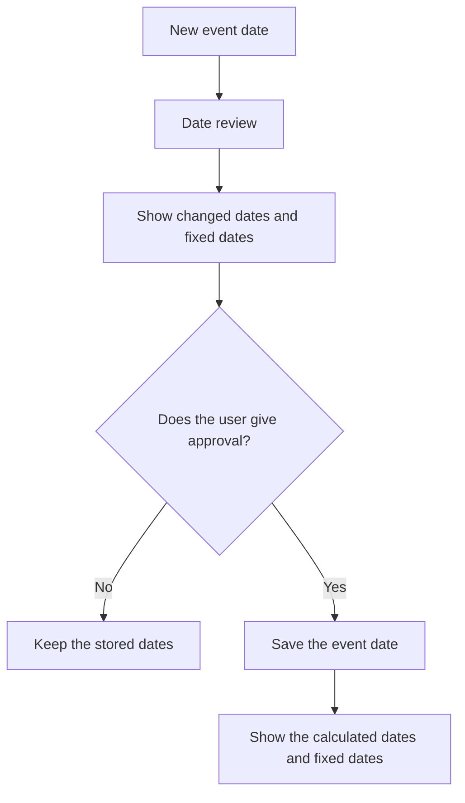

The date review is a V2 proposal for the milestone change procedure.
It is not part of the present application.

A date change must keep completed task records unchanged.
The system must identify open tasks for a date review.

Cancellation of an event must stop future reminders.
It must keep the earlier records available to users with the applicable permissions.

## 8. Access

Calendar access must use the configured Diary permission groups and trusted caller identity.
An account or team membership alone does not give calendar access.

### Confirmed access requirements

The user confirmed that Diary uses the role names DiaryManager and DiaryUser.
The host supplies the group names through `DIARY_MANAGER` and `DIARY_USER` in Django settings.
Each setting identifies one group.
DiaryManagers have all template permissions and inherit DiaryUser capabilities.
Other projects can use different group names without changes to Diary.

A DiaryManager can view any calendar instance that the host project permits.
Diary adds no separate calendar selection policy for managers.
The host can restrict which calendar instances a manager can access.

A DiaryUser can view tasks associated with that user in the instances permitted by the host.
These tasks include personal tasks and tasks owned by roles that include the user.
The callable API and HTTP API must support all permitted instances or one selected permitted instance.
Each task result must identify its calendar instance.
Selection of all instances means all instances permitted by the host, not unrestricted project data.

The host supplies trusted identity, role membership, and calendar scope.
Diary enforces that supplied scope without inventing another calendar access policy.
Neither API accepts permission grants from an untrusted request body.
HTTP requests need authentication and the same access checks as callable API requests.

| Configured Diary role | View templates | View tasks in permitted diary instances |
| --- | --- | --- |
| DiaryManager | Yes. | All entries within the host's permitted scope. |
| DiaryUser without DiaryManager membership | No grant from this role. | Tasks associated with the user or their current groups. |

The template view shows its entries, date rules, and template version.
The diary view identifies each selected instance by its permitted Diary key and required diary name.
A diary page displays the diary name.
It does not require an external event name or event date.
Without a diary key, the personal task view groups the user's open tasks by diary name.
Section 6 defines the URL and context selectors.

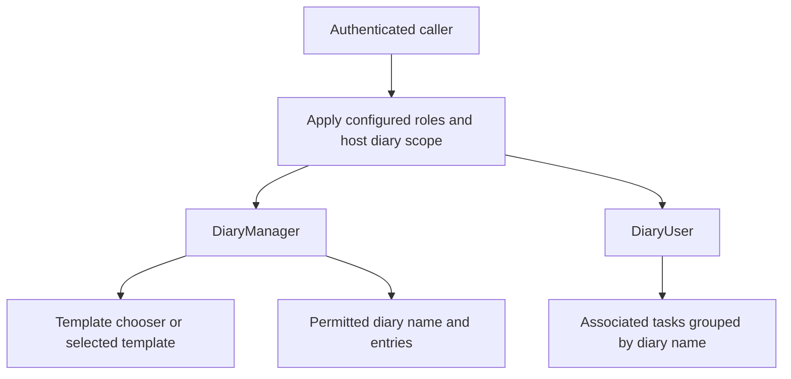

Opening a view must not create a diary or copy template entries.
The view must preserve the selected diary key.
The host's event selection and group mapping belong in its integration document.

### Entry creation: confirmed requirements

The user confirmed these entry creation permissions.
Entry creation targets a selected diary instance within the caller's permitted scope.

| Action | DiaryUser without DiaryManager membership | DiaryManager |
| --- | --- | --- |
| Add a personal entry for themselves. | Yes. | Yes. |
| Add an entry for a specific person. | Only for themselves. | Yes. |
| Add an entry for all members of a selected user role. | No grant. | Yes. |
| Also add the new entry to the template for future diaries. | No grant. | Yes. |

The server sets the owner of a DiaryUser's personal entry to that DiaryUser.
The user cannot select another person or role through the personal entry action.
The server must enforce this rule if a request contains another owner identifier.
Only DiaryManagers can add tasks owned by another person.

A DiaryManager can select a specific person or a user role for the new entry.
The existing person ownership rule uses a selected DiaryUser.
Role ownership includes all members of the selected role.

The DiaryManager form includes an “Add to template for future diaries” choice.
That choice is off initially.
If the DiaryManager selects it, the save adds the entry to the selected diary and to a new template version.
Without that choice, the save adds the entry only to the selected diary.

The template addition must keep a reusable date rule.
A one-time date needs an annual date rule or calculated date rule before the entry can become a recurring template entry.
The form must show the future date rule and owner choice before save.
It must not change an exact date into an annual date without the DiaryManager's selection.

The new template entry must have an entry key.
The selected diary entry must identify that key when the DiaryManager also adds it to the template.
The save must not create a second entry in the selected diary from the template addition.
Other existing diaries must stay unchanged.

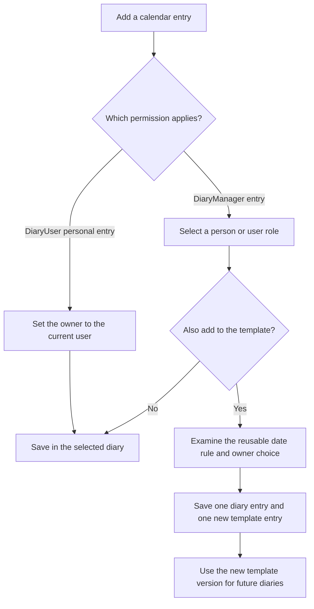

The save must prevent repeated requests from adding the same entry twice.
If the template addition fails, the system must not report a successful combined save.
`DiaryInstance.create_task()` now saves both additions in one PostgreSQL transaction.
`TaskCreateView` implements the creation page with trusted diary scope and server-controlled ordinary-user ownership.
The [implementation record](diary-v1-remaining-work.md#dv1-029-dv1-030-and-dv1-033-task-creation) identifies the forms, tests, and remaining boundaries.

A personally added entry is visible only to its owner and DiaryManagers within the host's permitted calendar scope.
Other DiaryUsers cannot see that entry through lists, task details, searches, or predecessor choices.
The callable API and HTTP API must enforce the same visibility rule.
Hiding a page link alone does not enforce this requirement.
The permission to add an entry does not settle permission to edit, delete, or complete it.

### Server checks and other actions

The server must check the applicable permission on each request.
A hidden navigation item alone does not prevent access.
The same checks apply to direct page URLs, downloads, and calendar feeds.

Changing a Diary key does not grant access outside the calendar scope supplied by the host.
The template view permission does not give permission to change the template or approve a template version.
The DiaryManager entry creation permission includes the template addition defined above.
Only DiaryManagers can change templates.
DiaryManagers approve new templates and versions through the save action in V1.
A separate approval step is outside V1 scope.
The calendar view permission does not give permission to change tasks or send reminders.

The confirmed entry creation actions need their own permission checks.
Other task changes and reminder controls must also have their own access rules.
The design does not grant those additional rights.

The host configuration must preserve the confirmed view and entry creation rules.
The template view and diary view need distinct permission checks.

Diary has no public view.
The server must restrict pages, downloads, and calendar feeds to configured Diary roles within the host's permitted scope.

## 9. Startup validation

### Configured access groups

At startup, Diary must confirm that Django settings specify valid `DIARY_MANAGER` and `DIARY_USER` group names.
Each referenced group must exist in the database.
Each referenced group must have at least one user.
These checks apply to every group named by either mapping.
Diary must use the configured Django user model through `get_user_model()` for user-model access.

A missing mapping, missing group, or empty group must raise `ImproperlyConfigured` during startup.
The error must identify the relevant setting and each invalid group.
It must distinguish an absent group from a group with no users.
The error must explain that the administrator must correct the settings or group membership.

### Task ownership roles

At startup, Diary must validate every role in `DIARY_TASK_OWNER_ROLES`.
Each role must exist in the database and have at least one member.
An absent or empty configured ownership role must raise an actionable `ImproperlyConfigured` exception.
This check helps ensure that template instances have people who can progress their tasks.
Database and role setup commands must remain available before application startup validation succeeds.

### Diary creation

Diary creation must repeat the ownership-role existence and membership checks against the current database state.
It must reject creation when a configured ownership role is absent or empty.
The API must identify the affected roles in its validation error.
A failed check must not leave a partly created diary.

### Template editing

The template editor must show an on-screen warning when a selected task ownership group has no members.
The warning must identify the group and the affected task.
The editor must read current membership when it performs this check.
The warning does not replace the validation required at diary creation.

### Runtime warning limit

**Warning:** Diary does not continuously monitor ownership groups for deletion or membership changes.
If a task-owning group becomes empty or is deleted, Diary gives no automatic runtime warning.
The next server restart, diary creation, or template edit is the next validation or warning point.
The API usage guide must document this limit.

### Implementation status

The current startup check validates access setting values and the existence of configured task ownership roles.
Database checks for access-group existence, membership, and diary creation remain implementation work.
Template editor warnings also remain implementation work.

## 10. Reminders: subsequent design

Reminders are a separate phase.
The first version does not send them.
The user confirmed that reminders are outside V1 scope.
Recipient, timing, and delivery decisions do not prevent the V1 release.
The following reminder rules are proposals for a later release.
No release number is confirmed for reminders.

The team must give approval for each recipient and message channel.
Email to the task owner is one possible channel.
For a person-owned task, the recipient is the selected ExecMember.
For a role-owned task, the proposal uses all current members of the selected role.
The system must identify the recipients when it prepares the reminder.
The send record must keep the actual recipients after a role membership change.
Whole-team tasks have no individual task owner for that channel.
The recipient rule for whole-team reminders is an open decision.
An absent owner must not automatically cause an email to every team member.

Each reminder must have a record of the entry, recipient, and scheduled send time.
The system must use this record to prevent repeated messages.
The team must be able to see an email failure.
The system must limit the number of attempts to send that email again.
An accepted email does not prove receipt in the recipient's inbox.

If the service starts after a scheduled send time, a rule must control the missed reminder.
A completed task must stop subsequent reminders for that task.
A date change must cancel pending messages that use the old date.

## 11. Proposed phases

| Phase | Result | Decision before the next phase |
| --- | --- | --- |
| 1 | Template copies, team dates, optional task owners, entry creation, task progress, and completion records in PostgreSQL. | Define task states and permissions before implementation. |
| 2 | Milestone date changes with impact review, plus proposed other task changes. | Design the impact presentation, change rules, and permissions. |
| 3 | Reminders with send records. | Give approval for recipients, timing, retries, and message content. |
| 4 | Optional calendar export for permitted ExecMembers. | Give approval for export data and update rules. |

Task progress and completion are confirmed requirements for the first release.
Milestone date changes and their impact review are confirmed V2 scope.
The other phase assignments remain proposals.
Reminders are confirmed as outside V1 scope.
Unresolved rules still need approval before implementation.

## 12. Open decisions

1. Resolved: Diary has no public view. Configured DiaryUsers and DiaryManagers have access within the scope permitted by the host.
2. Resolved: The selection of template tasks is outside the feature definition. Diary provides a generic capability to hold those tasks.
3. Resolved: Templates identify named milestones for task date rules. The caller supplies each required milestone date through the API during calendar creation.
4. Resolved: The first feature release must support task progress through completion.
5. Resolved: A simple date-ordered list is sufficient for the first release. A month display is not required.
6. Resolved: Milestone date changes and the presentation of their effects belong in V2. The review workflow still needs design.
7. Access resolved: Configured DiaryManagers can view host-permitted calendars. DiaryUsers can read associated tasks across all permitted instances or one selected instance. Task-change permissions remain open.
8. Resolved for V1: Reminders are outside scope. Recipient and timing rules are deferred to a later release.
9. Outside feature scope: The selection of annual or one-time dates for specific entries is application data.
10. Outside feature scope: The selection of annual entries for the year before the event is application data.
11. Outside generic Diary scope: Event lifecycle decisions belong to Garage Sale integration. See [the host integration design](https://github.com/TonyFlury/GarageSale/blob/integration/event-calendar/GarageSale/DIARY_INTEGRATION.md).
12. Resolved: Only DiaryManagers can change and approve templates. V1 has no separate approval step.
13. Resolved: Only DiaryManagers can modify tasks copied from a template into a calendar instance. The V1 completion rules apply separately.
14. Resolved: Copying existing template tasks into existing diaries is not required. DV1-034 is removed, and DEC-003 is closed.
15. Resolved: The template author may select a person, role, or whole team for each task. A specific owner is optional.
16. Completion resolved for V1: Permitted users can complete accessible tasks under the predecessor rules. Owner-change permissions remain open.
17. Deferred beyond V1: Who must receive reminders for whole-team tasks?
18. Resolved: Task role membership alone does not grant Diary access. The configured Diary roles and host permissions control access.
19. Resolved for V1: Multiple sign-offs are outside scope. Each task has one completion record, including role-owned tasks.
20. Resolved: Personally added tasks are visible only to their owner and DiaryManagers. Only DiaryManagers can add tasks owned by another person.
21. Resolved for V1: A DiaryManager's template addition approves the resulting version through the same save action.
22. Resolved for V1: “Complete” requires no open predecessors. DiaryManagers can use “Close all” to complete the blocking chain and selected task.
23. Resolved for V1: “Close all” records the manager, time, due date, and explanatory predecessor comments. Review force completion features for V2.
24. Resolved for V1: DiaryManagers can edit dependencies only in templates. Changes do not propagate into live diaries. Review live dependency editing for a future release.

Template content does not prevent implementation of the generic Diary capability.

## 13. Language review

The author got the official Issue 9 PDF on 2 November 2026.
The review used its writing rules and dictionary.
The glossary identifies the necessary technical names.

The document uses short sentences, active voice, and consistent technical names.
The diagrams use the same names as the text.

Status: Draft language inspection.
A full inspection of word meanings and technical names is necessary.
This draft does not claim full ASD-STE100 compliance.

## 14. References

- [ASD-STE100, Issue 9](https://www.asd-ste100.org/assets/files/ASD-STE100_ISSUE9.pdf).
- [Existing event fields](https://github.com/TonyFlury/GarageSale/blob/integration/event-calendar/GarageSale/models.py).
- [Original task list request](../../Future%20Feature%20List).
- [Current access policy](../../PERMISSION_ACCESS_MATRIX.md).
- [Deployment instructions](https://github.com/TonyFlury/GarageSale/blob/master/General%20Deployment%20Instructions).
